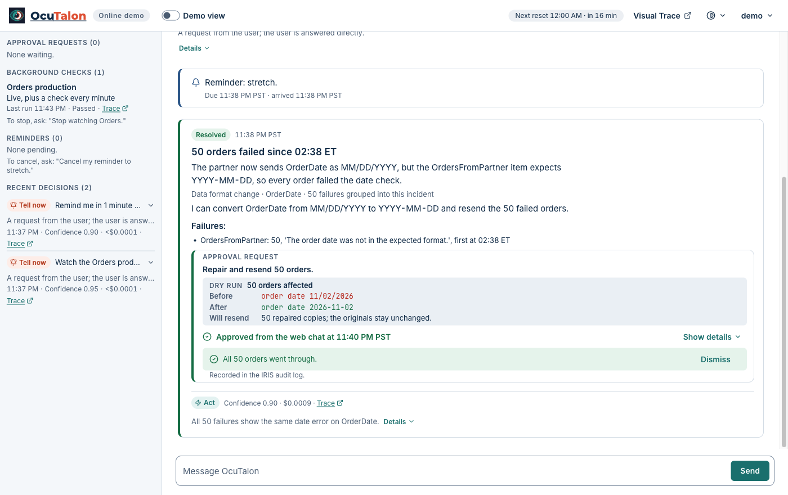
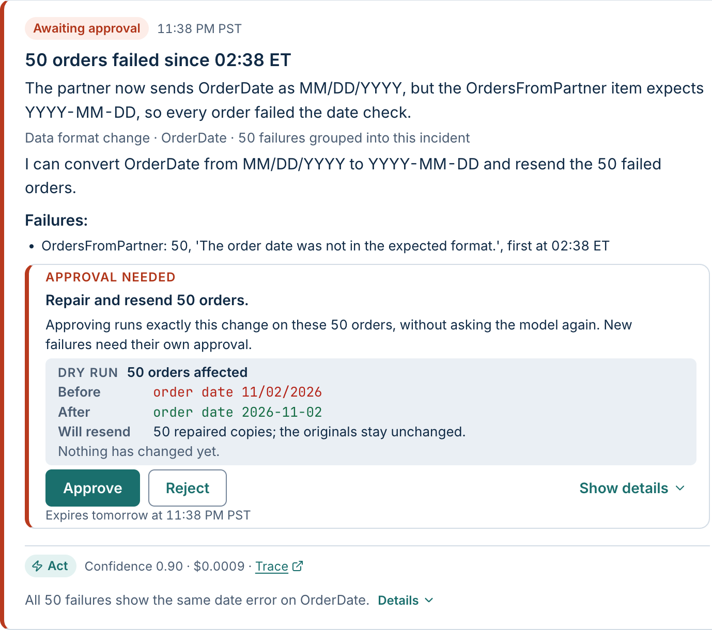
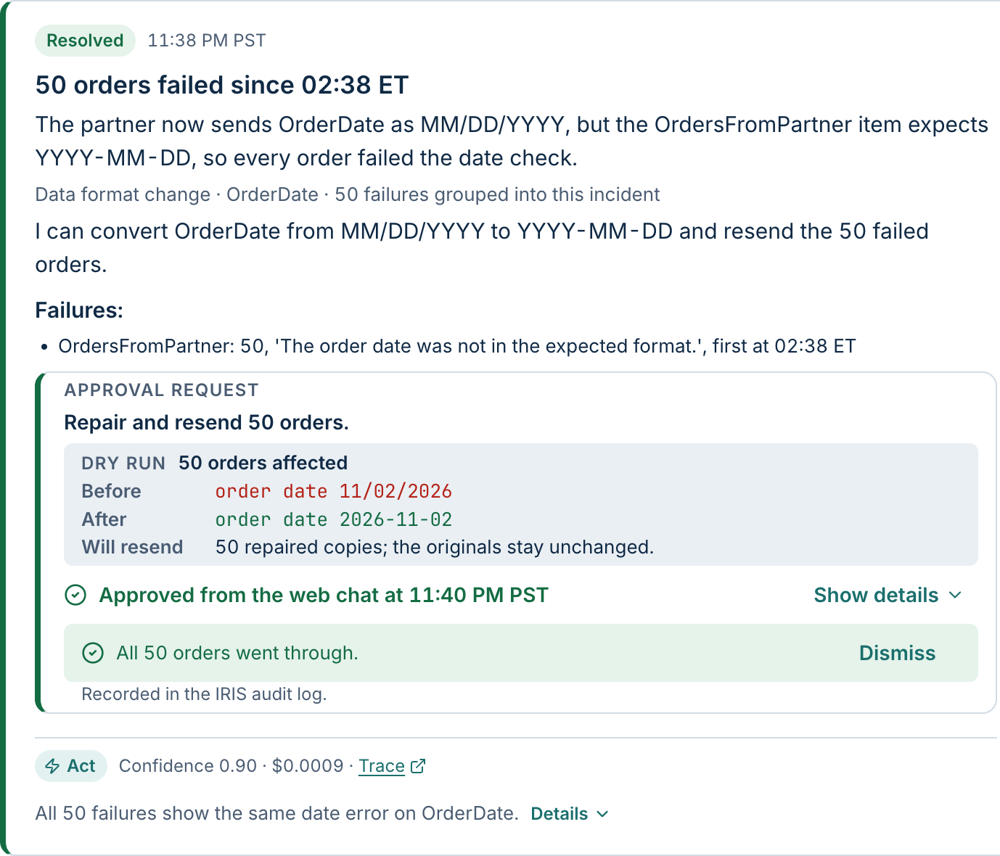

# OcuTalon guide: install, features and administration

## New since 1.0.0

Each item says where to try it. Visual Trace on the online demo is shared, so save and add nothing personal.

#### Your integrations

- **A dry run that checks good messages.** Before it offers to repair and resend, OcuTalon tries the repair on up to 20 of the newest messages from the same source that went through, and offers no fix if any of them would change. Try it: after the guide's incident, More to try, *Reject a fix*, then read the approval request on the Simulated phone.
- **Incident summaries.** When an incident closes, OcuTalon writes a summary from its own records, with no extra model request: the timeline, the cause and evidence, each approval with its channel and time, the messages affected and the incident's model cost. It arrives in the chat and on the Simulated phone (and in Telegram when it is paired on your own install), and you can ask for it again in the chat. Try it: after the guide's incident, More to try, *Read the incident summary*.
- **Suspend, resume and reroute.** Ask OcuTalon in the chat to suspend or resume an item of a watched production, or to reroute an incident's failed messages to another item. Each comes as an approval request with its own dry run: the item's state before and after, or the count, the current and new target and one example. Nothing changes until you approve, and while the incident is open a suspend is undone the same way, by asking OcuTalon to resume the item. On the online demo every visitor shares the Orders production, so there it offers the reroute only. Try it: after the guide's incident, More to try, *Reject a fix*, then *Reroute the failed orders*.
- **Partner delay notices.** Ask OcuTalon in the chat to warn the partner about an incident's delay. It drafts a short notice from the incident's count, times, affected flow and cause, never from a message's contents, and raises it as an approval request that shows the exact text and every recipient. Nothing is sent until you approve. In demo mode the partner contacts are simulated and the approved notice goes to the Simulated mailbox, not to a real inbox; without demo mode there are no partner contacts yet, so no notice is drafted. Try it: after the guide's incident, More to try, *Warn the partner*.
- **Queue backlogs between digests.** Ask OcuTalon in the chat to watch the queue backlogs, and every minute it reads the queues of each production it can read (on the online demo, the Orders production's). When a queue holds more than 100 messages, or its oldest message has waited over 10 minutes (an admin can change both), OcuTalon decides once whether to tell you now, and again only after the queue has dropped below and backed up again. The check only reads, and a run that can't read a namespace shows Not checked, never Passed. Try it: More to try, *Watch queue backlogs*.
- **Webhooks.** On your own install, an admin creates a webhook in Settings, under Channels, with a name and a secret, and any other system can send it a JSON event with POST, with the secret in a header. OcuTalon answers at once, then decides on the event as untrusted content: it can lead to a notice or to your digest, and nothing in the event can approve, change or run anything. The decision shows on the History page, and the event and its decision in Visual Trace. The secret is kept only as a salted hash. Webhooks are off on the online demo, which has no public webhook address. Try it on your own install: More to try, *Send an event through a webhook*.
- **Your own mailbox.** On your own install, an admin connects a POP3 mailbox in Settings > Channels > Email. OcuTalon makes an attention decision on each email that arrives after that, sends the email to the model for it, and leaves your mail on the server. Email is read as untrusted content: nothing in an email can approve, change or run anything. The online demo keeps its simulated mailbox.
- **A History page.** Open History in the header to look back at the decisions OcuTalon made on your messages, filtered by outcome, channel, date and fallback, each with its reasons and a link to its trace, and at your incidents with their state and, once closed, their summary. On the online demo you see only your own session's decisions and incidents. Try it: More to try, *Look back at past decisions*.
- **A Usage page.** Open Usage in the header to see your tokens and cost by day, agent, channel or model, counted per turn and per decision, with each day's largest model request (an estimate) against the 100,000-token limit. On the online demo you see only your own session's use. Try it: More to try, *See tokens and cost*.

#### Your documents and memory

- **Answers from your own documents.** Add Markdown, plain-text, PDF or Word (.docx) files on the Documents page, then ask about them in the chat. The answer names the document and section it used, or says "None of your documents cover that." Try it: More to try, *Ask about a document*, which adds a sample runbook if you have no file to hand.
- **Where an answer came from.** An answer from your documents ends with a chip for each source that names the document and section: press it to read the passage, or open the whole document on the Documents page. An answer that recalls a memory carries a From memory chip that shows what was remembered and when. Try it: More to try, *See where an answer came from*.
- **Memory.** Say "Remember that ..." in the chat, and it answers later questions from what it remembered. "What do you remember?" lists your memories, and you can tell it to forget one. The vectors are computed on your instance by FastEmbed in Embedded Python, and a search combines IRIS vector search with a keyword index. Forgetting deletes the memory, its search entries and any pin at once, so no later session start reads it; earlier messages of the current conversation aren't rewritten. Try it: More to try, *Ask it to remember something*.
- **The Memory card.** In the Memory card, All memories lists what OcuTalon remembers, each marked Told or Learned, with Pin, Unpin and Forget on each and a search box. Pinned shows the facts read at the start of each conversation and how much of their 1,000-token limit they use. Try it: More to try, *Pin a memory*.

#### Personas, the heartbeat checklist and the digest

- **Personas.** In the Persona card, choose how OcuTalon talks: Professional, Starship computer, Pirate, Kind friend, Another language, or Your own words (on your own install). A persona changes the wording, never what OcuTalon may do. Try it: More to try, *Change how OcuTalon talks*.
- **A heartbeat checklist.** Write what to check in the Heartbeat checklist card, and OcuTalon looks at it on your schedule, from every 30 minutes to every 24 hours. Each check-in makes one attention decision, and the card shows its cost. Try it: More to try, *Run a heartbeat check-in*.
- **A daily digest.** On your own install, OcuTalon sends a digest each morning, by default at 08:00 to the web chat, and to Telegram when it is paired: how IRIS is doing, a Passed, Failed or Not checked line for each watched production, what needs you, and yesterday's cost. The checks and the verdict come from OcuTalon's code, not the model. Try it on the online demo: ask "Send my digest now".

## What you can use it for

- **The partner feed that breaks at 2am.** A trading partner changes a date format, and 50 orders fail. Instead of 50 alerts, you get one notice: the cause in plain English, the fix, and a dry run that shows what it would resend. Nothing is resent until you approve, and then OcuTalon reports how many orders went through. Break the feed in the online demo plays this out in two minutes. On your own install you can also approve it in Telegram on your phone, without a laptop or the Management Portal ([how to set up Telegram](#telegram)).
- **"Only tell me if something needs me."** Ask OcuTalon in plain words to watch a production, and it stays quiet until something needs you. Failures with one cause become one incident, not a flood, and when you ask whether everything is fine, it never gives a false all-clear. It also tells you once when a production stops or one of its items is disabled.
- **[An AI decision step you can audit, in your own production.](docs/bridge-guide.md)**

## How you talk to it

The web chat page is OcuTalon on every install. Demo mode adds four parts to it for trying OcuTalon out: the demo guide, Break the feed, the Simulated phone and the Simulated mailbox.

| Part | What you do there | Where you have it |
| --- | --- | --- |
| The web chat page | Chat with OcuTalon, answer its approval requests, and follow its decisions, background checks and reminders as they happen | Every install |
| The demo guide and Break the feed | Follow one incident in about two minutes: Break the feed makes a simulated partner's orders fail for real | Demo mode |
| The Simulated phone and the Simulated mailbox | See OcuTalon's notices, reminders and approval requests on a phone simulated on the page, and simulate an incoming email to see what OcuTalon decides | Demo mode |
| Telegram | Chat with OcuTalon and answer its approval requests on your phone, on your own install with your own bot token ([how to set up Telegram](#telegram)) | Your own install |

Demo mode is on in the online demo, and on the Docker install until an admin switches it off ([Demo mode](#demo-mode)). Email comes in a later release.

In demo mode, the Demo view switch in the header hides those four parts. With it off, you see what the page has on your own install:



## What OcuTalon does

OcuTalon is a personal assistant that runs inside InterSystems IRIS. For every item that reaches it, OcuTalon makes one attention decision. The decision has one of four outcomes:

- **Ignore**: Recorded; nobody notified.
- **Digest**: Saved for the daily digest.
- **Tell now**: Needs you now.
- **Act**: OcuTalon took or requested an action.

Each decision shows its reasons, its confidence and its cost.

- **Chat on a live page.** You talk to OcuTalon in a web page that updates as things happen. A reply shows its decision and a link that opens it in Visual Trace.

- **Break the feed.** In demo mode the page has a Break the feed button. It makes a simulated partner send 50 orders in a changed date format into the Orders production, where they fail for real. OcuTalon groups the failures into one incident, explains the cause in plain English and proposes a fix with a dry run: how many orders it would resend, with an example. Nothing is resent until you press Approve in the chat or on the page's Simulated phone. Reject leaves everything as it was. After an approval, OcuTalon reports how many orders went through.

  

  

- **Watching a production.** Ask in plain words, for example "Watch the Orders production and only tell me if something needs me." To stop, say "Stop watching Orders."
- **Reminders.** Ask in plain words, for example "Remind me in 1 minute to stretch." A reminder arrives on time, survives a restart, and can be listed and cancelled in the chat.

**What changes without the agent?** Worked out from the expected answers of the recorded evaluation set ([eval](eval)), not from a run: fixed rules decide Tell now for every item, which is the expected answer for only 6 of the 24 routine items, and they give none of the 11 incidents a cause or a fix. With Claude Haiku 5.5, release 1.0.4's evaluation got 21 of 24 and 11 of 11 right ([Measured](README.md#measured)).

**With a model, and without one.** OcuTalon uses Claude Haiku 5.5 by default. With no model key, or when the model can't give a usable answer, it falls back to fixed rules and says so on the page and in Visual Trace.

| | With a model | With fixed rules only |
| --- | --- | --- |
| An item arrives | It decides Ignore, Digest, Tell now or Act, and says why | Tell now, marked as a fallback with the reason |
| 50 orders fail | One incident, with the cause in plain English, the part at fault, and a fix with a dry run | Grouped by item and error, with no cause and no fix |
| You ask in the chat | It answers, watches a production or sets a reminder | It says it couldn't answer, and why |

## Install it yourself

### What you need

- [Docker Desktop](https://docs.docker.com/desktop/) (macOS, or Windows with a [WSL 2](https://learn.microsoft.com/windows/wsl/install) shell), or [Docker Engine](https://docs.docker.com/engine/install/) with the Compose plugin (Linux).
- Docker Compose 2.24 or later. `docker compose version` shows yours; [how to install it](https://docs.docker.com/compose/install/).
- git, to clone this repository.
- An arm64 or x64 CPU.

macOS and Linux are what OcuTalon's author and its automated tests use. On Windows, work in a WSL 2 shell; the automated tests do not cover that.

### Get the image

OcuTalon 1.0.0 is built and tested on IRIS for Health AI Hub Early Access build 154 (`irishealth-community:2026.3.0AI.154.0`). The InterSystems Early Access Program portal now offers build 109 (`irishealth-community:2027.1.0AI.109.0`) in its place: https://evaluation.intersystems.com/Eval/early-access/AIHub

OcuTalon also runs on build 109: at release 1.0.0 its install, production and test checks and the demo guide passed on it, and `./install.sh` accepts either build.

Choose the file that ends in `docker.tar.gz` for your CPU: arm64 for Apple silicon and ARM Linux, x64 for Intel or AMD. `docker info --format '{{.Architecture}}'` tells which one Docker runs: `aarch64` for arm64, `x86_64` for x64.

Then load it:

```
docker load -i <the archive file>
```

### Start it with the install script

```
git clone https://github.com/jbrandtmse/OcuTalon.git
cd OcuTalon
./install.sh
```

The script checks that Docker and Docker Compose work and that a build 154 or build 109 image for your CPU is loaded; when both are, it uses build 154. It gives the image the name OcuTalon builds from, creates `.env` from `.env.example` when there is none, and starts OcuTalon with `docker compose up -d`. It shows a progress line every 10 seconds, waits up to 15 minutes, and prints the address and the sign-in details. When a check fails, it says what is wrong and the exact fix, and changes nothing.

When OcuTalon is ready, it prints:

```
OcuTalon is ready after <time>.

  Open:      http://localhost:52773/ocutalon/
  User:      ocutalon
  Password:  ocutalon
```

### Start it by hand

Without the script, give the loaded image the name OcuTalon builds from, then start it. `docker load` printed the loaded image's name; for the IRIS for Health archive of build 154 it is `docker.iscinternal.com/docker-intersystems/intersystems/irishealth-community:2026.3.0AI.154.0`, and for build 109 it is `docker.iscinternal.com/docker-intersystems/intersystems/irishealth-community:2027.1.0AI.109.0`. The name is `ocutalon-iris-base:2026.3.0AI.154.0` for both builds.

```
docker tag <the name docker load printed> ocutalon-iris-base:2026.3.0AI.154.0
cp .env.example .env
docker compose up -d
```

The `cp` step is optional: without `.env`, OcuTalon starts with no model key ([Set a model key](#set-a-model-key)). Skip it when `.env` already exists, because `cp` would replace that file and the key in it.

### The IRIS (non-Health) image

OcuTalon also runs on the plain IRIS AI Hub build 154 image (`iris-community:2026.3.0AI.154.0`). It differs from IRIS for Health only by the HealthShare libraries and the HSCUSTOM namespace. It is supported and verified on ARM64. OcuTalon's automated tests use only the IRIS for Health image. Build 109's plain IRIS image has not been tested, and `./install.sh` does not use it.

`./install.sh` uses the plain IRIS image when no IRIS for Health image for your CPU is loaded. By hand, give it the same name, then start as above:

```
docker tag <the name docker load printed for the iris-community image> ocutalon-iris-base:2026.3.0AI.154.0
docker compose up -d
```

### Check that it is ready

```
docker compose ps
```

OcuTalon is ready when the STATUS of the `iris` service ends in `(healthy)`, for example `Up About a minute (healthy)`. Then open http://localhost:52773/ocutalon/.

On an x64 Linux machine with 4 CPUs and 8 GB of memory, the whole install took about 8 minutes in two measurements: about 2 minutes to build the image, then about 6 minutes for the first start. The install script waits up to 15 minutes. A slower machine can take longer; run `docker compose ps` again to see.

### Install it with IPM

To install OcuTalon into an IRIS instance you already run, use the InterSystems Package Manager (IPM) 0.10.10. These commands were run as written on fresh IRIS for Health instances of AI Hub build 154 and build 109. A fresh instance has no IPM in %SYS, so first open an IRIS terminal in %SYS and load IPM 0.10.10 from the community package registry:

```
s r=##class(%Net.HttpRequest).%New(),r.Server="pm.community.intersystems.com",r.SSLConfiguration="ISC.FeatureTracker.SSL.Config" d r.Get("/packages/zpm/0.10.10/installer"),$system.OBJ.LoadStream(r.HttpResponse.Data,"c")
```

Its output is long and ends with `Load finished successfully.` If %SYS already has IPM 0.10.10, the line installs nothing new. Then, still in %SYS, enable IPM for USER and point it at the community package registry:

```
zpm "enable -map -ns USER"
zpm "enable -community"
```

`enable -community` first removes the package repositories that are already set up in %SYS, so note any you use before you run it.

Then open an IRIS terminal in USER, an Interoperability-enabled namespace, and run:

```
zpm "install ocutalon"
```

This first run ends early by design: it creates the namespace OCUTALON and stops with a line that says what to do next. Switch to OCUTALON and run the same command:

```
zn "OCUTALON"
zpm "install ocutalon"
```

This second run installs OcuTalon with demo mode off. [Install OcuTalon with IPM](docs/install-ipm.md) shows the output of each command, and the install from the package folder, for developers.

The second run also downloads OcuTalon's Python packages from PyPI (fastembed, pdfplumber and python-docx with their dependencies, about 250 MB once installed) and the embedding model from Hugging Face (about 90 MB), so the instance needs network access to pypi.org, files.pythonhosted.org, huggingface.co and its download hosts under hf.co (in our test installs us.aws.cdn.hf.co and cas-server.xethub.hf.co). In our test installs, the whole second run took about 1 to 1.5 minutes on an Apple silicon Mac and about 3 minutes on a shared x64 Linux build server. On the Mac, the downloads took about 20 seconds of that.

## Set a model key

OcuTalon uses Anthropic's Claude models. The default model is Claude Haiku 5.5.

Anthropic is the supported model provider: in Settings, an admin can choose Claude Haiku 5.5 or Claude Sonnet 5.5 for each agent. Each supported provider's key comes from its own environment variable, which `.env.example` lists without a value; Anthropic's is `ANTHROPIC_API_KEY`. A key is never entered on the settings page, and the page never shows one.

To give it a key:

1. Create an API key at https://console.anthropic.com.
2. Copy `.env.example` to `.env` (`./install.sh` already did). Git ignores `.env`, so the key is never committed.
3. In `.env`, set `ANTHROPIC_API_KEY=<your key>`.
4. Apply it: `docker compose up -d --force-recreate`. This is what the page means by "restart OcuTalon".

Without a key, OcuTalon still starts. Every decision uses fixed rules, and the page shows a notice that says so.

## Sign in

Open http://localhost:52773/ocutalon/ and sign in with the README account:

- User name: `ocutalon`
- Password: `ocutalon`

OcuTalon does not ask you to change the password when you first sign in.

**Change the README account's password after your first sign-in.** OcuTalon publishes its web port on every network interface of your machine, so the IRIS Management Portal can be reached from your LAN until the passwords of the default IRIS accounts and of the README account are changed. [How to change the README account's password](#change-the-readme-accounts-password). The user name stays `ocutalon`. [How to change the default IRIS accounts' passwords](#change-the-default-iris-accounts-passwords).

**Visual Trace.** A trace link on the page opens the IRIS Management Portal in a new tab. The first time, the page shows "Sign in to Visual Trace", and the portal may ask you to sign in with the same account, which holds the trace role.

## Telegram

Telegram is optional, and these steps are for your own install. With a bot of your own, OcuTalon sends its notices, reminders and approval requests to your phone, and you can approve or reject a fix with the "Approve" and "Reject" buttons in the Telegram chat. Without a bot token, everything else works and the page shows "Telegram not set up".

1. In Telegram, open @BotFather, send `/newbot` and follow its steps. It gives you the bot's token.
2. Turn groups off for the bot: send `/setjoingroups` to @BotFather, choose your bot, then Disable. OcuTalon answers only private chats.
3. In `.env`, set `TELEGRAM_BOT_TOKEN=<your token>`. Copy `.env.example` to `.env` first if there is no `.env` (`./install.sh` already did). Git ignores `.env`, so the token is never committed.
4. Restart OcuTalon, from the OcuTalon folder: `docker compose up -d --force-recreate`.
5. When `docker compose ps` shows the `iris` service `(healthy)` again, open http://localhost:52773/ocutalon/ and sign in if it asks. In the Status section (in a narrower window, open it with the Status button at the top of the page), the Telegram card shows a QR code. Scan it with your phone's camera, then tap Start in Telegram. The card then shows "Telegram paired" with your Telegram name, and an "Unpair" button. If it still says "Telegram not set up", check the token in `.env` and repeat step 4.

Each OcuTalon needs its own bot. If another process polls the same bot, OcuTalon pauses Telegram and tries again after 5 minutes.

## Stop, start and update

- Stop: `docker compose down`. Your data stays on a Docker volume. Do not add `-v`: that deletes the volume.
- Start again: `docker compose up -d`.
- Update: `git pull`, then `docker compose up -d --build`. Your data and the changed password stay.

## Troubleshooting

These are the usual causes and fixes. Most entries are messages that `./install.sh` prints when a check or the start fails; the last two are about the page.

**"No IRIS build 154 or build 109 image is loaded in Docker"**: download the archive for your CPU ([Get the image](#get-the-image)), load it with `docker load -i <the archive file>`, then run `./install.sh`.

**"The IRIS build 154 or build 109 image that is loaded is for another CPU than this machine's"**: download and load the archive for your CPU. `docker info --format '{{.Architecture}}'` tells which one Docker runs. If the message says that `ocutalon-iris-base:2026.3.0AI.154.0` exists but is for another CPU, point the name at the right image: `docker tag <the loaded image's name> ocutalon-iris-base:2026.3.0AI.154.0`.

**"Docker is not installed (the docker command was not found)"**: install Docker Desktop (macOS, or Windows with WSL 2) or Docker Engine (Linux), then run `./install.sh`.

**"Docker is installed, but it is not running, or this user cannot reach it"**: start Docker Desktop. On Linux, run `sudo systemctl start docker`. If Docker is running, add your user to the docker group with `sudo usermod -aG docker $USER`, then log out and in again.

**"Docker Compose is missing"** or **"Docker Compose ... is too old"**: install the Compose plugin, version 2.24 or later. It comes with Docker Desktop; on Linux, install the `docker-compose-plugin` package. The old `docker-compose` command (version 1) does not work with OcuTalon.

**"Docker Compose could not start OcuTalon"**: the messages above it say why. Most often the web port 52773 is taken. Set another port in `.env` with `OCUTALON_WEB_PORT=<port>`, run `docker compose up -d`, and open that port instead of 52773. To read the container's log, run `docker compose logs iris`.

**"OcuTalon stopped before it was ready"**: run `docker compose logs iris` to read what happened.

**"OcuTalon was not ready after 15 min ..."**: run `docker compose logs iris`. For what the start did, run `docker compose exec iris cat /durable/ocutalon-after-start.log`: the lines that begin with `STEP` name each install step, and a start that went well has a line that begins with `RESULT OK`. A slow machine can take longer than 15 minutes, so run `docker compose ps` again before you give up.

**The page says "OcuTalon has no model key"**: see [Set a model key](#set-a-model-key). Until you add one, every decision uses fixed rules.

**The sign-in is refused**: use user name `ocutalon` and password `ocutalon`, or the new password if you changed it. To set a new one, see [Change the README account's password](#change-the-readme-accounts-password).

## For admins and developers

### Demo mode

Demo mode is on for the Docker install. It adds the demo guide, the Simulated phone and mailbox, and Break the feed, and it runs the Orders production in the namespace OCUORDERS.

An admin switches it from a terminal in the OCUTALON namespace:

```
docker compose exec iris iris session IRIS -U OCUTALON
```

At the `OCUTALON>` prompt, run the line below with 1 to switch demo mode on or 0 to switch it off, then `halt`:

```
do ##class(OcuTalon.Core.Admin).SetDemoMode(<0 or 1>)
```

The line needs the OcuTalonAdmin role or `%All`. The container's operating system login (irisowner) holds `%All`, so it works from that terminal. The answer is one plain-English line:

- On: "Demo mode is on. The Orders production runs in namespace OCUORDERS. Reload the OcuTalon page in a minute to see the change."
- Off: "Demo mode is off. The Orders production is stopped and namespace OCUORDERS is removed. Reload the OcuTalon page in a minute to see the change."

When OCUORDERS holds something OcuTalon did not create, switching demo mode off keeps the namespace, and the answer starts with "Demo mode is off." and then says, with {what was kept} naming what OcuTalon found:

> OcuTalon left the OCUORDERS namespace in place because it holds {what was kept}. To remove it, delete the namespace OCUORDERS and its databases OCUORDERS_CODE and OCUORDERS_DATA in the Management Portal.

A change takes up to a minute to show on the page.

### Change the README account's password

Open a terminal in the %SYS namespace:

```
docker compose exec iris iris session IRIS -U %SYS
```

At the `%SYS>` prompt, run the line below with your new password in place of `<new password>` (keep the quotation marks), then `halt`:

```
kill p set p("Password")="<new password>" write ##class(Security.Users).Modify("ocutalon",.p)
```

It prints `1` when the password was changed; if it prints anything else, the password was not changed. If your new password contains a double quotation mark, write it twice. Sign in again with the new password. The user name stays `ocutalon`.

### Change the default IRIS accounts' passwords

IRIS also comes with predefined accounts, among them `SuperUser` and `_SYSTEM`, which hold every right, and `Admin`. Change their passwords in the Management Portal: open http://localhost:52773/csp/sys/UtilHome.csp and sign in as `SuperUser` (its first sign-in asks for a new password).

Then open System Administration, then Security, then Users. For `_SYSTEM`, `Admin` and any other enabled account you don't use, choose its name, select Enter new password, enter a new password in Password and Password (confirm), and press Save.

Leave `CSPSystem`, the web gateway's account, and the accounts marked for internal use as they are.

### Repository layout

- `src/ocutalon`: OcuTalon's classes: the production, its agents, the web service behind the page and the install steps.
- `src/bridge`: the bridge, the part that calls the AI Hub agents, checks each tool call before it runs, handles the approval requests and writes the audit entries.
- `web`: the web page (Angular) and its browser tests.
- `docker`: the image's files and the checks and live tests in `docker/tests`.
- `ci`: the CI scripts and the model mock.
- `eval`: the recorded evaluation set.

### Tests and CI

`bash ci/checks.sh` runs the checks that need no container, among them the check of the README. The GitHub Actions workflow in `.github/workflows/ci.yml` runs them and the web build on pushes and pull requests, and the browser tests and the IRIS tests on pushes and on pull requests from this repository's own branches.
