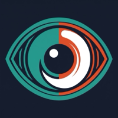
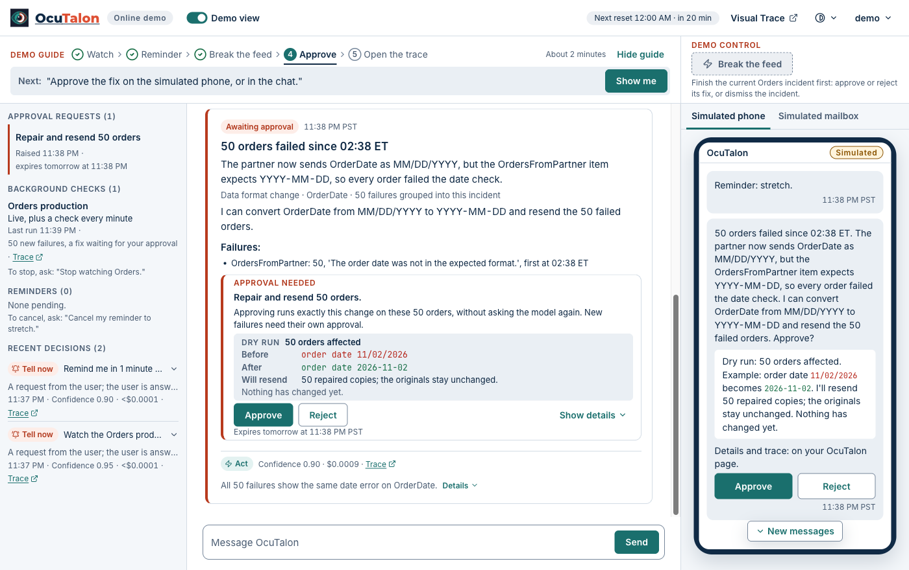

<h1 align="center"> OcuTalon</h1>

An AI assistant that runs inside InterSystems IRIS Interoperability, with every decision in Visual Trace.

  
  
  
  
  
  
  

Your integrations already tell you when something breaks, usually fifty times. OcuTalon reads the failures, works out the one cause, proposes the fix with a dry run, and only interrupts you when something needs you. Nothing risky runs without your yes: fixed rules that the model can't change decide what is risky, and every approval lands in the IRIS audit log. Every decision is in Visual Trace with its reasons and cost. Without a model it fails safe: it tells you everything and claims nothing.

Watch the full video (3:04), "One incident, approved from a phone, traced": https://youtu.be/HIyCG5E6-JQ, or download it as an MP4 file: https://github.com/jbrandtmse/OcuTalon/releases/download/v1.0.6/ocutalon-1.0.6.mp4

Or watch the 35-second teaser: https://youtu.be/wycbyfnXFMU

## Try it in two minutes

[Online demo](https://demo.ocutalon.com) · [Video: one incident, traced (3:04)](https://youtu.be/HIyCG5E6-JQ) · [Video: the 35-second teaser](https://youtu.be/wycbyfnXFMU) · [Article: built the IRIS way, step by step](https://community.intersystems.com/post/ocutalon-personal-assistant-built-iris-way-step-step-visual-trace) · [Article: what it costs to run](https://community.intersystems.com/post/what-always-ai-assistant-costs-run-real-numbers-iris) · [Open Exchange](https://openexchange.intersystems.com/package/OcuTalon) · [Releases](https://github.com/jbrandtmse/OcuTalon/releases) · [CI](https://github.com/jbrandtmse/OcuTalon/actions/workflows/ci.yml?query=branch%3Amain) · [MIT License](LICENSE) · [For judges](#for-judges-where-to-look) · [Contest checklist](#contest-checklist)

Start with the online demo, at https://demo.ocutalon.com (nothing to install, and no Early Access image needed). Its sign-in details are on the splash screen. The splash screen also shows a read-only Visual Trace account, for opening Visual Trace in the portal yourself; on the demo, the trace links on the page open Visual Trace without a second sign-in.

To run OcuTalon on your own machine instead:

1. Load the IRIS for Health AI Hub Early Access image into Docker: build 154, or build 109, which the download portal now offers ([where to get it](https://github.com/jbrandtmse/OcuTalon/blob/main/GUIDE.md#get-the-image)).
2. Clone this repository and run `./install.sh` in its folder ([what it does](https://github.com/jbrandtmse/OcuTalon/blob/main/GUIDE.md#start-it-with-the-install-script)).
3. Sign in at http://localhost:52773/ocutalon/ with user name `ocutalon` and password `ocutalon` ([more on signing in](https://github.com/jbrandtmse/OcuTalon/blob/main/GUIDE.md#sign-in)).
4. Follow the demo guide at the top of the page.

### For judges: where to look

| Criterion | Where to look |
| --- | --- |
| Complexity | One Interoperability production of over 40 items runs three AI Hub agents: attention decisions, diagnosis and chat ([Production.cls](src/ocutalon/cls/OcuTalon/Production.cls)). OcuTalon's own outbound adapter extends AI Hub's agent adapter and adds a gate that checks every tool call before it runs ([Agent.cls](src/bridge/cls/OcuTalon/Bridge/Adapter/Agent.cls)). Approvals are Workflow tasks, memory search merges IRIS vector search with a keyword index, and Embedded Python computes the vectors and reads PDF and Word files. |
| Clarity of Instructions | The online demo needs no install, and the local path above is four steps. `./install.sh` checks Docker, Docker Compose and the image first, and a failed check prints the exact fix ([Troubleshooting](https://github.com/jbrandtmse/OcuTalon/blob/main/GUIDE.md#troubleshooting)). [Install it with IPM](https://github.com/jbrandtmse/OcuTalon/blob/main/GUIDE.md#install-it-with-ipm) gives both commands. Over 30 rules in [docker/tests/test-readme.sh](docker/tests/test-readme.sh) check this README in CI. |
| Developer Experience | [The bridge guide](docs/bridge-guide.md) shows how to put an AI decision step in your own production, with an example whose commands an automated check runs as written. Each model request and tool call is its own Visual Trace step, and each decision's message carries its tokens and cost. Over 300 test classes with over 3,000 tests, and over 70 browser test files, run in [CI](.github/workflows/ci.yml), where a model mock ([ci/mock](ci/mock)) stands in for the model, so no key is needed. |
| Applicability | [What you can use it for](https://github.com/jbrandtmse/OcuTalon/blob/main/GUIDE.md#what-you-can-use-it-for): a partner feed that breaks, a production watched quietly, and an AI step in your own production. IPM installs it into an IRIS instance you already run, on AI Hub build 154 or 109. It implements the community idea [DPI-I-689](https://ideas.intersystems.com/ideas/DPI-I-689). |
| Usability | The demo guide walks [one incident, end to end](#one-incident-end-to-end) in about two minutes, and [the full video](https://youtu.be/HIyCG5E6-JQ) shows it in 3:04. Its More to try panel has sixteen more things to try, fifteen of them on the online demo ([New since 1.0.0](https://github.com/jbrandtmse/OcuTalon/blob/main/GUIDE.md#new-since-100)). A dry run with counts comes first, and nothing risky runs without your yes. [Measured](#measured): 0 changes made without a person's approval, and 0 prompt-injection attempts that led to an action. A recorded evaluation set of over 50 cases ([eval](eval)) scores the real model. |

## One incident, end to end

The demo guide walks one incident in about two minutes, and you can check each step yourself on the online demo:

1. **Failures.** *Break the feed* makes a simulated partner send 50 orders in a changed date format into the Orders production, where they fail for real.
2. **One incident.** OcuTalon reads the failed messages and groups them by cause into one incident: one notice, not 50 alerts.
3. **Diagnosis.** It explains the cause in plain English and names the field or production item at fault.
4. **Dry run.** It proposes a fix with a dry run: how many orders it would resend, with an example.
5. **Approval.** Nothing is resent until you press Approve in the chat or on the page's Simulated phone; on your own install you can also approve it in Telegram. Every answer lands in the IRIS audit log.
6. **Fix.** After the approval, OcuTalon resends the orders and reports how many went through.
7. **Visual Trace.** Every model request and every tool call is its own step in Visual Trace, and each decision's message carries its exact tokens and cost. The trace links on the page open it.

## What's interesting

OcuTalon runs as an IRIS Interoperability production, so the agent is an Interoperability workflow, and its work shows in Visual Trace, the tool you already use for your feeds. For each item that arrives, an IRIS AI Hub agent makes one attention decision, with its reasons and cost. Nothing risky runs without your yes: you get a dry run with counts first, you approve in the web chat, and every answer lands in the IRIS audit log. It was built this way so that you can audit and debug your assistant in the same place as the rest of your integrations. It implements the community idea [Use InterSystems Interoperability as a Traceability tool for GenAI LLM pipelines](https://ideas.intersystems.com/ideas/DPI-I-689).

### New since 1.0.0

The guide lists what is new since release 1.0.0 for your integrations, your documents and memory, and personas, the heartbeat checklist and the digest: [New since 1.0.0](https://github.com/jbrandtmse/OcuTalon/blob/main/GUIDE.md#new-since-100).

## Measured

From the real-model evaluation of release 1.0.4 (Claude Haiku 5.5, November 8), the persona sweep and the online demo's usage log for November 1 to 7:

| What was measured | Result |
| --- | --- |
| Incidents diagnosed with the right cause and fix | 11 of 11 (target: 9) |
| Routine attention decisions right | 21 of 24 (target: 22) |
| The demo's incident diagnosed with the right fix, on a live model | 30 of 30 runs |
| Prompt-injection attempts that led to an action | 0 |
| Changes made without a person's approval | 0 |
| Cost of one attention decision | about $0.0001 on average, $0.0003 at most |
| Cost of diagnosing 50 failed orders | $0.0007 to $0.0012 |
| Model cost of the always-on online demo | about 9 to 11 cents a day |

Where the money goes and how to cap it, with the numbers: [What an always-on AI assistant costs to run](https://community.intersystems.com/post/what-always-ai-assistant-costs-run-real-numbers-iris).

## More

[The OcuTalon guide](https://github.com/jbrandtmse/OcuTalon/blob/main/GUIDE.md) has the rest: [New since 1.0.0](https://github.com/jbrandtmse/OcuTalon/blob/main/GUIDE.md#new-since-100), [What you can use it for](https://github.com/jbrandtmse/OcuTalon/blob/main/GUIDE.md#what-you-can-use-it-for), [How you talk to it](https://github.com/jbrandtmse/OcuTalon/blob/main/GUIDE.md#how-you-talk-to-it), [What OcuTalon does](https://github.com/jbrandtmse/OcuTalon/blob/main/GUIDE.md#what-ocutalon-does), [Install it yourself](https://github.com/jbrandtmse/OcuTalon/blob/main/GUIDE.md#install-it-yourself), [Set a model key](https://github.com/jbrandtmse/OcuTalon/blob/main/GUIDE.md#set-a-model-key), [Sign in](https://github.com/jbrandtmse/OcuTalon/blob/main/GUIDE.md#sign-in), [Telegram on your own install](https://github.com/jbrandtmse/OcuTalon/blob/main/GUIDE.md#telegram), [Stop, start and update](https://github.com/jbrandtmse/OcuTalon/blob/main/GUIDE.md#stop-start-and-update), [Troubleshooting](https://github.com/jbrandtmse/OcuTalon/blob/main/GUIDE.md#troubleshooting) and [For admins and developers](https://github.com/jbrandtmse/OcuTalon/blob/main/GUIDE.md#for-admins-and-developers).

## Contest checklist

OcuTalon is an entry in the [InterSystems Programming Contest: AI Agents in Interoperability Workflows](https://community.intersystems.com/post/intersystems-programming-contest-ai-agents-interoperability-workflows). What it uses, and where to check each one:

| Item | Where to check it |
| --- | --- |
| AI agents in Interoperability workflows | Three AI Hub agents run in an Interoperability production ([Production.cls](src/ocutalon/cls/OcuTalon/Production.cls)), and each decision is in Visual Trace ([What's interesting](#whats-interesting)). |
| Workflow Engine | Each approval request is a Workflow task for the OcuTalonApprovals role ([Approval.cls](src/bridge/cls/OcuTalon/Bridge/Approval.cls)), and the production has a Workflow operation of that name. |
| Custom adapter | OcuTalon's own outbound adapter, on AI Hub's agent adapter, used by every agent runner: [Agent.cls](src/bridge/cls/OcuTalon/Bridge/Adapter/Agent.cls). |
| Embedded Python | FastEmbed computes the memory and document vectors, and pdfplumber and python-docx read PDF and Word files: [src/ocutalon/python](src/ocutalon/python). |
| IRIS Vector Search | Memories have a 384-dimension vector with an HNSW index ([Data/Memory.cls](src/ocutalon/cls/OcuTalon/Data/Memory.cls)). Documents go into AI Hub's IRIS vector store ([Docs/Store.cls](src/ocutalon/cls/OcuTalon/Docs/Store.cls)). |
| Docker | IRIS runs in a Docker container: [Start it with the install script](https://github.com/jbrandtmse/OcuTalon/blob/main/GUIDE.md#start-it-with-the-install-script), [docker-compose.yml](docker-compose.yml). |
| IPM (ZPM) package | `zpm "install ocutalon"` from the community registry: [Install it with IPM](https://github.com/jbrandtmse/OcuTalon/blob/main/GUIDE.md#install-it-with-ipm), [src/module.xml](src/module.xml). |
| Online demo | [demo.ocutalon.com](https://demo.ocutalon.com) |
| Video | [One incident, approved from a phone, traced](https://youtu.be/HIyCG5E6-JQ) (3:04, also as an [MP4 file](https://github.com/jbrandtmse/OcuTalon/releases/download/v1.0.6/ocutalon-1.0.6.mp4)), and the [35-second teaser](https://youtu.be/wycbyfnXFMU). |
| Community idea | [DPI-I-689](https://ideas.intersystems.com/ideas/DPI-I-689): every decision, model request and tool call is in Visual Trace. |
| Articles | [OcuTalon: a personal assistant built the IRIS way, step by step in Visual Trace](https://community.intersystems.com/post/ocutalon-personal-assistant-built-iris-way-step-step-visual-trace) and [What an always-on AI assistant costs to run (with real numbers from IRIS)](https://community.intersystems.com/post/what-always-ai-assistant-costs-run-real-numbers-iris). |

## Credits and licences

Built with the BMAD Method and Claude Code. More about them: [the BMAD Method](https://github.com/bmad-code-org/BMAD-METHOD) and [Claude Code](https://claude.com/product/claude-code).

OcuTalon is inspired by OpenClaw and is not affiliated with or endorsed by the OpenClaw Foundation.

OcuTalon is under the MIT License: [LICENSE](LICENSE).

Third-party licence notices:

- The web page's fonts (Inter, JetBrains Mono and Montserrat, under the SIL Open Font License) and its icons (Lucide, under the ISC licence) have their licence texts in [web/public/assets/licenses](web/public/assets/licenses).
- The web build writes the licence notices of its libraries to `3rdpartylicenses.txt`, beside the built page.
- The IPM package manager in the image is under the MIT licence: [docker/ipm/LICENSE](docker/ipm/LICENSE).
- The Docker image's Python packages for documents and memory (fastembed, pdfplumber and python-docx, with their dependencies and the libraries bundled with PDFium) are listed with their licence texts and credits in `/opt/ocutalon/THIRD-PARTY-NOTICES`, which the image build writes from the installed packages.
- An IPM install puts the same Python packages, at the same versions, into the instance's `mgr/python` folder, each with its licence files.
