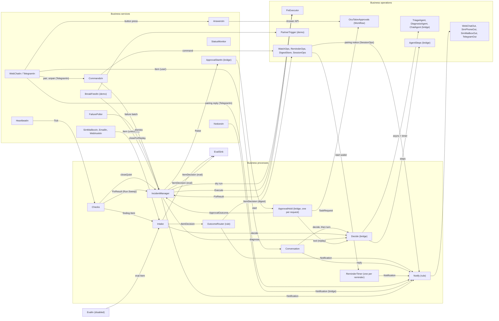
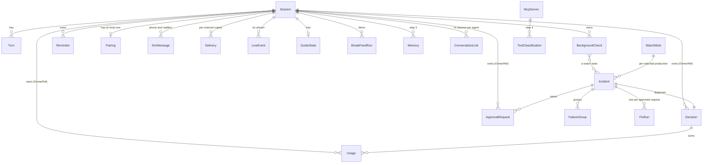
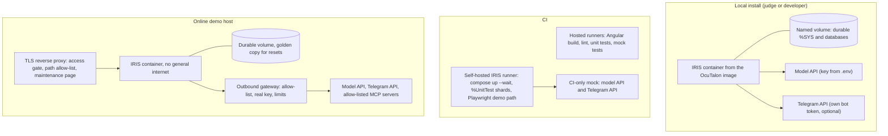

# Architecture Spine: OcuTalon

This spine fixes the decisions that keep OcuTalon's separately built parts consistent while two build runners work in parallel. Requirement IDs refer to the PRD; "the addendum" is the PRD addendum; "the UX" is `EXPERIENCE.md`. **[ADOPTED]** marks a decision the PRD, the addendum or the author had already settled. **Sn** refers to a spike under [Spikes](#spikes): build 154 behaviour that must be confirmed before the story that depends on it, with its fallback already chosen. `ARCHITECTURE-NOTES.md` beside this file holds the evidence, the departures from the addendum, the answers to the open items, the UX handoff verdicts, and the PRD and UX changes with their status.

**Platform note.** The public AI Hub documentation describes build 162 (2026.2.0AI). OcuTalon runs on 2026.3.0AI build 154. Every AI Hub API named here was checked against the build 154 class export or the running build 154 instance. Behaviour that lives only in AI Hub's native library is marked as a spike.

## Design Paradigm

**A message-driven Interoperability production.** OcuTalon is pipes and filters on IRIS Interoperability. Channels are adapters at the edge (a business service in, a business operation out), the bridge is the decision core, and everything that passes between them is a production message, so Visual Trace is the assistant's own debugger (NFR-20). Commands and queries are separated: commands enter only through business services as messages; the web app reads tables directly.

| Layer | Packages | IRIS construct | Owns |
| --- | --- | --- | --- |
| Edge: channels | `OcuTalon.Channel` | business services (in), business operations (out) | turning channel traffic into Items, rendering outbound text |
| Edge: web | `OcuTalon.Web`, `web/` | CSP applications, `%CSP.REST`, `%CSP.WebSocket`, Angular | sign-in, queries, live events, commands sent to services |
| Core | `OcuTalon.Core` | business processes, routing rules | turns, untrusted intake, outcome routing, notification fan-out, commands, answers |
| Bridge (reusable) | `OcuTalon.Bridge` | business process, operations on AI Hub's adapter, AI Hub policies, IRIS Workflow | decisions, agent steps, budgets, cost, fallback, approvals, audit |
| Agents and tools | `OcuTalon.Agent`, `OcuTalon.Tools` | `%AI.Agent`, `%AI.ToolSet` | prompts, input rendering, built-in tools |
| Domain | `OcuTalon.Watch`, `.Fix`, `.Schedule`, `.Checks`, `.Digest`, `.Memory`, `.Docs`, `.Mcp` | hosts plus plain classes | IRIS watch, fixes, heartbeat, reminders, coverage, digest, memory, documents, MCP |
| Contracts and state | `OcuTalon.Msg`, `OcuTalon.Data`, `OcuTalon.Live` | message classes, persistent classes | cross-lane message shapes, records, live events |
| Platform | `OcuTalon.Install`, `OcuTalon.Test`, `OcuTalon.Eval` | installer steps, `%UnitTest`, the evaluation items | install, upgrade, roles, tests, the evaluation harness |
| Demo | `OcuTalon.Demo` | Orders production in its own namespace, demo guide | demo mode |

## Invariants & Rules

**Dependency direction.** Production components talk to each other only through messages addressed by production item name, never by calling each other's classes. An arrow means "may reference classes of". A CI check enforces the bridge boundary (AD-2) and the `%AI` allow-list; the rest is checked in review.

```mermaid
flowchart TD
  Web["Web: OcuTalon.Web + web/"] --> Msg["Contracts: OcuTalon.Msg"]
  Web --> Data["State: OcuTalon.Data, OcuTalon.Live"]
  Web --> Guide["OcuTalon.Demo.Guide"]
  Channel["Channels: OcuTalon.Channel"] --> Msg
  Channel --> Data
  Channel --> Trace["OcuTalon.Core.Trace"]
  Channel --> Allowance["OcuTalon.Core.Allowance"]
  Web --> TgIncluded["OcuTalon.Channel.Telegram.In.Included()"]
  Web --> McpTools["OcuTalon.Mcp.Ops.Tools(server) (step 4)"]
  Core["Core: OcuTalon.Core"] --> Msg
  Core --> Data
  Core --> Input["OcuTalon.Agent.Input"]
  Core --> Render["OcuTalon.Checks.Render"]
  Core --> Drop["OcuTalon.Docs/Memory.DropSession (step 3)"]
  Core --> DemoStep["OcuTalon.Install.Step.Demo.Run() (SettingsOps, on a demo-mode switch; AD-23)"]
  Demo["Demo: OcuTalon.Demo"] --> Msg
  Demo --> Data
  Domain["Domain: Watch, Fix, Schedule, Checks, Digest, Memory, Docs, Mcp"] --> Msg
  Domain --> Data
  Domain --> Input
  Domain --> Restart["OcuTalon.Core.SettingsOps.RestartRunners() (Mcp, step 4)"]
  Agents["OcuTalon.Agent + OcuTalon.Tools"] --> Msg
  Agents --> Data
  Agents --> WatchReader["OcuTalon.Watch.Reader"]
  Data --> Guide
  Guide --> TgIncluded
  Demo --> DemoKey["OcuTalon.Install.Step.Demo (its constants: the demo-mode key, the Orders namespace and production names)"]
  Web --> Commands["OcuTalon.Core.Commands.Submit"]
  Channel --> Commands
  Demo --> Commands
  Domain --> Commands
  Agents --> Commands
  Shared["Bridge shared: Msg, Approval, Context, ReplyCheck, Budget, Keys, Timeouts and settings-merge APIs, Ids, Audit, Redact, Ext bases, Data (read only)"]
  %% ReplyCheck added to the Bridge shared node: the request a reply class validates against, read by its %OnValidateObject [AMENDED 2026-10-27, Story 7.1, Epic 7 runner, orchestrator, owner U-125]
  Web --> Shared
  Channel --> Shared
  Core --> Shared
  Demo --> Shared
  Domain --> Shared
  Agents --> Shared
  Bridge["Bridge: OcuTalon.Bridge"] --> AIHub["%AI + EnsLib.AI"]
  Bridge --> Ens["Ens, EnsLib.Workflow"]
  Orders["OcuTalon.Demo.Orders production"] --> Ens
  Install["OcuTalon.Install"] --> All["all packages"]
```



Every layer submits commands through `OcuTalon.Core.Commands.Submit`, the one entry point AD-1 requires; nothing else in `OcuTalon.Core` is referenced from outside it, except that channel services may call `OcuTalon.Core.Allowance` and `OcuTalon.Core.Trace` (both Lane B APIs, built in Stories 2.4 and 2.9; AD-20, AD-26), and from step 4 `OcuTalon.Mcp` may call `OcuTalon.Core.SettingsOps.RestartRunners()` (Lane B, Story 35.2 (was 21.1); AD-21). From step 3, `SessionOps.End` (Core) may call `OcuTalon.Docs.DropSession` and `OcuTalon.Memory.DropSession` (Lane A, Story 19.5; AD-21). The web layer may call `OcuTalon.Channel.Telegram.In.Included()` (AD-29) and, from step 4, `OcuTalon.Mcp.Ops.Tools(server)` (Lane A, Story 22.2; AD-21). Within the domain layer, `OcuTalon.Watch` may reference `OcuTalon.Fix.Kind` to validate a proposed fix's parameters, and `OcuTalon.Checks` may call `OcuTalon.Fix.Run.Sweep()` (AD-16).

### AD-1: Every command is a production message [ADOPTED]

- **Binds:** all; NFR-20, NFR-14, FR-1, FR-3, FR-13
- **Prevents:** a feature that changes state outside Visual Trace; arriving content reaching a governance command.
- **Rule:**
  - Every channel input, item, attention decision, agent step, approval request and answer, action and outbound channel message is a production message in OCUTALON.
  - State-changing commands from the web app, Telegram, tools, timers and webhooks enter through a business service; adapterless services are called with `Ens.Director.CreateBusinessService` and `ProcessInput`.
  - A safe tool that changes state submits an `OcuTalon.Msg.Command.<Verb>` through `CommandsIn` and returns the owner's synchronous `CommandResult`; it never writes domain tables itself. A command from a tool carries an `IdempotencyKey` (the turn's `ItemId` plus the tool call's position in the turn), and its owner ignores a repeat, so a re-sent turn can't act twice (AD-8).
  - Every command carries an `Origin` (`web_user`, `web_admin`, `telegram`, `tool`, `timer`, `system`) set by the submitting code from its authenticated context, never from the payload: commands are submitted only through `OcuTalon.Core.Commands.Submit`, which sets `tool` whenever a bridge context is active in the process, whatever the caller asks for. `CommandsIn` accepts from origin `tool` only: set, cancel or list reminders (`SetReminder`, `CancelReminder`, `ListReminders`; AD-29), start or stop a watch, save or forget a memory, and dismiss one of the session's own incidents (PRD FR-24 allows a dismiss from the chat). Approval answers go only through `AnswersIn`; settings, classification, MCP servers, pairing codes and demo mode only through admin-checked or session-checked web endpoints, and demo mode also through the documented admin terminal command of AD-19 (a pairing completes only through `SessionOps`, which `TelegramIn` submits to with origin `telegram`). A test submits each governance command with origin `tool` and expects a refusal.
    - `Submit(command, origin, Output result)` validates the caller's origin against the enumeration, overwrites the payload's `Origin` with it (or with `tool` inside a bridge context, held in `^||OcuTalonBP.Context`), and sends to `CommandsIn`. `CommandsIn` makes the origin checks: it accepts each verb only from its listed origins, so it refuses an admin-only verb (`SetDemoMode`: `web_admin` and `system`) from any other origin; the role check is in the admin-checked endpoints that submit as `web_admin` or `system` (for example AD-19's `OcuTalon.Core.Admin.SetDemoMode`), which refuse a caller without the role before anything is submitted. [AMENDED 2026-10-19, Story 0.6, Rule 22 ruling] [AMENDED 2026-10-25, DW-75, owner decision U-70 relayed by the Contest Planner: as built; was "role checks stay with the admin-checked endpoints and `CommandsIn`"; `CommandsIn` makes none]
  - REST and WebSocket code may read tables, and may write only: the `Session` row and per-address counter at sign-in, a sign-out, which submits `SessionOps.End` through `CommandsIn` on the online demo, a pairing code's hash (AD-4), and UI-only markers (guide markers, trace link opened).
  - Only business operations send outbound channel traffic.

### AD-2: One IPM package with a separable bridge, and one dependency direction (Open Question 6)

- **Binds:** FR-5, FR-57, all packages
- **Prevents:** a bridge that can't be lifted out later because it imports OcuTalon features; an install that depends on a second package; `%AI` calls scattered through the code.
- **Rule:**
  - OcuTalon ships **one** IPM package, `ocutalon`, because an Open Exchange listing carries one IPM package (decided by the author on October 17). Its single `module.xml` lists the bridge's resources (`src/bridge/`: packages `OcuTalon.Bridge` and `OcuTalon.BridgeExample`) before everything else (`src/ocutalon/`), plus the Angular app's built bundle. OcuTalon installs the bridge itself and never depends on a separate bridge package.
  - The bridge also installs on its own without IPM: `src/bridge/` loads with `$SYSTEM.OBJ.LoadDir`, and its own installer class, `OcuTalon.Bridge.Installer`, sets up what the bridge needs (its Workflow role and user, audit events, default settings). OcuTalon's installer calls it as its first step. The developer guide (FR-5) uses this path.
  - The bridge becomes its own product, with its own IPM package and Open Exchange listing, as a follow-on. The rules below keep it extractable without code changes.
  - A CI check fails the build if any class in `OcuTalon.Bridge` references another `OcuTalon` package. The bridge reaches its host only through the extension classes of AD-31, named as strings in settings.
  - A CI job loads `src/bridge/` alone into a clean namespace without IPM, runs `OcuTalon.Bridge.Installer`, and runs `OcuTalon.BridgeExample` (FR-5). S1 confirmed on build 154 both this path and the one package with the bridge listed first: overlapping package resources load and package correctly, and installer steps declared in `module.xml` run in the order listed.
  - A second CI check fails the build if a class outside the packages `OcuTalon.Bridge`, `.BridgeExample`, `.Agent`, `.Tools`, `.Docs`, `.Memory`, `.Mcp`, `.Install` and `.Test` (matched as whole package names, not prefixes) references `%AI` or `EnsLib.AI`.
  - Bridge records carry `OwnerRef`, which is exactly a `SessionRef`, the literal `instance`, or the literal `eval`. Correlation ids are separate named properties.

### AD-3: Namespaces, databases, and one gateway per cross-namespace job

- **Binds:** FR-16, FR-23, FR-25, FR-56, FR-59, NFR-12
- **Prevents:** `$NAMESPACE` switching scattered across tools; the demo touching a user's own productions; viewers reading private records.
- **Rule:**
  - OCUTALON has a code database, a data database (messages and Interoperability state), a private database, and a small public database, `OCUTALON_PUBLIC`, with public Read. [ADOPTED: own namespace]
  - **The public database** holds only two packages and one global, through mappings in OCUTALON and OCUORDERS:
    - `OcuTalon.Web.Public`: the login page, the public status endpoint, the shell that dispatches `/ocutalon` (`Shell`, AD-13) and the generated sign-in assets (`SignInAssets`), and the API's base class `ApiBase` (AD-13) [AMENDED 2026-10-19, Story 0.5, Rule 22 ruling] [AMENDED 2026-10-18 — see Story 0.3's change log];
    - `OcuTalon.Data.Public`: the public-settings accessor;
    - the public settings global, `^OcuTalonPublic`.

    The login page runs with no roles before sign-in (S7, AD-13). Confirmed by S16: package mappings put the definitions and compiled code in the public database, and OCUORDERS sees them through its own mappings.

    A CI check fails if either package references anything but `%CSP` (including `%CSP.REST`), dynamic objects, `$SYSTEM.License`, `$SYSTEM.Status`, `$SYSTEM.Encryption` (used only by a compile-time generator) and the two packages. The check reads both packages' classes from the class dictionary, so a new class is covered. It reads superclasses, property, argument and return types, `##class` calls, `$SYSTEM` members and dynamic dispatch; a system datatype class (`%String`, `%Integer`, `%Status`, `%Library.Boolean` and the like) is allowed as a type, while a non-datatype system class or another package's datatype class is not [AMENDED 2026-10-19, Story 0.7, Rule 22 ruling]. They keep their own copies of the UX texts they render, and a test compares those with the catalog.

    The status class overrides `%CSP.REST.AccessCheck`, whose default needs Read on the data database and answers 403 (S16).
  - **Private records:** every OcuTalon persistent class that isn't a message or a business process sets `Parameter DEFAULTGLOBAL` to a fixed prefix (`^OcuTalonP.<Short>`, and `^OcuTalonBP.<Short>` in the bridge). Global mappings put those two prefixes (written `OcuTalonP.*` and `OcuTalonBP.*`, with the dot, so `^OcuTalonPublic` stays in the public database; an install check confirms where it resolves), `^AI.Agent.Session*` and `^IRIS.IF.*` (`%iFind`'s word dictionary, which holds private memory text, S14) in the private database. Epic 0 starts a registry of short names, `src/short-names.tsv` (one row per class, union-merged) [AMENDED 2026-10-19, Story 0.4, Rule 22 ruling], and a CI check fails on a duplicate `DEFAULTGLOBAL` across `src/`. Business processes store in `Ens.BusinessProcess`'s own extent, so they set none, and they keep no private text in their properties; anything private they hold goes in a private table [AMENDED 2026-10-19, Story 0.6, Rule 22 ruling].
  - **Mappings come first:** the databases and mappings exist before any OcuTalon class is compiled (AD-23). The merge runs outside IPM's transaction, so a failed install leaves the namespace and databases in place, harmlessly, for the next run (S19).
  - **The production:** `OcuTalon.Production` is not an autostart production on the Docker install; the installer's `Production` step starts it after every install or upgrade (AD-23). An IPM install marks it autostart, because no after-start script runs there after an instance restart.
  - In demo mode, `OcuTalon.Demo.Orders.Production` runs in namespace OCUORDERS with its own code and data databases, reaching its classes through a package mapping of `OcuTalon.Demo.Orders`. `OcuTalon.Install.Step.Demo` creates or removes OCUORDERS, its code and data databases and its mappings (including AD-3's public package and global mappings) through the `Config` classes, together with the OCUORDERS trace application and the trace role's OCUORDERS grants (AD-24), and runs at install, in its fixed place in AD-23's order, and whenever the demo-mode setting changes.
    - **As planned in Story 0.10.** The databases are `OCUORDERS_CODE` and `OCUORDERS_DATA` on the durable volume, with resources `%DB_OCUORDERS_CODE` and `%DB_OCUORDERS_DATA` that grant no public permission. Interoperability is enabled with `%Library.EnsembleMgr.EnableNamespace("OCUORDERS", 0, , 1)`, whose install flag runs no Foundation installer on the Health image, so OCUORDERS never holds Foundation artefacts and demo mode off can remove it whole (measured in the story's Task 0). The step owns only an OCUORDERS whose default destinations are its own two directories: a foreign OCUORDERS fails the on path. With demo mode off, an OCUORDERS that OcuTalon didn't create, or that holds any production other than the Orders demo, is left in place: the step logs a warning naming what it kept, records a status note saying how to remove it by hand, and the start finishes normally with the ready marker written (the keep path removes only OcuTalon's own access there, the OCUORDERS trace application, the trace role's OCUORDERS grants and its SQL privileges, as AD-24 ties them to demo mode on; the note is the status mark `demoKept` [AMENDED 2026-10-20, Story 0.12, Rule 22 ruling]); the off path never deletes a user's data and never fails the start over it [AMENDED 2026-10-20, owner decision 2]. Off removes the namespace, both databases and their files, the mappings, the trace application and grants, and the `%SYS` rows keyed by the namespace. The step starts the Orders production itself (not autostart), recovers it if Troubled, and never stops another production in OCUORDERS. Its items are `PartnerOrdersIn`, `OrdersFromPartner` (a custom process that runs the DTL and returns its error unchanged) and `OrdersToWarehouse`; the partner is called with `Partner.Send(count, dateFormat, traceRef, orderDate)` [AMENDED 2026-10-20, Story 0.10, Rule 22 ruling].
  - Only these classes switch namespace, each in one method with `New $NAMESPACE`:
    - `OcuTalon.Watch.Reader` (headers, event log, settings, queues, vital signs);
    - `OcuTalon.Fix.Executor` (resending repaired copies);
    - `OcuTalon.Demo.PartnerTrigger` (Break the feed);
    - `OcuTalon.Install.Step.Demo` (to OCUORDERS, to start and stop its production);
    - `OcuTalon.Install.*` and `OcuTalon.Bridge.Installer` (to `%SYS`).
  - `Watch.Reader` reads a namespace only if the service user holds read access to that namespace's data database (`$SYSTEM.Security.CheckUserPermission`), as FR-23 defines; the list of productions a user can watch is filtered the same way, and the security overview says that any OcuTalon user can see evidence from those namespaces. On the online demo only the Orders production can be watched (AD-4).
  - On IRIS for Health, the Foundation template production stays installed and stopped, and OcuTalon never deletes Foundation artefacts. On the non-Health image, `Interop=1` only enables Interoperability: no Foundation installer, template production, HealthShare role or application, and the namespace's default web application is `/csp/<ns>` (S12). Nothing in OcuTalon depends on either. Trace links never use the Foundation portal application, and use OcuTalon's own trace applications on both images (AD-24).

### AD-4: Session ownership from step 1 [ADOPTED]

- **Binds:** FR-6, FR-15, FR-18 to FR-20, FR-23, FR-41, FR-42; every owned record, REST read and command
- **Prevents:** an isolation retrofit for the 1.0.0 kit; records keyed differently by the two lanes; Telegram identity or pairing codes in the trace.
- **Rule:**
  - `OcuTalon.Data.Session` owns every per-person record: turns, decisions, watches, reminders, approval requests, pairing, simulated phone and mailbox messages, guide state, demo orders, memories (on a local install, the IRIS user's durable session owns them, so they are per user) and, on the online demo, documents. On a local install, documents are shared by every user of the install (`OcuTalonKB.Docs`; PRD P23, October 17). Each carries `SessionRef`, or `OwnerRef` holding the `SessionRef` for bridge records.
  - Each session also has a `TraceRef`, which is not secret. It is the `SuperSession` of every message for that session (AD-26), and the demo tag on its Orders messages; the Orders message bodies carry no `SessionRef` [AMENDED 2026-10-20, Story 0.10, Rule 22 ruling].
  - **On a local or IPM install,** each IRIS user has one durable session, and signing out ends only the CSP session.
  - **On the online demo,** an OcuTalon session lasts until the next reset, independent of its CSP sessions (PRD FR-14 as amended on October 17). The first sign-in in a browser creates it and sets a resume cookie (HttpOnly, Secure, `SameSite=Strict`, path `/ocutalon/`) holding a random 22-character resume reference. The `Session` row stores only the reference's hash, and the reference is a bearer secret under the same rules as pairing codes (never in a message, log, live event or audit entry). A later sign-in from the same browser, after its CSP session ended, attaches the new CSP session to that OcuTalon session instead of creating one; only creations count toward FR-15's per-address limit.
  - **The resume hook (S16).** The attach runs in `OnLogin` of `/ocutalon`'s `%CSP.SessionEvents` class, `OcuTalon.Web.SessionEvents` (Lane B), once per new CSP session after a successful sign-in. It reads the cookie, finds the row by the reference's hash and records the new CSP session.
    - **A first sign-in** creates the row and sets the cookie with `%response.SetCookie(<name>, ref, <next reset as an RFC 1123 GMT date>, "/ocutalon/", "", 1, 1, "Strict")`, so the cookie expires at the next reset. The reference is 16 random bytes, base64url-encoded (22 characters); only its SHA-256 is stored.
    - **New CSP sessions** are recognised in the session events, never by a changed `%session.SessionId`, which IRIS often reuses.
    - **The trace applications** have no session-events class, so only `/ocutalon` attaches.
    - **Secure is always set** on the online demo, which is HTTPS at the proxy.
    - **Cross-site arrivals:** a visitor arriving from another site doesn't send the Strict cookie with the first page load, but the sign-in POST does, so the splash never depends on the cookie. Telegram, reminders, watches and approvals keep working while no CSP session is open.
  - **Ending an online-demo session.** Only an explicit sign-out (the account menu's Sign out) or the reset ends it. The reset ends every session by restoring the golden copy, so nothing runs, and the resume cookie expires at the same time. A sign-out runs `SessionOps.End(SessionRef)`, a command that removes the pairing, cancels reminders (`ReminderOps`), stops watches (`WatchOps`), cancels pending approval requests (`Approval.Cancel`), from step 3 drops the session's documents and memories (`OcuTalon.Docs.DropSession`, `OcuTalon.Memory.DropSession`; AD-21), and clears the resume cookie (the same name and path, expired). A CSP session ending (page closed, idle cap, timeout) frees its licence connection and ends nothing else.
  - **One live pairing per chat:** a Telegram chat has at most one live `Pairing`, and a new pairing replaces the old one.
  - Production messages carry `SessionRef`, never a user name, Telegram chat id or display name. The Telegram identity lives only in the `Pairing` row. A chat that writes to the bot without a valid pairing gets a `Pairing` row with no session, which `TelegramIn` records through Lane B's `OcuTalon.Data.Pairing.RecordChat`, a direct call, so no message carries the chat id; production messages refer to any chat only by its row's `Ref` (`ChatRef`, a property `Notification` and `Outbound` carry from Epic 0), and `Notify` routes kind `pairing` with a `ChatRef` to `TelegramOut` alone (FR-19). The display name may travel to the session's own page, in `/state` and its `pairing` live event, never in a production message (FR-18).
  - A pairing code never appears in a message body, header, log, live event or audit entry. The web layer generates it, stores only its hash in `Pairing` (a new code replaces the session's earlier one), and returns the plaintext only in the HTTP response. Both lanes hash through one method, Lane B's `OcuTalon.Data.Pairing.HashCode(code)` (SHA-256, base64url; Story 10.3): the web layer before storing, and `TelegramIn` on the code from `/start <code>` before it builds the pair command; `SessionOps` compares hashes only. The Telegram items don't offer the `ArchiveIO` setting.
  - **Pairing replies and notices.** Before each reply to any other message from an unpaired chat (not to a code, a bare `/start` or `/help`), `TelegramIn` calls Lane B's `OcuTalon.Data.Pairing.TakeReplySlot(chatRef)`, which returns 1 and records the time, atomically, when no reply has gone to that chat in the past minute, and 0 otherwise. For `/stop` and for pair outcomes, `SessionOps` returns the outcome and `TelegramIn` sends the reply. On an unlink the dropped chat didn't start (a page Unpair, or the session pairing a second chat), `SessionOps` sends a `pairing` `Notification` carrying the dropped chat's `ChatRef` and the matching catalog key ("unpaired from the page" or "other chat paired"). A chat that pairs with another session started that move itself and gets its pair reply. Every change publishes a `pairing` event to every session whose state changed (the old session too when a chat moves).
  - Failures tagged with a session's `TraceRef` are always scoped to that session, on any install. Untagged failures have scope `instance`. On the online demo, the watch tool accepts only the Orders production (PRD FR-23), so `instance` scope never arises there.
  - An `instance` incident on a local install belongs to every session that watches that production: `IncidentManager` sends one notification per watcher session, its live events go to each watcher's stream, and the ownership API shows the incident and its approval request (which carries `IncidentRef`) to those sessions. One method, `OcuTalon.Data.Session.Recipients(ownerRef, incidentRef)`, resolves those sessions for `IncidentManager`, `BridgeSink` and `AnswersIn` alike.
  - REST reads and command handlers go through one ownership API (`OcuTalon.Data.Ownership`, Lane B) that applies the caller's `SessionRef` and re-checks the target's owner or scope. No endpoint accepts a `SessionRef` from the client.

### AD-5: State survives restarts and in-place upgrades

- **Binds:** FR-6, FR-60, NFR-16, NFR-17, REL-6; every persistent class and business process
- **Prevents:** a release that loses settings, the audit trail or a waiting reminder, or breaks stored data.
- **Rule:**
  - All state lives on the durable volume: durable `%SYS` (`ISC_DATA_DIRECTORY`, holding security, tasks, the Config Store and the audit log) plus OCUTALON's data and private databases and OCUORDERS's data database (OCUORDERS has no private database). Every install replaces only code: the code databases and the public package; the public settings global is rewritten by its install step (AD-19).
  - Storage is append-only for persistent and message classes: never rename, retype or remove a stored property, and never edit a storage definition by hand. Every such class's source carries its compiler-generated `Storage` block, because a class loaded without one regenerates its storage and remaps existing rows (S1); the compiler then appends each new property's slot. A CI check fails a persistent class without a committed storage block, and another diffs storage definitions against the previous release tag: each block's lines at the highest earlier `v*` tag must stay a subsequence of its lines at HEAD, every slot keeps its number and the property it holds (so a slot put before an existing one fails), and a shallow clone fails rather than passes. The IRIS checks job also compares each compiled `Storage` block, exported after the install, with its committed file [AMENDED 2026-10-19, Story 0.7, Rule 22 ruling]. Upgrade code never assumes a new property has a value on old rows.
  - The production class holds structure only (items, classes, pool sizes, enabled flags). Values an install or an admin may change live in System Default Settings, bridge tables or `OcuTalon.Data.Setting`, so reinstalling the production class keeps them.
  - Only two business process classes hold a timer longer than two minutes: `OcuTalon.Bridge.Process.ApprovalHold` and `OcuTalon.Schedule.ReminderTimer` (the bridge timer is capped at 110 seconds, AD-8). Their persistent properties are frozen (append-only, with logic kept in other classes). Each mirrors a row (`ApprovalRequest`, `Reminder`) that is the source of truth. The startup reconciler starts a new waiter for any pending row whose process is gone, re-arming from the row's times, and cancels any orphaned Workflow task.
  - Every other process handles one message and ends, keeping its state in rows (turn queue, incident, failure group).

### AD-6: All model use goes through the bridge pipeline

- **Binds:** FR-1 to FR-5, FR-38, FR-40, NFR-1 to NFR-8, NFR-23
- **Prevents:** agents called from several places with different budgets, fallbacks and step recording; a slow model call blocking a business process; two turns on one conversation at once.
- **Rule:**
  - Every model use runs: caller → `OcuTalon.Bridge.Process.Decide` → an agent runner operation → response to the caller (AD-30). `Decide` does the budget and size precheck, sends asynchronously with `SetTimer(timeout)`, interprets the reply, applies the fallback route, records the decision and steps, and answers its caller. The runner writes the turn's usage itself (AD-20), so a reply that arrives after the timer is not passed to the caller, but its cost is still counted.
  - Request kinds: `decide` (Triage → attention decision), `diagnose` (Diagnosis → diagnosis decision), `turn` (Chat → reply in a conversation) and `tool` (no model: one governed tool call, either an approved call's replay (AD-10) or, from step 4, a source poll).
  - Agent runners are business operations, one per agent (`TriageAgent`, `DiagnosisAgent`, `ChatAgent`), all of class `OcuTalon.Bridge.Operation.AgentRunner`. Their adapter is `OcuTalon.Bridge.Adapter.Agent`, a subclass of AI Hub's `EnsLib.AI.Agent.OutboundAdapter` that:
    - always adds the gate and the step audit policy (AD-9, AD-10) in `OnAfterAgentInit`, then attaches the MCP servers (AD-21). AI Hub chains policies rather than replacing them: every authorization policy must allow, every audit policy is called, and policies named in settings run first (S4);
    - so it refuses to start if `AuthPolicy`, `AuditPolicy`, `DiscoveryPolicy`, `IrisTools`, `AdditionalTools`, `IrisSkills`, `AdditionalSkills`, `SystemPrompt` or its own session-config setting is set, or if `AgentClass` isn't on its allow-list (a bridge setting, seeded with OcuTalon's three agents, to which a developer adds their own agent class, FR-5). OcuTalon's toolsets declare no policies of their own;
    - builds the agent on first use, so a missing key never stops the item from starting (FR-38, S4);
    - composes the session config in one method, from the agent and the resolved model's family (AD-7), and passes the same object when it creates a session and on every `OpenSession`, because a session resumed without it silently loses its cap and effort (S2);
    - passes the step renderer to `Chat`, keeps `Response.Extra`, and reads `GetStats()` before and after `Chat` for the turn's usage (AD-20);
    - `%Save`s an AI session only after a completed `Chat`;
    - never lets a callback (renderer, policy or tool) call into AI Hub's native library: no `%AI` agent, session, tool-manager, provider, setting-store or RAG method. On build 154 a session call from inside `OnMessage` deadlocked the job permanently (S4), and the other calls take the same native path. A CI check flags `%AI` references in tool, policy and renderer classes beyond their base classes. `call_mcp_tool` never uses the tool manager; it uses its own HTTP client (S9).
    - runs no embedded Python inside a callback. A callback that needs Python (memory embedding, and from step 3 file extraction [AMENDED 2026-10-25, owner decision, relayed by the Contest Planner (PRD Open Question 3; the owner: "B. Yes."): reading PDF and Word files moves from step 6 into step 3, regardless of the bonus list: it read "from step 6 file extraction"]) hands the work to a `%SYSTEM.WorkMgr` worker and waits, because on build 154 a process that runs Python both inside and outside a callback crashes (S11). The same CI check flags Python methods and `%SYS.Python` in callback classes.
  - **Conversation link.** `OcuTalon.Bridge.Data.ConversationLink` maps (`OwnerRef`, agent) to an AI session.
    - Only the runner writes it, and only for `turn` requests with provenance `user`. `decide`, `diagnose`, `tool` and untrusted turns always use a throwaway AI session that is never linked.
    - The runner holds `LOCK ^OcuTalonBP.Conv(<link>)` from `OpenSession` to `%Save`, so a turn waits while an earlier one, even one `Decide` gave up on, is still running.
    - The runner rotates the link to a fresh AI session when the request says so (`SessionMode` `fresh`, seeded with the request's `SeedText`) or when `Decide` asks it to compact (AD-20).
  - This moves the agent call from the business process (addendum §4) into a business operation on AI Hub's adapter; S4 confirmed it on build 154.
  - Runners are the only code that calls `Chat`. Pool size is the concurrency cap.
  - **The request** (`OcuTalon.Bridge.Msg.Request`) carries:
    - rendered `Input` text, never an `OcuTalon.Msg.Item`. Callers fill it from `OcuTalon.Agent.Input` (Items) or `OcuTalon.Watch.EvidencePack` (diagnoses);
    - `Kind`, `Provenance`, `ItemId`, `Summary` (one code-written line set by the caller, never model text: sender and subject for mail, otherwise the item's first line, at most 80 characters; the `Decision` row keeps it and the decision event carries it), `DecisionRef` (allocated by `Decide`, AD-20), `OwnerRef`, `TraceRef`, `Channel` and correlation refs;
    - `ThreadSessionId`, the caller's own trace session id (AD-26);
    - `SessionMode` (`continue` or `fresh`), `SeedText` (a code-written recap for a fresh session) and `SystemNote` (code-written text sent before the input, such as the note that an approved call ran, never its result text, AD-30).
  - **The responses.** `Decide` answers `decide` and `diagnose` with `OcuTalon.Bridge.Msg.DecisionResponse` (`DecisionRef`, outcome, the decision or diagnosis payload, the fallback flag and reason), and `turn` and `tool` with `OcuTalon.Bridge.Msg.Reply`, which carries the reply text, `Tainted`, `SessionRotated`, `ToolsRun` (whether any tool ran), `SessionBroken` (the provider rejected the stored history), `Busy` (below), `HostData`, the turn totals (`InputTokens`, `OutputTokens`, `CacheReadTokens`, `CacheWriteTokens`, `CostUSD`, `Model`, `AgentStepCount`, `DurationMs`; AD-20), and, as every decision and reply message does, its `DecisionRef` and AD-26's `Outcome`, `Reasons`, `Confidence`, `Fallback` and `FallbackReason`. Epic 0 creates all of these fields (Story 0.4).
  - **The context.** `OcuTalon.Bridge.Context` holds the per-call context, set by the runner before `Chat` and read by the gate and tools: the request's fields (including `ThreadSessionId` and the `SuperSession`), taint, and `HostData`. The runner copies `HostData` (JSON a tool may fill, such as check rows) and the turn's taint onto the `Reply`.
  - **One decision per item:** a repeated `decide` for the same `ItemId` returns the recorded `Decision`.
  - **Busy conversations.** `Decide` refuses a `turn` whose conversation lock is still held after a 2-second wait by answering with a `Reply` whose `Busy` is 1; such a `Reply` has no text and no decision (no `Decision` row is recorded), and `Decide` never signals busy with an error status. Fresh-session untrusted turns are exempt. `Conversation` serializes its own turns and treats `Busy` as "wait and retry", re-queuing the turn after 3 seconds, at most 5 times, before it takes the fallback route with reason `rate_limited` ("the model was busy and retries ran out"); an error status still takes the fallback route (AD-30).
  - For an item with provenance `user`, `Decide` maps an `ignore` or `digest` answer to `tellnow` before recording, and says so in the reasons (FR-1).

### AD-7: Three declarative agents, configured by production settings

- **Binds:** FR-2, FR-5, FR-38, FR-39, NFR-1, NFR-2, NFR-3
- **Prevents:** provider code inside features; keys in settings; sampling parameters; free-text decisions code can't check; a silent fall back to an expensive default model.
- **Rule:**
  - Three declarative agents: `OcuTalon.Agent.Triage`, `OcuTalon.Agent.Diagnosis` and `OcuTalon.Agent.Chat` (`%AI.Agent` subclasses with static `XData INSTRUCTIONS`, `TOOLSETS` and `MODEL`). No INSTRUCTIONS block contains `{{` (a CI check), so AI Hub never compiles a template, and OcuTalon never calls `%AI.Utils.Template`.
  - Triage has no tools; this departs from addendum §2, for cost, injection surface and the lack of structured output. Diagnosis has read-only watch tools. Chat has the conversation toolsets.
  - The model is the runner's `Model` setting (System Default Settings), defaulting to the agent's `MODEL` parameter: `claude-haiku-5-5` for all three. Switching Diagnosis to `claude-sonnet-5-5` is one setting change (S2 ran it). The Config Store entry's own `model` is ignored, and with no model anywhere build 154 silently sends the provider's default model with a 131,072-token cap (S5), so an install check and a CI check fail when any runner resolves no model.
  - `ProviderConfig` holds the provider, the `@{env:...}` key placeholder, `base_url` and `http_config` only, never the model. From step 1 it is `@{config:OcuTalon<Agent>}` naming a Config Store `AI.LLM` entry, for example `AI.LLM.OcuTalonTriage` (S5 tested this three-part form; AD-19). The inline JSON (PRD §11.1) remains only as the documented alternative.
  - No request sets `temperature`, `top_p` or `top_k` (S2 confirmed none is sent).
  - **The session config is built in code, never stored** (AD-6). One bridge table, `OcuTalon.Bridge.Data.ModelFamily`, maps a model family to the key that carries the cap and the key that carries effort, and the runner builds the config from it and the agent:
    - **The cap:** `max_tokens` 8,000 (never below 4,000), a valid session key on build 154 (S2). GPT-5-class models reject `max_tokens`, so they get `extra_params: {"max_completion_tokens": 8000}` instead (S2).
    - **Effort:** `extra_params.output_config.effort` for Anthropic models (S2), and none for other families until a story tests their own field. Effort per runner is a plain setting: Triage `low`, Diagnosis `high`, Chat the model's default.
    - **`max_iterations`** per agent: 4 for Chat, AD-20. Hitting it maps to `unusable`.
    - **The cache block:** `{"enabled":1,"cache_system_prompt":1,"cache_tool_definitions":1,"min_tokens_for_cache":512}`. The system prompt and tool list come first, and anything variable after them.
    - **`timeout_ms`** from the timeout derivation (AD-8).

    So changing a runner's model or provider never leaves a config the new model rejects.
  - `OcuTalon.Agent.Input` is the one renderer of an Item into the model's user message (quoting, provenance and a local-time preamble); `Conversation`, `Intake` and the evaluation set call it. Triage and Diagnosis answer with one JSON object, checked against the `%JSON.Adaptor` class named in the runner's `ReplyClass` setting (`OcuTalon.Bridge.Msg.DecisionPayload`, `OcuTalon.Watch.Msg.DiagnosisPayload`; both carry plain-English reasons and a confidence between 0 and 1, which the incident card and Visual Trace show for a diagnosis too). Content that doesn't validate is unusable (AD-8).

### AD-8: The bridge alone decides when a reply is unusable

- **Binds:** FR-4, FR-38, FR-40, NFR-2, NFR-3, NFR-5, NFR-23
- **Prevents:** callers detecting failures in different ways; an unusable reply leading to an action.
- **Rule:**
  - `Decide` classifies every reply as usable or as one `FallbackReason`, checked in this order:
    - before sending (never sent): `no_key`, `daily_cap`, `budget`, `too_large`;
    - while waiting: `timeout` (the bridge timer, default 60 s);
    - on failure: `rate_limited`, `error`;
    - on the reply: `refusal` and `cut_off`, `empty`, `invalid` (JSON that fails validation).
  - **Mapping on build 154 (S2):**
    - A refusal or cut-off returns normally. `Response.Extra.finish_reason` is `refusal` or `max_tokens` on the Anthropic provider. The OpenAI provider reports none (S2), and other providers are treated the same until checked, so their refusals and cut-offs fall to `unusable`.
    - `empty` is a reply whose `Content` is empty.
    - Every failure raises the same `<%AICore>ProviderError`, so `Decide` classifies by its text in one method:
      - "Rate limit exceeded" is `rate_limited` (HTTP 429 and 529);
      - "operation timed out" is `timeout`;
      - the agent's provider-configuration error for a missing key is `no_key`;
      - "Invalid input" on a `turn` sets the reply's `SessionBroken`;
      - the agent's maximum-iterations error is `unusable` (a story confirms its text on build 154);
      - the online demo gateway's fixed daily-cap refusal (HTTP 403, "daily cost cap reached") is `daily_cap`, with no re-send;
      - anything else is `error`.
  - **Timeouts and retries (S2):**
    - The session's `timeout_ms` doesn't interrupt a request in flight. One method, `OcuTalon.Bridge.Timeouts.Derive(timer)`, derives from the bridge timer:
      - `timeout_ms`, the timer minus 5 seconds, which bounds the loop;
      - the provider's per-attempt `request_timeout_secs`, (timer − 10 seconds) / 2 rounded down: 25 seconds under a 60-second timer;
      - its **full** `retry` block, never a partial one: `{"max_retries": 1, "attempt_timeout_secs": <request timeout>, "initial_backoff_ms": 500, "max_backoff_ms": 2000}`. AI Hub waits `min(Retry-After, max_backoff_ms)` before a rate-limit retry, and with a missing or partial block that cap defaults to 30 seconds (S18). The worst case is (retries + 1) × the attempt timeout + retries × the back-off cap, 52 seconds under a 60-second timer.

      A compaction failure arrives as `<%AICore>InternalError` and never becomes a turn's reason; it only sends the runner to the seeded fallback (AD-20).

      Any timer change goes through it and restarts the runners. The bridge timer stays at or under 110 seconds (AD-5).
    - AI Hub itself retries 429, timeouts and connection errors, but never 500 or 529.
    - After a `rate_limited` failure, `Decide` re-sends with back-off until its timer fires, but only if no tool ran in the failed attempt (`ToolsRun`); otherwise it falls back. An `error` falls back at once.
    - A `SessionBroken` turn is retried once by `Conversation` in a fresh AI session seeded with its recap (AD-30). The stored history is never repaired in place.
  - When the platform can't tell cases apart, the reason is `unusable`. `invalid` and `unusable` both show the UX's generic reason.
  - An unusable result has outcome `tellnow`, `Fallback` true and its reason, and never triggers a tool, fix or approval request. A fallback on a user's turn is a reply only; item and incident fallbacks notify. An incident in fallback is grouped by fixed rules (production item plus error pattern) and proposes no fix.
  - From step 2, if a second model is configured, `Decide` retries once on it before falling back, through a second runner item per agent named in a bridge setting (step 2's spine update fixes the details).
  - The per-session message allowance is not a fallback; it is enforced before any model call (AD-20).

### AD-9: Agent steps come from AI Hub's hooks

- **Binds:** FR-2, FR-3, NFR-11, NFR-20; UX turn indicator
- **Prevents:** hand instrumentation in every tool; MCP tool calls missing from the trace; secrets or identities in step records.
- **Rule:**
  - The runner passes `OcuTalon.Bridge.Adapter.StepRenderer` (a `%AI.Shell.StreamRenderer` subclass whose `OnBegin` returns an empty string, so it writes nothing to the job's device and gets no progress calls) to `Chat`. Each `OnMessage` is one model-request step with its duration from the clock and an estimated request size built only from callback data (S4).
  - Tokens are recorded per turn, from the `GetStats()` delta the runner reads around `Chat`, not per step: session calls inside `OnMessage` deadlock the job, and `Response.Usage` covers only the turn's last request (S4). `StreamRenderer` subclassing and the policy setters are marked experimental in the bridge guide.
  - The pinned Audit policy, `OcuTalon.Bridge.Policy.StepAudit`, records every tool call through `%LogExecution` and every denial through `%LogDenial`: the tool's readable step label, a summary of inputs and result (the call's arguments arrive as a JSON string), duration and status.
  - Each tool declares its readable step label as a class parameter ("Checking the Orders production"); the label never contains arguments or model text.
  - Steps are buffered in the runner's job, passed through the redactor, returned with the reply, and emitted by `Decide` as `OcuTalon.Bridge.Msg.AgentStep` messages, in order, to the `AgentSteps` operation.
  - Before each tool runs, the gate reports `turn.step` (the step's label and its decision's `Ref`, with the session as `ownerRef`) through the HostSink (AD-31); the bridge never needs OcuTalon's `Turn` table.

### AD-10: One governance gate decides every tool call

- **Binds:** FR-7, FR-10, FR-44, FR-48, FR-49, FR-51, NFR-12, NFR-13, NFR-14
- **Prevents:** a risky tool running without approval; an MCP tool taking on a built-in classification; arriving content steering a state change.
- **Rule:**
  - `OcuTalon.Bridge.Policy.Gate` is an AI Hub Authorization policy that the runner adapter always installs (AD-6). It runs for every tool call, including tools that don't require authorization (S4). It fails closed: a missing context, an exception or a lock timeout means deny. It catches every exception itself and returns a `ToolAccessDenied` status, because an exception escaping `%CanExecute` skips the audit policies and sends the gate's source line to the model (S4). Its `%CanExecute` decides each call before it runs:
    1. **Classification** by (source, name). An MCP call is recognised first, by a `toolref` starting `mcp:`: its source is that `toolref`, which names the `OcuTalon.Mcp.Server` row, and its name is `call.name`. The prefix is checked before `metadata.origin_class`, because an MCP tool that shadows a built-in name carries the built-in's class (S9). For toolset tools, the gate receives only the tool's name as `toolref`, so the source is the implementing class in `metadata.origin_class` (S4). The runner fingerprints each MCP tool (description plus canonical input schema) from `ToolManager.%Discover()` before `Chat` and keeps the map in the bridge context; a tool missing from the map, or with a changed fingerprint, counts as unclassified. Built-in tools are classified by a class parameter, or a `Classify(arguments)` method in code where the class depends on arguments (email to the user is safe, email to anyone else is risky); a developer's own tools from a bridge setting; MCP tools from the admin's table with a fingerprint of description and input schema. Anything else is unclassified, which counts as risky. MCP annotations such as `readOnlyHint` are ignored. Lookups go through the `ClassificationClass` extension (AD-31).
    2. **Permissions:** the service user's IRIS privileges for the tool's declared resources, through `$SYSTEM.Security.CheckUserPermission`. Each MCP server gets its own IRIS resource (`OcuTalon_MCP_<server>`) that the service user must hold. AD-24 states this check's limits.
    3. **Provenance and taint:** a turn whose item didn't come from the user runs with provenance `untrusted` in a fresh AI session. Every tool result taints the turn unless its tool is declared `TrustedOutput` (output built by code from OcuTalon's own records, such as the reminder list or `check_status`); message bodies, event-log text, email, webhook, MCP and document results and memories saved from untrusted content are never trusted output. In an untrusted or tainted turn, only read-only tools run; any other call is denied with a plain sentence, and the reply describes the suggested action to the user as an offer they can ask for in their own turn (FR-7). An offer never becomes an approval request by itself, so an email can't put anything in the approval queue.
       - **3a. Quarantine:** untrusted content never carries into a later turn. When a reply comes back with `Tainted` set, `Conversation` sends the session's next turn with `SessionMode` `fresh` and a `SeedText` recap written by code (the user's messages and OcuTalon's replies as sent, from `Turn` rows, never raw tool results). The runner then rotates the conversation link (AD-6). Any system note `Conversation` adds travels as code-written `SystemNote` text. A CI test: after a tainted turn, the next turn's first model request holds no tool result from it, and an untrusted `act` turn leaves the user's link unchanged.
    4. **Result:** allowed calls run. A risky or unclassified call in a user's turn raises an approval request through `Approval.Raise` (kind `tool_call`) holding the exact call. A synchronous service round trip from inside `%CanExecute` works (S4), and that is how `Raise` starts `ApprovalHold`: through the adapterless service `ApprovalStartIn` (AD-11). The call is denied with a plain sentence the model relays ("held for your approval; nothing was run"). AI Hub puts its own prefix before the sentence in the tool result ("Access denied: … Tool access denied:"), so each sentence is written to read well after it.
  - Risky built-in actions always go through a fix kind with a dry run (AD-16). Exact-call replay is only for MCP and developer tools, with the UX's "no dry run" text (PRD FR-8 as amended on October 17).
  - **Replaying an approved call.** It runs from its stored definition, with no model, in the job S4 tested.
    - `ApprovalHold` sends a `tool` request carrying the approval `Ref` through `Decide` to the runner of the agent that made the call. `ApprovalHold` itself only sends and receives messages.
    - That runner re-checks the row through the Approval API (`StartExecution`), sets a context (provenance `user`, the approval `Ref`) and a process-private grant, calls `..Agent.ToolManager.ExecuteTool` (which takes the call through the whole policy chain, S4), and records `FinishExecution`.
    - The gate checks for a live grant before rule 4 and consumes it at the first call whose (name, canonical arguments with sorted keys) hash matches and whose source matches the row's. It denies a replay with no live grant, which `ExecuteTool` raises as `ToolAccessDenied`.
    - The first replay story confirms that `metadata.origin_class` arrives on a replay; if it doesn't, the source comes from the stored row alone.
    - The gate never modifies a replayed call beyond its two rewrites: clamping `top_k` to 5 on document search, and routing every allowed MCP call to `call_mcp_tool` (AD-21, S9).
  - **Tool results are cut and marked as cut before they reach the model, so that all the results of one model step together pass at most 10,000 tokens, which also bounds any single result (NFR-3).** The gate runs before a tool and never sees its result, so built-in tools return through one shared base, `OcuTalon.Tools.Result`. It cuts and marks each result against what remains of the step's 10,000, and keeps the total for the current model step in the bridge context, which is reset at each `OnMessage`. AI Hub's MCP execution has no hook for cutting a result (S9), so every allowed MCP call goes through the governed proxy tool (AD-21), which cuts its result the same way.
  - No built-in tool runs operating system commands, arbitrary code or data-changing SQL, and AI Hub's shell, filesystem, SQL and web-search tools are never registered. A test inspects every running runner's ToolManager (FR-10).

### AD-11: Approval requests live in IRIS Workflow, and the row is the truth

- **Binds:** FR-8, FR-11, FR-20, FR-24, FR-25, FR-29, FR-47, NFR-13
- **Prevents:** approval state duplicated beside Workflow; two answers both acting; the Workflow inbox becoming a second, unchecked way to answer.
- **Rule:**
  - `OcuTalon.Bridge.Approval.Raise` creates the `ApprovalRequest` row (kind `fix` or `tool_call`; `IncidentRef` when there is one; fixed targets; exact change; the stored dry run, `DryRun` (AD-16); `OwnerRef`; required role; expiry 24 h; `ResultTarget`; `Ref`, an unguessable random reference) and starts an `ApprovalHold` process with the caller's trace session, through the adapterless business service `ApprovalStartIn` (`OcuTalon.Bridge.Service.ApprovalStart`), the one way in from any job: the gate's `%CanExecute` (synchronously, S4), `IncidentManager` and the `Reconcile` step. `ApprovalHold` sends an `EnsLib.Workflow.TaskRequest` (`%Actions="Approve,Reject"`) to the Workflow operation and sets the expiry timer. [ADOPTED mechanism, addendum §5]
  - AI Hub has no pause-and-resume approval (its only human-in-the-loop policy blocks on a terminal prompt), so the gate denies and records, and Workflow holds the request.
  - The bridge's approval-role setting names the role a person needs to answer; OcuTalon seeds it with `OcuTalonUser` (PRD FR-8 before step 6), and a standalone bridge uses whatever its developer sets (FR-5).
  - The Workflow role `OcuTalonApprovals` has exactly one member, the technical, login-disabled Workflow user `OcuTalonWorkflow`. No person is a Workflow user, so the Workflow inbox can't answer for anyone.
  - `AnswersIn` (Core) resolves the answering session first (web and simulated phone from the CSP session; Telegram from the press's `ChatRef`, through the chat's live `Pairing` row), applies FR-8 and FR-11 against the row's `OwnerRef`, the install mode and the session's IRIS user, then hands the answer synchronously to its business operation `AnswerOps` (its only sender), which calls `OcuTalon.Bridge.Approval.Answer(Ref, Action, Channel, IrisUser, SessionRef)` in its production job, with the IRIS user and SessionRef taken only from the server-side session; `Answer` still checks the row's `RequiredRole` there (U-113). [AMENDED 2026-10-27, Story 6.2, Epic 6 runner, orchestrator, owner U-120]
    - **Its Telegram entry (Lane B, Story 10.3, tested with fixture calls):** `TelegramIn` calls `AnswersIn` synchronously with channel `telegram`, the approval `Ref`, the action and the press's `ChatRef` (never a chat id). `AnswersIn` returns a result code: `approved`, `rejected`, `already_answered`, `expired` (the request expired before the press), `not_paired` (no live pairing), `not_visible` (a request this session can't see or answer), `not_allowed` (the approver-role refusal, step 6) or `unknown` (an unknown or pre-reset `Ref`), with the slots its alert or answer needs: for `approved`, the request's affected count and item noun (from its stored dry run, AD-16); for `already_answered`, the winning action, channel and time (as `Answer` returns them, below); for `expired`, the expiry time; for `not_allowed`, the request's kind. `TelegramIn` turns the code and its slots into the press's alert or answer (AD-32).
  - The row's state changes only through the `OcuTalon.Bridge.Approval` API (`Answer`, `Expire`, `Cancel`, `StartExecution`, `FinishExecution`), each under `LOCK ^OcuTalon.Bridge.Approval(Ref)`, along one path: `pending` to `approved`, `rejected`, `expired` or `cancelled`; `approved` to `executing` to `done` or `failed`; and `approved` straight to `failed` when an approved run can't start (AD-16). The executor, the reconciler and MCP removal use the API too.
  - `Answer` rejects an answer past the expiry time even if the timer hasn't fired, records the action, channel, IRIS user and time on the row, then assigns and completes the task as `OcuTalonWorkflow`. It returns synchronously one of `done`, `already_answered` (with channel and time), `expired`, `not_found` or `not_allowed`, which channels use for REST 409 and Telegram's `answerCallbackQuery`.
  - `ApprovalHold` acts on a `TaskResponse` only if the row already shows that answer. On approval it sends `ApprovalOutcome` to `ResultTarget` (`IncidentManager` for an incident's fixes) or, for a tool call, sends the replay as a `tool` request and waits for its result (AD-10); on rejection or expiry it sends `ApprovalOutcome` too.
  - States are `pending`, `approved`, `rejected`, `expired`, `cancelled` (an MCP server's removal, or the end of an online-demo session (AD-4), cancels its pending requests), `executing`, `done` and `failed`. `FinishExecution` takes the result `done`, `failed` or `interrupted`; an interrupted run leaves the row `failed`, and its `FixRun` records `interrupted` (AD-16). It also accepts an approved row whose run couldn't start, and closes it as `failed`. Every change is audited (AD-17) and reported through the HostSink (AD-31).

### AD-12: Live events, a snapshot, and a server-derived guide

- **Binds:** FR-12, FR-15, FR-16, FR-18, FR-32, NFR-9; UX live-event, status and guide handoff
- **Prevents:** WebSocket and polling drifting apart; event gaps that aren't gaps; the page deciding guide progress or Break the feed availability itself; a double batch.
- **Rule:**
  - `OcuTalon.Live.Event` rows hold `Seq` (per stream, allocated under a per-stream lock held across the allocation, the insert and the commit, so a stream's rows commit in `Seq` order), `Stream` (a `SessionRef`, or `instance` for instance-wide events), `Ts`, `Type` and `Payload`. Row ids never leave the server.
  - Rows are written only through `OcuTalon.Live.Publish`, after the publisher's own change has committed. `Publish` refuses to run inside an open transaction. `Stream` is exact-collated, and `LastSeq` waits for an open publish on the stream, so `/state` never hands out a cursor ahead of a committed event. `Seq` comes from a per-stream counter, `^OcuTalonP.LiveEventC(stream)`, which the purge never deletes, so a page's cursor stays valid. The browser's envelope labels the stream `session` or `instance` (the cursor it advances), never the stored `SessionRef`. Nested payload shapes are part classes under `OcuTalon.Live.Payload.Part`, and the TypeScript interfaces in `web/` are generated from the payload classes by `web/scripts/payloads.mjs`, whose `--check` runs in the build [AMENDED 2026-10-19, Story 0.5, Rule 22 ruling]. Each type has exactly one publisher (the event table in the Structural Seed).
  - A payload is the full current public view of one entity, keyed by its public `Ref`, never a delta. Payload shapes are `OcuTalon.Live.Payload.<Type>` (`%JSON.Adaptor`, created in Epic 0, owned by the publisher's lane) with matching TypeScript interfaces in `web/`. Payloads carry trace targets as `TraceHeaderId` and `TraceNamespace`; the web layer adds the URL through `OcuTalon.Web.TraceLink` when it serves `/state`, polling and the WebSocket.
  - **The `incident` payload** (`OcuTalon.Live.Payload.Incident`, created in Story 0.5, published only by `IncidentManager`, AD-15) carries `Ref`, `State`, `OpenVariant`, `Count`, `NoticeCount`, `FirstAt`, `LastAt` (UTC), `ItemNoun` (`{"one", "other"}`), `Cause`, `FixSummary`, `CauseCategory`, `Element`, `Fallback`, `FallbackReason`, `DecisionRef` (the diagnosis decision), `Groups` (for the fallback and no-fix notices: each group's readable item name, count, plain error summary and first time), `Requests` (each approval request's `Ref`, `State` and `Result`: `Total`, `Resent`, `Completed`, `FailedAgain`, `Skipped`, `Interrupted`, `Reason`), `Evidence` (the sample failed message's header id and its error, and failures per item with first and last times) and `TraceTargets` (`diagnosis`, `sample`, `firstFailure`).
  - The page reads `GET /api/v1/state` (a snapshot, including each stream's last `Seq`), then receives events by polling `GET /api/v1/events?after=<sessionSeq>&afterInstance=<instanceSeq>` (one cursor per stream) every 1 to 2 seconds or, where it connects, by WebSocket. It applies events idempotently and reloads the snapshot when a stream's `Seq` skips. Each socket waits on its session's `$SYSTEM.Event` resource and on one instance resource.
  - Polling is built first and is the shared contract that release 1 depends on; the WebSocket is built second, as an enhancement that can't block release 1. On the online demo polling is the only live path and the page never opens the WebSocket, because an open WebSocket keeps its session, and so a licence connection, alive with no timeout (S13). The WebSocket serves local installs.
  - Status conditions are a closed catalog (`allowance`, `dailyCap`, `noModelKey`, `heartbeatStalled`, `telegramPaused`, `resetSoon`), each with its slots. They are computed on read in `/state` and published as `status` events by `StatusMonitor`.
  - Guide completion and Break the feed availability (with its hint reason) come only from `OcuTalon.Demo.Guide.Compute(SessionRef)`. The finish state needs a run that ended with an approved fix and a resolved incident; after a fallback notice, a no-fix notice or a rejection the guide keeps the step 4 hint (UX P24, October 17). "Telegram is on" comes from the same source as `/state`'s Telegram block (included and `on`; REST surface). When demo mode is on, `Live.Publish` recomputes it after publishing `chat.message`, `incident`, `approval`, `check`, `reminder`, `pairing` or `breakfeed.progress`, and publishes `guide.state` when it changed. `StatusMonitor`'s 15-second tick runs the same recompute for sessions with an open Break the feed run (for the clock-based stages), and so does every REST marker write. `GuideState` holds the markers and a run epoch ("Run again").
  - Break the feed: `BreakFeedIn` alone runs the check, under `LOCK ^OcuTalon.Demo.BreakFeed(SessionRef)`. It asks `IncidentManager` to close a resolved Orders incident synchronously (the replay rule), writes a `BreakFeedRun` row (`sending`, then `sent`), and only then triggers the partner. `Guide.Compute` derives the later stages from the session's incidents and the clock: a run with no noticed incident (none with `NoticedAt` set, AD-15) that is under 3 minutes old is an incident in progress, and one older than 3 minutes is "no notice".

### AD-13: The web applications, sign-in and the browser envelope

- **Binds:** FR-12, FR-14, FR-15, FR-17, FR-45, NFR-9, NFR-25; UX sign-in and session handoff
- **Prevents:** pages reachable without sign-in; cross-site requests acting for a signed-in user; arriving content running as script in the page; the demo's limits keyed to the proxy.
- **Rule:**
  - Two CSP applications share one CSP session: `/ocutalon` and `/ocutalon/api` (`OcuTalon.Web.Api`, `%CSP.REST`, JSON, versioned `/v1`). Both have `SessionScope` strict and no CORS allow-list. Static files are served under CSP security.
    - **`/ocutalon` is a `%CSP.REST`-dispatched application** with password authentication, its `Path` the durable `csp/ocutalon-web/` folder (`ServeFiles` 3; AD-23), and the dispatch class `OcuTalon.Web.Public.Shell` (in the public package, AD-3). The shell's `Login()` renders `OcuTalon.Web.Public.Login` for every request without a session and serves only the sign-in page's images. After sign-in it runs the user-role check and serves the built Angular files through `%CSP.StreamServer`. `PermittedClasses` applies to the trace applications only. The WebSocket (AD-12) is forwarded by the shell or moved to its own application, as its story decides.
    - Why: on build 154 a password-only application serving built files answers 404 before sign-in, both for `/ocutalon/` and for every static file, and a dispatched application never shows its `LoginPage`. Story 0.3's probes confirmed the shell keeps `%CSP.Login`'s error codes, the original URL and the typed user name, the shared session with `/ocutalon/api`, the no-role sign-out and the group-wide `?IRISLogout=end` (author, October 18). [AMENDED 2026-10-18 — see Story 0.3's change log]
  - **One sign-in group.** `/ocutalon`, `/ocutalon/api` and OcuTalon's two trace applications, at the fixed paths `/ocutalon/trace/ocutalon/` and `/ocutalon/trace/ocuorders/` (AD-24; the OCUORDERS one exists only with demo mode on), share one dedicated sign-in group (`GroupById` `OcuTalon`, never `%ISCMgtPortal`).
    - One sign-in opens them all with no token passing, and signing out of one ends them all, without also signing the user in to the Management Portal (S7).
  - **The public application.** A third, unauthenticated application, `/ocutalon/public`, serves only `GET /status`: readiness, the next reset, busy, and the last reset's time and kind (`scheduled` or `unscheduled`; P32). It sits outside the sign-in group (`AutheEnabled` 64, `UseSession` 0, `no-store`), dispatches to `OcuTalon.Web.Public.Status`, and always returns every key, `null` when unset: `{ready, nextReset, busy, lastReset, lastResetKind}` [AMENDED 2026-10-19, Story 0.5, Rule 22 ruling]. Its dispatch class lives in `OcuTalon.Web.Public` (AD-3). It and the login page read only the public settings, through `OcuTalon.Data.Public.Settings` (AD-19).
  - `OcuTalonUser` holds no database resources directly; the two applications grant them as application roles, so the same credentials grant nothing elsewhere.
  - **The login page.** Sign-in is IRIS password authentication through a branded login page, `OcuTalon.Web.Public.Login` (a `%CSP.Login` subclass, no Angular), which renders the splash screen when the online-demo flag is set and the sign-in page otherwise.
    - Before sign-in it runs with no roles, and application roles don't apply (S7). So it loads from `OCUTALON_PUBLIC` and uses only `%CSP` and its own package.
    - It renders the busy state on the server, carries its styles inline (generated from the token stylesheet at build time), and loads no script or file from an authenticated path.
    - **Confirmed (S16):** the login page and the status class dispatch from `OCUTALON_PUBLIC` before sign-in, as `CSPSystem` and `UnknownUser` with no roles, in both namespaces, at install and after an in-place upgrade. `$SYSTEM.License` needs no privilege.
    - **How it is built:** `OnLoginPage` renders the page and keeps `%CSP.Login`'s form contract: the action from `Error:FullURL`, `InsertHiddenFields`, the fields `IRISUsername`, `IRISPassword` and `IRISLogin`, and `OnPreHTTP` calling the superclass for the session token.
    - **Styles:** no `style=` attributes; the style hash comes from a compile-time generator over the CSS.
    - **The CSP header:** `default-src 'none'; script-src 'sha256-…'; style-src 'sha256-…'; img-src 'self'; form-action 'self'; frame-ancestors 'none'; base-uri 'none'`. The splash carries one hash-pinned inline script, for its copy buttons and for showing times in the browser's zone; it loads no other script.
    - **Upgrades** compile the package in place, never delete-then-load, which leaves a gap of 404s.
    - A signed-in user without the OcuTalon user role (from step 6, the user or viewer role) gets the UX's "no OcuTalon role" message from a post-sign-in check. `InvalidLoginAction` stays 0, so nobody can lock the shared demo account.
  - `OcuTalon.Web.Api` extends `OcuTalon.Web.Public.ApiBase`, which answers a request without a session with 401 `signed_out` (an `Api.Login` override never runs without a session on build 154); a signed-in user without the OcuTalon user role gets 403 `no_role` and keeps the session. The API's own queries over the signed-in user's rows are prepared without the SQL privilege check, because `OcuTalonUser` holds no SQL grant; ownership is enforced in the queries. A CI check allows these unchecked prepares only in `Session.ForUser`, `Live.Event.Since` and `Ownership.Rows`, keyed by class and method; any other one, or an allow-list entry that matches no call, fails (DW-17) [AMENDED 2026-10-19, Story 0.7, Rule 22 ruling] [AMENDED 2026-10-22, Story 2.2, owner's delegate via inbox U-15, orchestrator: it read "only in `Session.ForUser` and `Live.Event.Since`"]. `Ownership.Rows` takes the caller's `SessionRef` or owner `Ref` as a required argument, never from request input; its SQL text is fixed inside `Ownership` for each row kind, never built from caller-supplied text, field or table names; every statement it prepares has the owner check in its `WHERE` clause; a test shows that a second session reading through Ownership gets none of the first session's rows, for every row kind; and no embedded SQL or other unchecked path is added anywhere else [AMENDED 2026-10-22, Story 2.2, owner's delegate via inbox U-15, orchestrator]. Until Story 2.2 builds `OcuTalon.Data.Ownership`, `/state` and `/events` find the caller's session by user name (`Session.ForUser`), an Epic 0 interim; Story 2.2 switches them to Ownership, which resolves the session from the CSP session as AD-4 requires, before any shared online-demo account exists (DW-15) [AMENDED 2026-10-19, Story 0.5, Rule 22 ruling].
  - Every state-changing call needs `Content-Type: application/json`, the custom request header `X-OcuTalon-Request: 1` and a matching `Origin`. The WebSocket checks `Origin` before it accepts.
  - The client's address is the right-most `X-Forwarded-For` entry when the request comes from the proxy address in settings, and the connection's address otherwise. The per-address counter (`OcuTalon.Data.AddressCounter`, Lane B) stores a hashed address with timestamps, from which the page gets the time a new session becomes available. The monitoring probe is exempt.
  - The webhook (step 4) is its own application, `/ocutalon/hook`: dispatch class only, a minimal webhook role, no session, the secret in a header compared as a salted hash in constant time, a body size cap, and the same 401 for an unknown webhook and a wrong secret.
  - Untrusted text (email bodies, webhook payloads, tool results, failed message bodies, model text) is rendered as text. Nothing calls `bypassSecurityTrust*`, and the page sends a `Content-Security-Policy` of `script-src 'self'`.
  - **Session lifetime, locally:** at least 8 hours of idle time. While any application of the sign-in group is alive, a timed-out one signs back in silently, so the trace applications never shorten it (S7).
  - **Session lifetime, online demo (S13; PRD FR-14 as amended on October 17).** The OcuTalon session lasts until the reset (AD-4); each CSP session, which holds a licence connection, is short:
    - Why: the Community licence caps the instance at 8 concurrent connections, and every signed-in CSP session holds one until it signs out or times out. Each trace application a visitor opens holds one more.
    - Measured locally on build 154 (Story 4.7, DW-146), licence units:
      - Signing in to `/ocutalon` takes no licence unit.
      - The first Visual Trace page of each distinct user and client address takes one. More trace tabs of the same user take none.
      - Closing the trace tabs, or the whole browser, frees nothing. The unit is held until sign-out (`?IRISLogout=end` frees it at once) or the session timeout (8 hours locally).
      - At 8 units, trace pages answer 503 and `iris session` terminals are refused.
    - On the online demo, with the 120-second timeout below, a visitor who leaves a trace page therefore holds its unit for about 120 seconds after its last request, unless the page signs the trace session out first (Story 16.4); the trace unit, not the sign-in, is what visitors use up (inference, until Story 29.4 measures units per visitor on the demo configuration). [AMENDED 2026-10-27, Story 4.7's measurement, inbox U-103, the Contest Planner under the owner's delegation, orchestrator: the measured facts and their online-demo consequences added; the S13 sentences above stay until Story 29.4's measurement]
    - So `/ocutalon`, `/ocutalon/api` and the trace applications use a 120-second CSP timeout. The page's polling keeps the main session alive while the page is open, and a reload keeps it. A closed page frees its connection 5 to 15 seconds after the timeout.
    - The page doesn't sign out on `pagehide`, because that event also fires on a reload.
    - The idle cap, a product setting defaulting to 600 seconds: after that long without a key press, a click or a sent message (polling doesn't count), the page stops polling and ends its CSP session, freeing the connection. The splash then says the place was freed for other visitors and that signing in again picks the session up.
    - When the page finds its CSP session ended (a 401), it stops polling and returns to the splash, where signing in again resumes the same OcuTalon session. `/state` returns an opaque per-session epoch, generated by OcuTalon and kept on the `Session` row (never derived from `%session.SessionId`, which survives a timeout and a sign-out in the same browser, S16). It isn't secret and changes only when the OcuTalon session itself ended (sign-out or reset); then the page returns to the splash (with the after-reset notice when a reset caused it) and the next sign-in starts a fresh session. When the page returns to the splash after a 401 or a changed epoch, it passes the time it loaded (`?since=<UTC ISO 8601>`), and the server-rendered splash shows the reset notice when the last reset (from the public settings, as `/status` reports it) is later (P32).
    - Nothing calls IRIS under a public account without a session: sessionless authenticated requests disturb the licence counts (S13).
  - **"Demo busy":** when the online demo can't take another session, the visitor sees the UX's "Demo busy" text, never a raw server error.
    - **The cap** is a public setting (8 on the Community licence; AD-19), never read from `InstanceConnectionsMax()`, which is a high-water mark. The reserve is one connection for the probe and one for an operator.
    - **Before sign-in,** `/ocutalon/public/status` and the login page report busy when `$SYSTEM.License.InstanceConnections()` reaches the cap minus the reserve. That check is unauthenticated and sessionless, so it takes no connection.
    - **The reserve is enforced after sign-in:** the post-sign-in check ends a new public session with the busy text when connections exceed the cap minus the reserve. Sessions that don't arrive through the proxy are exempt; the probe connects directly from the demo host.
    - **Before opening a trace window,** the page checks `/status` and shows the busy text instead.
    - **At the cap itself,** IRIS answers with HTTP 503. The proxy turns that into the busy page for every request under `/ocutalon/` except `/ocutalon/api/`, and the Angular client shows the busy state for an API 503 (AD-25).
  - **Password changes.** The login page offers no password change. IRIS still accepts one through a sign-in request to any password-authenticated application, OcuTalon's own included, in almost any form: current or legacy field names, in the body or the query string, percent-encoded, multipart, chunked, GET or POST (S7, S17).
    - **First line:** on the online demo, the proxy allows only the expected sign-in fields (AD-25).
    - **Tested fallback:** a password-validation routine on the demo instance allows a public account only its published password. It compares the user name case-insensitively and doesn't block the installer setting that value (S17).
    - **Backstop:** the probe's sign-in check, which restores the published passwords (FR-59).

### AD-14: Channels, provenance and outbound routing

- **Binds:** FR-1, FR-13, FR-18 to FR-22, FR-44 to FR-46, NFR-6, NFR-11, NFR-14
- **Prevents:** user text arriving inside a tool result; arriving content treated as instructions; each channel inventing its own routing; a bot token in a log.
- **Rule:**
  - Each channel is an inbound service plus an outbound operation, named `<Channel>In` and `<Channel>Out`: WebChat, SimPhone (out only), SimMailbox, Telegram, Email (step 4), Webhook (step 4), Slack (step 7).
  - Every inbound message becomes an `OcuTalon.Msg.Item` with `ItemId`, `SourceItemId`, `SessionRef` (a session's `Ref`, `instance`, or `eval`, which only `EvalIn` sets; `Intake` copies it to `ItemDecision.OwnerRef`), `Channel`, `Provenance` (`user` or `untrusted`) and content. An Item whose notice text is fixed by code rather than written by the model (a check finding such as "The Orders production stopped at {time}.", keyed in `OcuTalon.Msg.Catalog.Watch`) also carries the two optional properties `CatalogKey` and `Slots`, which `Intake` copies to the `ItemDecision` (AD-30, AD-32). Only `EvalIn` sets `SourceItemId` (the evaluation case's id), and every hop copies it; it is empty otherwise. Text the user writes on any channel has provenance `user` and reaches the model as a user message. Everything else is `untrusted` and reaches the model as quoted data through `OcuTalon.Agent.Input`.
  - Outbound routing is one routing rule, `OcuTalon.Core.Rule.Notify`, on `Kind` and the session's channels only: a reply goes to its turn's channel and the web chat; a notification goes to the web chat, the simulated phone (demo mode) and the paired Telegram chat, except kind `allowance`, which goes to the web chat and the paired chat only.
  - Each `*Out` operation records its `Delivery` row (owner, channel, channel message id, approval `Ref`) through Lane B's `OcuTalon.Data.Delivery.Record(ownerRef, channel, channelMessageId, approvalRef)`, and `SimPhoneOut` and `TelegramOut` find the message to edit in place with `OcuTalon.Data.Delivery.FindByApproval(approvalRef, channel, ownerRef)`: there is one row per session's copy, and a Telegram row's channel message id is `<ChatRef>:<message_id>`, so an edit never reaches a message in another chat. Epic 0 declares both (Story 0.4, signatures with stub bodies); Lane B implements them in Story 2.7, where `WebChatOut` is the first writer, and `TelegramOut` (Lane A) uses them from Story 12.6.
  - Telegram: one job long-polls `getUpdates` per bot token. Calls are built with `%Net.HttpRequest` in OcuTalon code; the token comes from the environment and never enters a production setting, a `%Status` text or a log line. The API base URL and the SSL configuration are host settings, defaulting to the public API. The bot's username comes from `getMe` at start; if `getMe` rejects the token, Telegram stays off for that start, the page shows "Telegram not set up", and the log says the token was rejected without showing it. `TelegramIn` records its state through Lane B's `OcuTalon.Data.StatusMark.RecordTelegram(state, botUserName)` (Story 10.3): `on` with the bot's user name from `getMe` when it starts polling, `rejected` when `getMe` rejects the token, and `off` when it stops; the Telegram installer step records `off` when it leaves the items disabled (AD-23). The pause stays `StatusMark.Record("telegramPaused", until)`. Chat ids and display names are never passed to the audit writer, log macros or step summaries. Inline buttons carry an approval `Ref`.
  - The QR code is drawn in the browser from the pairing link, with a QR-code library that Lane B pins in `web/` in Story 10.3 and records as a Stack row, as the first web-shell story does for the component library.

### AD-15: IRIS watch, incidents and the 35-second notice

- **Binds:** FR-23 to FR-25, FR-27, FR-30, NFR-7; UX typical-notice target
- **Prevents:** one poller per watch racing the others; a notice counted mid-burst; several writers of one incident; a resent copy counted as a new failure.
- **Rule:**
  - One business service, `FailurePoller` (`Ens.InboundAdapter`, `CallInterval` 3 s), reads new errored message headers and event-log errors and alerts for each watched production, above a per-production high-water mark (`WatchMark`), through `OcuTalon.Watch.Reader`. It works on any production without changing it, and doesn't rely on its alerts. It sends one batch per scope per poll, only when there is something new.
  - A failure's scope is the session whose `TraceRef` is the message's `SuperSession`, or `instance`. A failure of a copy registered by a fix is attributed to that fix, never to a failure group.
  - `IncidentManager` is the only writer of `Incident` and `FailureGroup` rows and the only publisher of `incident` events. Everything else asks it with an `OcuTalon.Msg.IncidentCommand` (`dismiss`, `closeForReplay`, `closeQuiet`, answered synchronously; REST dismissals arrive through `CommandsIn`), an `ApprovalOutcome` from `ApprovalHold`, or a `FixResult` from `FixExecutor`.
  - An incident gets its public `Ref` when its first failure arrives. One `IncidentManager` instance per new failure group waits on the settle rule (10 s of quiet or 30 s after the first failure, from settings), re-reading the group row on each wake. It stores `NoticeCount` and `Count` separately. It publishes the incident only at the notice; before that only `watch.progress` events (`noticed`, `settling`, `diagnosing`), keyed by the incident's `Ref`, go out. The notice sets `NoticedAt` (UTC); until then the ownership API's incident reads leave the incident out, so the snapshot, the guide and Break the feed's availability see it only from the notice.
  - At settle, `OcuTalon.Watch.EvidencePack.Build(source)` builds one pack from the live reader or a recorded snapshot: counts, first and last times, a sample failed body with its error, the item's settings with credential-type values removed, a trace excerpt and, from step 5, recent setting changes. Diagnosis gets the pack in its first request, so a typical diagnosis needs one model request.
  - **Setting-change history (step 5, S15)** comes from snapshots, not the audit log. Scripted and API changes leave no audit record, and reading the log needs `%Admin_Secure`, which the service user doesn't hold.
    - **The snapshot:** `OcuTalon.Watch.SettingHistory` (Lane A) keeps a snapshot of each watched production's effective item settings: item, host and adapter settings, plus the System Default Settings that apply, read through `Watch.Reader` with credential-type values removed.
    - **When:** the heartbeat compares Interoperability's per-namespace production-change counter with the last value it saw, and takes and diffs a new snapshot only when the counter moved, after a restart, or hourly as a safety net. `FailurePoller` may check the counter too, to tighten the change time.
    - **The rows:** each difference becomes one change row (production, item, target, setting, old, new, detected at). The evidence pack uses the rows from the 24 hours before the first failure.
    - **What it can say:** a change's time is known to within the check interval, but not who made it. A fix that rolls back a setting (FR-26) restores the snapshot's old value through the governed fix path.
  - The heartbeat checks each watched production's state every minute, and `Checks` sends `closeQuiet` for incidents whose last failure is older than 15 minutes; `IncidentManager` applies it only where the transition table below allows (PRD FR-24, P26).
  - **The notice has three variants,** each one `Notification` of kind `incident` per recipient session, told apart by catalog key (AD-32): with a fix (a usable data-format diagnosis and a valid dry run; it carries the first request's `ApprovalRef`); fallback (FR-4); and no fix (a usable diagnosis whose cause has no fix in the fixed set, `unknown` included; P25).
  - **The item noun.** `OcuTalon.Watch.Msg.DiagnosisPayload` carries `ItemNoun`, singular and plural ("order", "orders"), which the notice's slots carry; the `*Out` operation picks the form by count. For the fallback notice, and whenever no usable diagnosis gives it, code takes the noun from `OcuTalon.Watch.ItemNoun` (Lane A), a fixed map from the failed messages' class to its noun (the Orders demo's message class → "order"/"orders"; otherwise "message"/"messages").
  - **A later request (P27, FR-8).** Same-cause failures that arrive after the notice and that no request covers settle by the same rule, then get their own dry run and their own approval request, sent as a `Notification` of kind `approval` and shown as a second request card in the incident card. This happens while the incident is awaiting approval, fixing or resolved; an open incident only updates its count. Each approved request gets its own `FixRun`.
  - **Transitions.** `IncidentManager` applies one table, and its unit test (Story 5.5) covers every row, the overlap rows included, and every refused move:

    | From | Event | To |
    | --- | --- | --- |
    | (none) | first failure of a new group | `open`, `NoticedAt` empty |
    | `open`, not noticed | notice with a fix and a valid dry run (`Raise`) | `awaiting_approval` |
    | `open`, not noticed | notice: fallback, or no fix | `open` (fallback or no fix) |
    | `awaiting_approval` | approved | `fixing` |
    | `awaiting_approval` | rejected or expired, no other request pending | `open` (rejected or expired) |
    | `awaiting_approval` | a request rejected or expired while another request is still pending | `awaiting_approval` |
    | `fixing` | in-progress `FixResult` | `fixing` |
    | `fixing` | final `FixResult`, interrupted included, with no approved request waiting | `resolved`, or `awaiting_approval` if a later request is pending |
    | `fixing` | a later request approved | `fixing`; its `Execute` waits for the running fix's final `FixResult` (one fix runs at a time per incident) |
    | `fixing` | a later request rejected or expired | `fixing` |
    | `fixing` | final `FixResult` while an approved request waits | `fixing`; `IncidentManager` sends the earliest waiting request's `Execute` |
    | `awaiting_approval`, `fixing` or `resolved` | a later request is raised | `awaiting_approval` (`fixing` stays `fixing`) |
    | `resolved` | `closeQuiet`, `dismiss` or `closeForReplay` | `closed` |
    | `open`, noticed | `dismiss`; `closeQuiet` only with demo mode off | `closed` |

    Every other move is refused, for example `dismiss` while awaiting approval or fixing, and anything on a closed incident. When requests overlap, one rule decides the state: `fixing` while a fix runs; otherwise `awaiting_approval` while any request is pending; otherwise the latest request's outcome. The latest request's outcome is the outcome that arrived last: a finished fix (`resolved`), or a rejection or an expiry (`open`). A cancelled request sends no `ApprovalOutcome`, and the incident stays as it is: a fix request is cancelled only when its session ends on the online demo, and the reset clears that session's incidents. The open variant (`IncidentOpenVariant`: `fallback`, `no_fix`, `rejected`, `expired`) is stored beside the state, so the PRD's five states stay as they are.
  - **Results per request.** The `incident` event's payload lists each of the incident's approval requests with its `Ref`, state and result (its `Requests`, AD-12). On the page each approval request card in the incident card carries its own answered status and result band, and the incident's state chip follows the table above.
  - **Time budget for the demo incident:** pickup under 3 s, settle about 12 s, diagnosis under 12 s, delivery under 2 s, about 30 to 35 s typical against NFR-7's 60 s. The 10-run gate measures diagnosis; the end-to-end time is measured in 20 runs in the clean-machine rehearsal and on the online demo.

### AD-16: Fixes come from a fixed set, and the executor trusts only the row

- **Binds:** FR-25, FR-26, FR-29, FR-31, NFR-13
- **Prevents:** model-written code running; a fix sent to a target the model chose; a resend triggered without an approved request.
- **Rule:**
  - A fix kind is a class under `OcuTalon.Fix.Kind` that implements `DryRun`, `Recheck` and `Execute` against fixed targets, with a parameter schema. The model picks only the kind and its parameters (for repair and resend, the field and the formats), and the kind validates them. The target operation and the message list come from the failure group, each message checked against the request's scope.
  - **The dry run is stored** as JSON in the `ApprovalRequest` row's `DryRun`. For repair and resend it holds `affected`, `resend`, `leftOut`, `field`, `before`, `after` and `itemNoun`; later fix kinds add their own keys in their step. The incident card and `AnswersIn`'s Telegram result read it (AD-11).
  - **The Fix area's messages** are `OcuTalon.Fix.Msg.Execute` (`ApprovalRef`) and `OcuTalon.Fix.Msg.FixResult` (`ApprovalRef`, `IncidentRef`, `Final`, `Total`, `Resent`, `Completed`, `FailedAgain`, `Skipped`, `Interrupted`, `Reason`). Story 5.5 creates both, so its unit test of `IncidentManager` covers every AD-15 row; Stories 7.3 to 7.5 build their senders and handlers. The dry-run ask from `IncidentManager` to `FixExecutor` uses two more Fix-area messages, `OcuTalon.Fix.Msg.DryRun` (`IncidentRef`, `FixKind`, `Parameters`) and `OcuTalon.Fix.Msg.DryRunResult` (`IncidentRef`, `Targets`, `DryRun`, `Reason`), which Story 7.1 creates [AMENDED 2026-10-27, Story 7.1, Epic 7 runner, orchestrator, owner U-125].
  - An `Execute` request carries only the approval `Ref`. `FixExecutor` loads kind, targets and change from the `ApprovalRequest` row, and runs only if the row is approved, not expired and not already executing (set atomically), and if the service user holds the kind's declared resources (for resend, `%Ens_MessageResend`). An approved `Execute` whose run can't start because the service user lacks those resources gets a final `FixResult` with `Resent` 0 and a plain reason, and `FixExecutor` closes the row as `failed` through `Approval.FinishExecution` (AD-11). The other refused `Execute` cases (pending, rejected, expired, cancelled, already executing, unknown) change nothing and send nothing.
  - Repair and resend builds repaired copies with a registered reformatter and resends each with `Ens.MessageHeader.ResendDuplicatedMessage(original, , target, newBody)` in the production's own namespace, from `FixExecutor`'s one `New $NAMESPACE` method (AD-3), building each body with the body class as resolved in that namespace. It registers each new header id, waits up to 60 s for each copy to complete or fail, and sends `FixResult` with `Total`, `Resent`, `Completed`, `FailedAgain` (with a plain reason) and `Skipped`. Originals stay unchanged, and a copy that fails again is never retried without a new approval.
  - Confirmed by S8 on build 154: the copy runs in the target namespace's production, keeps the original's trace session and `SuperSession` (so it stays in that session's trace and keeps the demo tag), and is marked `Resent`; IRIS audits each resend in addition to OcuTalon's own entry (AD-17); 500 copies resend in well under a second. A stopped target production returns `ErrProductionNotRunning`, reported per copy as `Skipped` with a plain reason. The incident's own trace links to the copies by their registered header ids.
  - The production's testing switch stays off. One test per fix kind sends `Execute` with no approved row and expects nothing to happen.
  - A drafted transform change (step 7) is stored as a proposal and is never compiled or deployed.
  - A `FixRun` still running when IRIS stops is marked interrupted by the Fix area's `Reconcile()` at the next start, never resumed; its approval request closes through `FinishExecution` with the result `interrupted` (the row ends `failed`, AD-11), and the incident is resolved with the interrupted result: the user gets the interrupted result with the count that went through, and the rest needs a new approval. A resend still running after `FixExecutor`'s 60-second wait is reported as in progress, then with its final result. Both later results reach `IncidentManager` through `Checks`: on each heartbeat `Tick` it calls `OcuTalon.Fix.Run.Sweep()` (Lane A, Story 7.5), which returns a final `FixResult` for each run reported in progress whose registered copies have all completed or failed, and for each run `Reconcile()` marked interrupted that hasn't been reported, and `Checks` sends each to `IncidentManager`. Each run gets exactly one final `FixResult`. (UX texts for the mixed, in-progress and interrupted results: P16, accepted by the author on October 17.)

### AD-17: One writer for the IRIS audit log

- **Binds:** FR-9, FR-11, FR-61, NFR-11
- **Prevents:** audit entries in several formats; secrets or identities in audit data; entries that name the system user instead of the person.
- **Rule:**
  - `OcuTalon.Bridge.Audit` is the only writer, for the bridge and for OcuTalon. It declares the user-defined audit events (`Bridge.Audit.Events()`), which `OcuTalon.Bridge.Installer` registers in its one `%SYS` method at every install and start (AD-3 lets only the installers switch namespace; the events are structural and re-enabled each start, and OcuTalon never changes instance-wide auditing) [AMENDED 2026-10-19, Story 0.4, Rule 22 ruling], and writes them with `$SYSTEM.Security.Audit`, with source `OcuTalon` and types `Action`, `Approval`, `Pairing`, `Settings`, `MCP` and `Tool`. A Break the feed run is audited as an `Action` (the UX lists it).
  - Production jobs run as the Interoperability system user, so every entry's event data names the acting or answering IRIS user, their role (from step 6), the `SessionRef` and the channel, and passes the redactor.
  - Every MCP tool call is audited, read-only ones included. Rejected webhook requests are audited at a capped rate.
  - There is no audit table of OcuTalon's own. Tests read entries back from the IRIS audit log, polling with a timeout, because IRIS writes some audit rows minutes late (S8).

### AD-18: Heartbeat, background checks, reminders and time

- **Binds:** FR-12 times, FR-32 to FR-34, NFR-10
- **Prevents:** replaying every missed minute after a restart; two owners of the checks; time-zone conversions in several places.
- **Rule:**
  - A Task Manager task calls the adapterless `HeartbeatIn` (Schedule) every minute; it sends a `Tick` to `Checks`. [ADOPTED] On each `Tick`, `Checks` also sends `IncidentManager` the final `FixResult`s that `OcuTalon.Fix.Run.Sweep()` returns (AD-16).
  - `OcuTalon.Data.BackgroundCheck` (Lane A) is the one table for every background check: a production watch (written by `WatchOps`, with `SessionRef`, namespace, production class, display name and the asking IRIS user), and from steps 4 and 5 source polls, queue backlog and SQL query watches. `Checks` runs every check whose next-due time has passed (a check that missed several runs runs once), recording its last run, result and latest run's trace header id. Only new findings become Items.
  - `StatusMonitor` (`CallInterval` 15 s) publishes `heartbeatStalled` when the last tick is more than 3 minutes old. The last tick's time, the Telegram pause and the Telegram state (`off`, `on` or `rejected`, with the bot's user name) live in `OcuTalon.Data.StatusMark` (Lane B), written by `HeartbeatIn`, `TelegramIn` (`Record("telegramPaused", until)` and `RecordTelegram(state, botUserName)`, AD-14) and the Telegram installer step (`off`, AD-23), and read by `StatusMonitor` and `/state`. `StatusMark.Record(mark, value)` ("" removes the mark) and `Get(mark)` are the general writer and reader, built in Story 0.12; the `Demo` step writes `demoKept` [AMENDED 2026-10-20, Story 0.12, Rule 22 ruling].
  - The chat agent's reminder tools (set, list, cancel) live in `OcuTalon.Tools` (Lane A) and submit Epic 0's reminder verbs `SetReminder`, `ListReminders` and `CancelReminder` (AD-29) through `Commands.Submit`; `ReminderOps` handles them. The heartbeat's Task Manager task is declared in `OcuTalon.Install.Step.Schedule`'s `Tasks()` (Lane B) and created by the core's task step (AD-23).
  - Each reminder is a `Reminder` row (Schedule) plus one `ReminderTimer` process waiting on `SetTimer` until it is due. [ADOPTED] On waking it reads the row and sets `Late` if it fired more than 10 s after its due time. The row keeps its waiter's trace header id.
  - `OcuTalon.Data.Time` is the only converter outside the bridge, and `OcuTalon.Bridge.Time` (the same zone source) the only one inside it, because the bridge can't reference OcuTalon packages (AD-2); a test compares the two across a daylight-saving change. Times are stored and sent as UTC; message text uses the instance's zone and the page the browser's. In release 1 the instance zone is the container's `TZ` (US Eastern on the online demo); measured on build 154, every production job inherits the container's `TZ`, and `Data.Time` in an item's job converts in that zone, which `test-production.sh` checks with a compose-level `TZ` (DW-12) [AMENDED 2026-10-20, Story 0.9, as measured]; a zone changed at run time from the settings page is decided in step 2. Every model request's preamble states the local time and zone.

### AD-19: Configuration and secrets have fixed homes

- **Binds:** FR-5, FR-17, FR-38, FR-39, FR-40, FR-44, FR-45, FR-47, NFR-11, NFR-15, CON-3
- **Prevents:** a key stored in IRIS; a setting that lives in two places; mock settings in the judges' install.
- **Rule:**
  - **Model keys and bot tokens** come only from environment variables (`.env`, never committed; `.env.example` lists the names) through `@{env:VAR}` or `$SYSTEM.Util.GetEnviron`, and are never stored in IRIS or shown. A key placeholder stays unresolved through the Config Store and is resolved only inside AI Hub's provider; neither the entry nor a saved AI session ever holds the key (S5). The online demo's IRIS holds only a dummy model key and a dummy bot token; the outbound gateway swaps in the real ones (AD-25).
  - **Endpoint overrides** come from fixed optional environment variables that only the CI override and the online demo's deployment set: `OCUTALON_MODEL_BASE_URL` (ending in `/v1/`, S3), `OCUTALON_EXTRA_CA_FILE` and `OCUTALON_TELEGRAM_API_BASE`. The installer builds the provider configuration from them; with a CA file, it writes the full `tls` block with both `accept_invalid_*` flags false, and never sets `ALLOW_DANGEROUS_TLS`. A custom `anthropic-beta` header in `http_config.custom_headers` replaces AI Hub's own, so any beta header OcuTalon ever adds carries AI Hub's value too (S2). Only when the explicit CI-only setting `OCUTALON_MOCK_KEY_HEADER=1` is on (an environment variable that only `ci/compose.ci.yml` sets) does the step also add `x-ocutalon-mockkey` (the agent class's `MOCKKEY`) to each runner's `custom_headers`, which is how the CI mock keys its default scripts; `OCUTALON_MODEL_BASE_URL` alone never adds it, and online-demo traffic never carries it [AMENDED 2026-10-20, Story 0.11; owner decision 5].
  - **Config Store entries** (S5) are instance-wide, so their names are product-specific, in the three-part form S5 tested: `AI.LLM.OcuTalon<Agent>`, for example `AI.LLM.OcuTalonTriage`.
    - One install step, Lane A's `OcuTalon.Install.Step.Provider`, is their only install-time writer, and it reads the endpoint overrides itself.
    - It calls `%ConfigStore.DescriptorManager.RebuildRegistry()` first, modifies an entry that already exists rather than creating it, and writes each entry before any runner setting that names it, because setting validation expands `@{config:}`.
    - At run time `SettingsOps` changes an entry only through one bridge method that merges fields, then restarts the affected runners.
    - Entries keep the default `%Admin_ConfigStore` read resource; only production jobs read them.
    - The installer refuses a second OcuTalon namespace on one instance, so two installs never share an entry.
  - **Bridge values** (timeout, token budget per decision, request-size limit, daily cost cap, second model, model per runner) are host settings on the bridge items; prices live in `OcuTalon.Bridge.Data.Price` (including the above-100,000-token tier and cache-write tiers).
  - **Admin-entered credentials** (step 4): mail credentials in IRIS Interoperability credentials and OAuth2 tokens in the IRIS OAuth2 client, which the email adapters read natively; MCP credentials in the IRIS Wallet, referenced from the server's Config Store entry with `secret://`. Webhook secrets are stored as salted hashes. Every secret field on the settings page is write-only, and any admin-entered value containing `@{` is rejected, so no setting can expand an environment variable.
  - **Structural or seed.** The installer-step registry marks every value it writes:
    - `structural` values are rewritten on every start: entry names, `base_url` and `tls` from the environment, the extension classes, the endpoint and adapter settings other than `Model`, the public settings and, on the online demo, `Decide`'s three budget settings;
    - `seed` values are written only when absent, and after that `SettingsOps` owns them: each runner's `Model` and every allow-listed bridge or product value.

    So a choice made on the settings page survives a restart and an upgrade. `SettingsOps` changes only the allow-list, and keeps the bridge timer at or under 110 seconds (AD-8).
  - **Product values that no bridge class reads** (digest time, thresholds, demo mode, the idle cap) live in `OcuTalon.Data.Setting` (demo mode is the seed key `demo.mode`, "1" or "0", which the `Demo` step seeds to "1" when `/opt/ocutalon/version` exists, that is, in OcuTalon's own image, and to "0" otherwise [AMENDED 2026-10-20, Story 0.10, Rule 22 ruling]), read through `OcuTalon.Data.Setting.Get` with a 60-second cache.
  - **Online-demo start values** come from fixed environment variables that only the online demo's deployment sets (AD-25), read on every start by the after-start script's `Public` step (structural values), which runs right after the bridge installer and before every step that reads them (AD-23). Without `OCUTALON_ONLINE_DEMO` the instance isn't the online demo.

    | Variable | Value (default) | Goes to |
    | --- | --- | --- |
    | `OCUTALON_ONLINE_DEMO` | `1` turns the online demo on | public key |
    | `OCUTALON_DEMO_USER`, `OCUTALON_DEMO_PASSWORD`, `OCUTALON_READONLY_USER`, `OCUTALON_READONLY_PASSWORD` | the published accounts (shown on the splash; not secrets) | public keys, and the users step |
    | `OCUTALON_RESET_INTERVAL_HOURS` | (4) | public key |
    | `OCUTALON_RESET_ANCHOR`, `OCUTALON_LAST_RESET` | UTC ISO 8601 | public keys |
    | `OCUTALON_LAST_RESET_KIND` | `scheduled` or `unscheduled` | public key |
    | `OCUTALON_PROXY_ADDRESS` | the proxy's address (AD-13's forwarded-address rule) | public key |
    | `OCUTALON_CONNECTION_CAP`, `OCUTALON_CONNECTION_RESERVE`, `OCUTALON_MESSAGE_ALLOWANCE` | (8, 2, 50 an hour) | public keys |
    | `OCUTALON_DAILY_COST_CAP_USD` | (20) | `Decide` host setting `DailyCostCapUSD` |
    | `OCUTALON_GATEWAY_SPEND_USD`, `OCUTALON_GATEWAY_SPEND_DATE` | today's gateway spend and the instance-zone date it counts | `Decide` host settings `GatewaySpendUSD`, `GatewaySpendDate` |

    **`Decide`'s budget host settings** are System Default Settings for item `Decide`, read by `OcuTalon.Bridge.Budget.State()` and `Decide`'s precheck through the bridge's settings accessor (AD-20): `DailyCostCapUSD` (0 means off), `GatewaySpendUSD` and `GatewaySpendDate` (an instance-zone date). On the online demo the `Public` step (Lane A) writes all three on every start (structural there), before `Production` starts, so the items start with them. On a local install `DailyCostCapUSD` is a seed value (0, off) that `SettingsOps` owns from step 2, and the two gateway values aren't written. The bridge never reads the public settings (AD-2).
  - **Public settings** live only in `^OcuTalonPublic` in `OCUTALON_PUBLIC` (AD-3). The keys are fixed: the online-demo flag, the demo and read-only user names and passwords, the reset interval, anchor, last reset and its kind, the proxy address, the connection cap and reserve (AD-13), the message allowance per session per hour (shown on the splash), and readiness. The accessor also computes the next reset.
    - One structural step, `OcuTalon.Install.Step.Public`, writes them on every start from the variables above, through the accessor, right after the bridge installer, so the steps that read the online-demo flag or the published accounts (users, web applications) find them; readiness stays cleared until the same step sets it last, after `Production` and `Reconcile` (AD-23). The after-start script clears readiness first, through the accessor too, when that class exists (nothing to clear on a fresh volume).
    - `SettingsOps` never writes them.
    - `OcuTalon.Data.Public.Settings` is their only reader and writer, for every reader of a public value, the installer steps included, with no exception (`Get`; `Set` for the fixed keys only; `ClearReady`, `SetReady`, `NextReset`). Epic 0 implements it, not as a stub, because readiness is written from Epic 0; Lane B owns it after. `Setting.Get` delegates to it for those keys. A CI check fails if any other class references the global.
  - Installer steps write structural values and seed values; at run time `OcuTalon.Core.SettingsOps` is the only settings writer. It ships in release 1: there an admin switches demo mode with one documented terminal command, `do ##class(OcuTalon.Core.Admin).SetDemoMode(<0 or 1>)`, which requires the OcuTalon admin role or `%All` (a terminal caller holding `%All` can grant itself any role, so it is accepted too; every other caller is refused, the audit entry still names the person, and a change whose audit entry cannot be written is still refused; the web endpoints stay `OcuTalonAdmin` only) [AMENDED 2026-10-26, 4-6-simulate-incoming-email-in-the-simulated-mailbox, U-72, decided by the Contest Planner under the owner's delegation; it read "which requires the OcuTalon admin role"] and submits the change to `SettingsOps` through `Commands.Submit` with Origin `system` (FR-16). The settings page (step 2) adds every other value. It audits each change and applies it within 60 seconds: product values by cache expiry, bridge host settings by `Ens.Director.UpdateProduction`, and model or provider changes by restarting the affected runner items (PRD FR-17 as amended on October 17). A Config Store edit takes effect only after that restart, which `SettingsOps` does itself; `UpdateProduction` alone doesn't apply it (S5).

### AD-20: Usage, cost, budgets and allowances

- **Binds:** FR-2, FR-15, FR-40, FR-52, NFR-3, NFR-4, NFR-15
- **Prevents:** totals that don't add up; budgets enforced in some paths and not others; an over-limit message answered with a fallback.
- **Rule:**
  - **Decisions.** Every `Decide` call, except a busy refusal (AD-6), records one `Decision` row with its own `Ref` and `Kind` (`decide`, `diagnose`, `turn`, `tool`), unique on (`ItemId`, `Kind`). `Decide` allocates the `Ref` before sending and passes it in the request. `Decide` also writes the row's `TraceSessionId`, the trace session that holds its decision message (AD-26; Story 1.3).
  - **Usage.** The runner, not `Decide`, writes one `OcuTalon.Bridge.Data.Usage` row per agent turn (one `Chat` call) right after `Chat`, even when `Decide` has stopped waiting. The row holds `DecisionRef`, `ItemId`, `Kind`, `OwnerRef`, `RecordedAt` (UTC), agent, channel, model, model-request count, input, output, cache-read and cache-write tokens, the largest estimated request size, and cost. Compaction's summarizer request gets its own row, with agent `compaction` and `Estimated` true, because its tokens aren't reported (S18); every other row has `Estimated` false.
  - **Totals.** A `Turn` stores its two `DecisionRef`s (triage and turn) and never a total. The ownership API offers `TurnCost(TurnRef)` and `RunCost(SessionRef, since)`. Tokens come from the `GetStats()` delta around `Chat` (AD-6, AD-9); build 154 gives no per-request tokens safely (S4). Input tokens are `prompt_tokens + cache_read_tokens + cache_creation_tokens`, because `prompt_tokens` excludes cached input, and each tier is priced at its own rate (S2). AI Hub reports tokens but not cost. Decision and turn totals are sums of their rows, carried in plainly named fields: `InputTokens`, `OutputTokens`, `CacheReadTokens`, `CacheWriteTokens`, `CostUSD`, `Model`, `AgentStepCount`, `DurationMs`. The evaluation set uses `OwnerRef` `eval`, which no session total or daily cap counts.
  - **Before sending,** `Decide` checks the token budget per decision, the daily cost cap (`DailyCostCapUSD`, 0 meaning off, AD-19; the day ends at midnight in the instance zone, through `OcuTalon.Bridge.Time`) and the request size.
  - **Status reads.** `StatusMonitor` and `/state` read the cap's state only through `OcuTalon.Bridge.Budget.State()` (spent, cap, capped, resets at, in UTC), and key presence only through `OcuTalon.Bridge.Keys.Status(agent)`.
  - **The online demo.** A reset erases the `Usage` rows, so the outbound gateway also enforces the daily cost cap from the usage in each response (AD-25). `Budget.State()` adds the gateway's spend that the deployment passes at start (written into `Decide`'s `GatewaySpendUSD` and `GatewaySpendDate` host settings by the `Public` step before `Production` starts, AD-19), so IRIS's own precheck and banner engage first.
  - **The day's cap, once.** The first decision of the day that falls back with `daily_cap`, from `Decide`'s precheck or from the gateway's 403, makes the bridge mark the day as capped, once, under a lock, and fire the HostSink event `budget.capped` (AD-31). Because the bridge records a gateway 403 too, `Budget.State()` then reports the cap reached, so the banner shows and later decisions fall back before sending, whichever path got there first. With the online-demo flag set, `OcuTalon.Core.BridgeSink` sends the daily-cap message (AD-32) to each session with activity; locally, a daily cost cap (from step 2) shows its banner and sends no chat message. On the online demo, a session that first becomes active later gets it with its first `daily_cap` fallback; each session gets it once a day, recorded on its `Session` row. A session has activity when it is open and its user has sent a chat message, pressed Break the feed or answered a request since it began.
  - Request size inside AI Hub's tool loop is bounded by arithmetic. Before a turn, `Decide` estimates the first request (system prompt, tool schemas, history and the new input); above 40,000 tokens it first compacts the conversation. Chat's `max_iterations` is 4, the shared tool-result base caps all tool results of one model step at 10,000 tokens together (AD-10), and output is capped at 8,000. The fourth request is then at most 40,000 + 3 × 10,000 + 3 × 8,000 = 94,000 tokens. The in-loop size is estimated from callback data for the step record only; nothing aborts a request inside the loop (S4).
  - **Compaction (S2).** `Decide` flags a `turn` for compaction; the runner does it in its own job, outside any callback, before `Chat`.
    - **The defect:** `Session.Summarize` cuts history by message count and can split a tool call from its result, which leaves the session permanently invalid.
    - **The guarded path (confirmed by S18):** the runner calls `ForkAndSummarize(summarizerProvider, "", k, <compaction prompt>, 0)`, which leaves the original untouched. `Summarize` in place is never used.
      - **The cut:** `k` keeps the last N user turns whole (N is 1 by default), computed from `GetContext()` read outside callbacks. If nothing older remains, there is no compaction.
      - **The prompt** is an Epic 0 constant whose first line starts `OCUTALON-COMPACTION-V1`. It asks for bare JSON in AI Hub's fixed summary schema: `user_goals`, `constraints`, `decisions`, `facts_learned`, `tool_actions` (each with a required `tool`), `open_questions` and `next_steps`. Every tool result goes into `facts_learned` verbatim, with its tool name, call id, arguments and values. AI Hub's default prompt dropped tool results, and any other reply shape makes compaction throw.
      - **The switch:** the conversation link moves to the fork only after a check passes (the first non-system message is a user message, and every tool result follows its tool call). Then the runner `%Save`s the fork. The check caught an unsafe cut before any request was sent (S18).
    - **The fallback:** any exception from `ForkAndSummarize`, or a failed check, uses a fresh AI session seeded with a code-written summary of the stored user and assistant texts.
    - **The summarizer provider** is the runner's provider settings plus `extra_config: {"output_config": {"effort": "low"}}`, the only way effort reaches the summarizer, with `request_timeout_secs` 20 and no retries. AI Hub fixes the summarizer's cap at 8,192, which is above AD-7's floor. `Decide` adds that 20-second bound to the timer of a turn it flags for compaction, staying at or under 110 seconds (AD-5).
    - **The stored form:** one system summary message, plus a system action-log message when tools ran, at the head of the history. Both are appended to the system prompt on every request, so the first request after compaction misses the prompt cache. They survive `%Save` and `OpenSession`, and a later compaction summarizes them again. AI sessions no link points to are purged by retention (AD-27).
    - **Usage:** the summarizer's tokens never appear in `GetStats()` (S18). So the `compaction` usage row is an estimate, marked `Estimated`: input is the prompt plus the flattened transcript of the summarized messages, output is the stored summary's length, both at about 4 characters a token, priced at the summarizer model's rate.
  - **Thinking history** needs no fallback for Claude 5.5's rule: AI Hub never sends thinking blocks back, so resumed, summarized and tool-changed conversations all pass, even with the rule forced on (S2). A live smoke test in every release-candidate run repeats that check: three turns across jobs, a compaction through the guarded path and a tool change, with the rule forced.
  - The online demo's per-session allowance (50 messages an hour, rolling, counting chat, Telegram and guide prompts) is enforced by `OcuTalon.Core.Allowance.TryConsume(SessionRef, Channel, Text)` (Lane B, Story 2.4), under a per-session lock, which `WebChatIn` and `TelegramIn` call synchronously before they queue a turn. It returns allowed, `retryAt` and a first-refusal flag, and on a refusal it records the refused message itself as a `Turn` with no decision. `Conversation` never checks it again. On a refusal the channel service queues nothing, `POST /messages` returns 429 with `retryAt`, and the channel service whose call was refused (`WebChatIn` or `TelegramIn`) sends the one-time allowance message, a `Notification` of kind `allowance` (web chat and paired chat only, AD-14), on the first refusal in the window. Break the feed, Approve and Reject keep working.

### AD-21: Memory, documents and MCP reuse AI Hub where it reaches

- **Binds:** FR-41 to FR-43, FR-47 to FR-51, N8, N15
- **Prevents:** a second vector store for documents; memory without hybrid search; an MCP call outside governance; one session's documents in another's search.
- **Rule:**
  - **Documents (step 3)** use `%AI.RAG.KnowledgeBase` over `%AI.RAG.VectorStore.IRIS` with FastEmbed. Citations come from `source` and `chunk_index`. The search tool takes no filter, so on the online demo each session gets its own knowledge base and table, gone after the reset (S14):
    - **Creating:** `OcuTalon.Docs` creates each table (`OcuTalonKB.S<session>` and its `_Config`, or `OcuTalonKB.Docs` on a local install) itself, with AI Hub's exact columns and `DEFAULTGLOBAL` under `^OcuTalonP.`, and only then builds the vector store. AI Hub's own DDL would put the globals in the data database, and building on a missing table re-creates it there, so a dropped table is never reopened.
    - **Attaching per turn:** the fourth bridge extension class, `TurnToolsClass`, returns the session's knowledge base or none. The adapter then builds a fresh tool manager for the turn (the agent's tools, that knowledge base, the gate and the audit policy) and assigns it before `OpenSession`, in the same method that composes the session config (AD-6). A long-lived manager keeps the first knowledge base bound, so one visitor would search another's documents.
    - **The tool:** its name is the knowledge base's `Name`, fixed as `documents`, with `TopK` at most 5 (FR-42).
    - **Removal:** the reset restores the golden copy, which holds no session tables, so every demo session's tables are gone with it; nothing drops them at the reset. A session ended by sign-out has its documents and memories dropped by `SessionOps.End` (Lane B) through `OcuTalon.Docs.DropSession(sessionRef)` and `OcuTalon.Memory.DropSession(sessionRef)` (Lane A, built in Story 19.5).
  - **Memory (step 3)** has its own table, `OcuTalon.Data.Memory`: a `VECTOR(DOUBLE,384)` column with an HNSW index, plus an `%iFind` index. Results merge vector and keyword hits by reciprocal-rank fusion. AI Hub's vector table has no HNSW or full-text index.
  - **Memory vectors** come from the Python `fastembed` package (pinned 0.9.0; AI Hub's `FastEmbed.EmbedBatch` throws on build 154). It gives vectors identical to AI Hub's AllMiniLM-L6-v2 from the same model cache (S11).
    - It is wrapped in `OcuTalon.Memory.Embedding`, an `%Embedding.Interface` class, so `EMBEDDING()` and embedding columns work.
    - It always runs in a `%SYSTEM.WorkMgr` worker (`OcuTalon.Memory.Embedder`, its own category, one or two workers of about 220 MB each), never in the calling process (AD-6).
    - `%Embedding.SentenceTransformers` is rejected, because it needs torch.
    - Step 3 checks that memory queries use the HNSW index at volume.
  - **The FastEmbed model** (about 97 MB) is baked at image build into a root-owned, read-only folder named by `FASTEMBED_CACHE_DIR`. AI Hub's FastEmbed and the Python package both read it, offline on first use (S11). An IPM install downloads it once into `<mgr>/fastembed/` during the install. A package can't set the IRIS process's environment, so OcuTalon passes that folder explicitly: the Python package's `cache_dir`, and the variable set inside its own worker before first use. Step 3's first story confirms this path for AI Hub's FastEmbed.
  - **MCP servers (step 4): AI Hub lists, OcuTalon calls (S9).** Servers are added only from the settings page, and never at run time on the online demo, whose installer preconfigures only the servers on the demo's allow-list (FR-47). Each is a Config Store entry `AI.MCP.OcuTalon_<server>` (its `url`, and any secret as a `secret://` wallet reference), plus an `OcuTalon.Mcp.Server` row and its IRIS resource.
    - **Listing:** the runner attaches each server in `OnAfterAgentInit`, after the agent's own toolsets, as `mcp:remote:@{config:AI.MCP.OcuTalon_<server>}`. It checks the attach status and the tool statuses. An unavailable server is reported, and an MCP tool whose name shadows a built-in is refused, with admins notified. The model sees the server's tools natively, so listing never taints a turn.
    - **Transport:** the settings page accepts only `https://` URLs whose certificate the container's trust store accepts, or loopback for development. AI Hub refuses plain HTTP to any other host, and an untrusted certificate makes the tools silently unavailable.
    - **Calling:** AI Hub's MCP execution can't be cut (S9), so the gate rewrites every allowed MCP call into the governed proxy tool `call_mcp_tool(server, tool, arguments)`. That tool calls the server with OcuTalon's minimal Streamable HTTP client (`initialize`, `tools/call`) and cuts the result through `OcuTalon.Tools.Result` (AD-10). The gate classifies a direct call to the proxy by its (server, tool) arguments, the same way.
    - **Changes:** a tool the server adds after the runner's build is listed but can't be called until the runner item restarts, so `SettingsOps` restarts the runner when an admin approves new tools. After a server is added or removed, `McpOps` (Lane A) calls `OcuTalon.Core.SettingsOps.RestartRunners()` (Lane B, Story 35.2 (was 21.1)), which restarts the runner items through `Ens.Director`. A changed fingerprint makes a tool unclassified and notifies admins; removal cancels pending requests for its tools. Its tools arrive unclassified: every discovered tool has an `OcuTalon.Mcp.ToolClassification` row, unclassified included.
    - **The settings page's tool list** reads `OcuTalon.Mcp.Ops.Tools(server)` (Lane A; fixed by Story 35.1 (was 22.1), built in Story 22.2): each discovered tool's name, classification and status, from those rows.
  - **Source polls (step 4)** call `call_mcp_tool` through a `tool` request to `Decide`, so the gate, the audit policy and the agent step apply with no model.
  - **OcuTalon as an MCP server (step 7, confirmed by S10)** is `OcuTalon.Mcp.Service`, a `%AI.MCP.Service` subclass offering only read-only toolsets, with `Parameter RESOURCE = "OcuTalon_MCPServer"`.
    - **The web application:** the installer creates `/mcp/ocutalon` with password authentication only, namespace OCUTALON and no application roles.
    - **`iris-mcp-server`:** it runs with no endpoint credentials (each client reaches IRIS as its own user), `allow_anonymous = false` and its status tool off. Its bridge login is a role-less user whose password comes from the environment.
    - **Never configure endpoint credentials:** an endpoint user and password in its configuration let anonymous clients in whatever `allow_anonymous` says (S10).
    - **Clients** authenticate as IRIS users holding `OcuTalonMCPClient` (AD-24), and the tools run as that user.

### AD-22: Testing, CI and the evaluation set

- **Binds:** REL-1 to REL-5, FR-4, FR-38, FR-62, NFR-1, NFR-2, NFR-5, CON-1, CON-3
- **Prevents:** mocks leaking into the judges' install; one test's mock scenario breaking another's; an evaluation set that tests a different path from the product.
- **Rule:**
  - ObjectScript tests are `%UnitTest` classes under `OcuTalon.Test.<Area>`, run on the self-hosted IRIS runner, sharded by area, each shard in its own compose project. Web and mock code runs on hosted runners.
  - A CI-only compose override adds one mock service for the model API and the Telegram API, reached through the AD-19 endpoint overrides. The model path uses the Anthropic provider's `base_url` over plain HTTP on the compose network, with no private CA or host alias (S3: the product's own request path, so REL-4's same-path rule holds; the matching PRD note is P3, applied October 17).
  - **What the mock serves.** It answers `POST /v1/messages` and the model lookup `GET /v1/models/<id>` that AI Hub makes when an agent starts. It rejects sampling parameters and output caps under 4,000. Its scenarios cover the `refusal` and `max_tokens` stop reasons, an empty reply, a provider error, the provider's "Invalid input" rejection, an answer held past the bridge timer, and 429 and 529 with `Retry-After`.
  - **How a request picks its scenario:**
    - by a marker in the newest user message that has text (`[[mock:<name>]]`);
    - else by a guide prompt, when the user message contains that prompt's exact text (it doesn't start with it, because the `Agent.Input` preamble comes first; scenarios under `ci/mock/scenarios/B/`);
    - else by the default script keyed by the agent class's `MOCKKEY` parameter, never by prompt wording. The tool names those scripts call are constants fixed in Epic 0.
    - The agents' `MOCKKEY` values are `triage`, `diagnosis` and `chat`; the 11 built-in tool names are defined once in `OcuTalon.Tools.Names`; the compaction prompt lives in `OcuTalon.Bridge.Compaction` and starts with `OCUTALON-COMPACTION-V1` [AMENDED 2026-10-19, Story 0.6, Rule 22 ruling].
  - **Summaries.** It recognises a summarizer request by `OCUTALON-COMPACTION-V1` at the start of its `system` text (AD-20), so markers quoted in a summarized transcript don't fire again. It answers in AI Hub's summary schema, with `facts_learned` and at least one `tool_actions` entry. One scenario answers off-schema, to exercise the fallback.
  - **Logs and state.** It logs header names and the key's length only. Its only state is a per-test countdown for retry scenarios, keyed by the test's own marker. One scenario sends a long `Retry-After` and asserts that the wait is capped at the retry block's back-off (S18). Scenario files live under `ci/mock/scenarios/<lane>/`, one JSON file per scenario (`<name>.json` with `name`; `match`, holding one of `marker`, `prompt`, `mockkey` or `telegram`; and `replies`, each with `status`, `headers`, `delayMs`, `stopReason`, and `text`, `toolUse` or `body`). Lane A extends the mock only by adding files under `ci/mock/scenarios/A/`; new mock behaviour is Lane B's, asked for under AD-33.
  - **The Bot API side (Lane B, Story 10.3).** A scenario whose `match` is `telegram` names a Bot API method (such as `getUpdates` or `sendMessage`), and its `replies` use `status`, `headers`, `delayMs` and `body` (Bot API bodies, including errors such as `{"ok": false, "error_code": 409, ...}` and 429 with `parameters.retry_after`). The control endpoint queues inbound updates, queues replies per method, and returns every call it recorded (method and parameters). The token is logged by length only, including where it appears in the URL path (`/bot<token>/`). `getFile` and the file-download path arrive in Story 25.3 (Lane B), for Story 26.2.
  - CI tests include: the demo path (REL-2, a Playwright test of UJ-1's web route on every pull request and push to `main`), every fallback reason, the production starting with no model key, a risky MCP tool held for approval against a mock MCP server, the live ToolManager inventory, governance commands refused from origin `tool`, a cross-session dismiss and answer, the storage diff, the bridge boundary and `%AI` allow-list, and the INSTRUCTIONS `{{` check.
  - **The evaluation set** lives in `eval/` as recorded Items and recorded reader snapshots.
    - A run sends Items into `Intake` (or diagnoses into `IncidentManager`, or, for FR-37's all-clear cases, chat `turn` requests into `Decide` with recorded check results) through `EvalIn`, an adapterless service (Lane A) that the production keeps disabled. Only the environment variable `OCUTALON_EVAL=1` enables it, which Lane A's evaluation job sets (on every push and for each release candidate); Story 0.7's CI override passes `OCUTALON_EVAL` through from the job's environment (default 0). `EnsLib.Testing.Service` isn't used, because it needs the testing switch AD-16 keeps off.
    - Each run mints fresh `ItemId`s, keeping the recorded one as the Item's `SourceItemId` (AD-14), so it exercises the product path, `Agent.Input` and `EvidencePack.Build` included.
    - `eval` is a reserved owner (AD-2): `Intake` and `IncidentManager` record the decision and send an `OcuTalon.Msg.ItemDecision` with owner `eval` to the `EvalSink` operation (Lane A; AD-30), never to `OutcomeRouter` or `Notify`. For a `turn` case, `EvalIn` itself sends `EvalSink` an `OcuTalon.Eval.Msg.TurnResult` (Lane A: the case's `SourceItemId`, the reply's `DecisionRef` and `ToolsRun`, the filtered reply text, and the rendered catalog key and rows), after putting the case's recorded check results in the request's `HostData`, which `check_status` reads for owner `eval`. A test proves an evaluation run writes no `Notification`, `Delivery` or live event. It runs against the mock on every push and on Claude Haiku 5.5 for each release candidate. It includes the UX's suspicious-request email and an injected "stop watching" as injection cases. The recorded incidents span causes: no cause category accounts for more than 8 of the first 10, so a diagnosis that always gives the same answer can't reach SM-2.
  - A CI step fails on any `docker push` or registry sign-in. The AI Hub image never enters a cache or artifact. Fork pull requests never run on the IRIS runner, which is never the online demo server. CI and release scripts never run `docker compose config` without `--quiet`, or `docker inspect` without `--format`, because both print the values from `env_file` (S1).
  - **CI as built (Story 0.7).** The CI-only override is `ci/compose.ci.yml` (project name `ocutalon-ci`), layered after the throwaway override. One recipe, `ci/iris.sh`, runs the IRIS units on the runner and on a developer machine, always in throwaway compose projects. The `%UnitTest` classes run in two shards of whole areas aligned with the lanes (`lane-a`: Agent, Bridge, Install, Tools and Digest; `lane-b`: the others) [AMENDED 2026-10-24, decided by the Contest Planner under the owner's delegation; the owner: "I have delegated authority to the Contest Planner. That agent is allowed to make decision on my behalf.": a factual correction of the as-built list after Epic 1 added the Tools and Digest areas to `ci/units.sh`'s `lane-a` shard; no rule change], each in its own project, inside six IRIS groups (`install-fresh`, `install-upgrade`, `production`, `browser`, `shards` and `image`), each its own job of the `iris` matrix; `image` is the IRIS checks job [AMENDED 2026-10-21, Story 32.1, as-built record per its criterion, orchestrator (Epic 32 spawn note): `install-fresh` (`live:install-start`) and `install-upgrade` (`live:install-upgrade`, `live:audit`) replace `install`, and `live:audit` moved from `production`; it read "inside five IRIS groups (`install`, `production`, `browser`, `shards` and `image`)"]. Every live script runs on the Health image in CI. A job skips its own steps, never the workflow, only when nothing it checks changed since the newest commit whose push run of the same workflow succeeded; pull requests, no such commit and API errors run everything, so a skip never turns a red into a green [AMENDED 2026-10-19, Story 0.7, Rule 22 ruling]. A push to `main` always runs everything. The demo path is the unit `live:demo-path`, first in the `browser` group on its own fresh throwaway; its step summary never counts a skipped step as a pass, and a test tagged `@floor` must have passed [AMENDED 2026-10-20, Story 0.8, Rule 22 ruling].
  - **The mock as built (Story 0.11).** The `mock` service in `ci/compose.ci.yml` runs Node's standard library from the digest-pinned `node:24.15.0-slim` with `ci/mock/` mounted read-only and no build; the image is pulled once per machine and kept, and `iris` gets `OCUTALON_MODEL_BASE_URL=http://mock:8080/v1/`, the CI-only `OCUTALON_MOCK_KEY_HEADER=1` (AD-19; owner decision 5, October 20) and no key variable. Besides the rejections above, it answers 401 to a request with no key, 400 to `stream: true` or a body that isn't JSON, 404 to any path but the API's and `/_mock/`, and 500 when no marker, guide prompt or known `MOCKKEY` matches (there is no default reply). A marker may carry a test key (`[[mock:<name>:<key>]]`), the first marker wins, and `summary-*` markers are read only from the transcript by summarizer requests. Per request it logs the header names, the key's length and the request with system text and tools reduced to size and names, key-like text redacted, to stdout and to `requests.jsonl` in the `mock-log` volume, which `iris` mounts read-only at `/opt/ocutalon/mock-log/`. The per-test countdown is armed and read through `POST` and `GET /_mock/countdown` (`{marker, remaining}`; `remaining: null` clears it), keyed by the full marker, and `/_mock/` takes no key. The reply rule: with `k` the number of assistant messages after the newest user message with text (0 for a summarizer request) and `last` the final reply's index, an unarmed match answers `replies[min(k, last)]`, an armed one with `remaining > 0` answers `replies[0]` and decrements, and an armed one that has run out answers `replies[min(1 + k, last)]`; AI Hub's own retries spend the countdown too [AMENDED 2026-10-20, Story 0.11, DW-43]. A scenario reply requires `status` and exactly one of `text`, `toolUse` and `body`; `headers`, `delayMs` (0 to 600,000) and `stopReason` are optional; `prompt` scenarios live only under `B/`, and `telegram` is reserved until Story 10.3. Its tests run in the hosted `web` job (`docker/tests/test-mock.sh`), and `OcuTalon.Test.Contract.Mock` in shard `lane-b` proves an IRIS-side call reaches it [AMENDED 2026-10-20, Story 0.11, Rule 22 ruling].
  - **The first evaluation case (Story 0.10).** `eval/<case>/` holds `case.json` (`name`, `kind`, `heldOut`, `description`, `snapshot`, `expectation{causeCategory, elementAtFault, fixKind}`, `recordedBy`) and `snapshot.json` (`format: ocutalon.readerSnapshot/1`, with the batch's failures, event log, item settings without credentials, and the first failure's trace). Throwaways mount `./eval` read-only at `/opt/ocutalon/eval` through `docker/tests/compose.throwaway.yml`, so neither the image nor the judges' compose file holds it. `docker/tests/record-eval.sh` records the snapshot from a real batch until Story 9.4's `Eval.Record` replaces it, and a test compares the committed file's projection with a fresh recording on every CI run [AMENDED 2026-10-20, Story 0.10, Rule 22 ruling].

### AD-23: One image recipe, installed and upgraded by IPM at start

- **Binds:** FR-55 to FR-58, FR-60, CON-1, CON-4, NFR-21, NFR-22
- **Prevents:** two install paths drifting apart; an upgrade without a version check; a judge's install timing out or losing data.
- **Rule:**
  - One Dockerfile builds `FROM` the retagged build 154 image; a build argument (`IRIS_IMAGE`) selects the non-Health image, and S12 built and ran the same Dockerfile unchanged on it. The install script retags whichever archive was loaded (`irishealth-community:2026.3.0AI.154.0` or `iris-community:2026.3.0AI.154.0`) to `ocutalon-iris-base:2026.3.0AI.154.0`, the name every compose file expects, prefers the Health image when both are present, and passes the build argument otherwise. Every compose file sets its own top-level `name:`, so two files in one folder can't replace each other's container, and the IRIS service sets `stop_grace_period: 60s` for clean shutdowns. The image bakes in the pinned IPM release file, OcuTalon's module sources with the committed web bundle (built by Node only in CI and development), the mount directory owned by UID 51773, and by step FastEmbed's model (a read-only folder named by `ENV FASTEMBED_CACHE_DIR`) and the Python packages. Third-party packages are installed pinned with `pip install --target /usr/irissys/mgr/python --only-binary=:all:` (for example `fastembed==0.9.0`, about 202 MB) and imported normally; IPM's own Python packages don't clash (S11). OcuTalon's own Python ships as `.py` resources loaded with `%SYS.Python.Import`. The judges' compose file publishes only the web port, `${OCUTALON_WEB_PORT:-52773}`, on every host interface (no superserver port); the README warns that the portal is reachable from the LAN until the default passwords are changed (author, October 18, DW-3). [AMENDED 2026-10-18 — see Story 0.1's change log]
  - Durable `%SYS` (`ISC_DATA_DIRECTORY`) lives on a named volume. A CPF merge at every start creates OCUTALON's databases (`OCUTALON_PUBLIC` included), the namespace and its package and global mappings, and enables `%Service_CallIn`, so every mapping exists before anything compiles (AD-3). S16 confirmed the merge actions (`CreateResource` with public Read, `CreateDatabase`, `CreateMapPackage`, `CreateMapGlobal`), also through `iris merge` on a running instance, and idempotent on every start. [ADOPTED] On build 154, `iris-main` applies `ISC_CPF_MERGE_FILE` only at the first start and whenever the file changes, after IRIS is up (Story 0.1), so the after-start script re-runs `iris merge` at every start, before its install steps, on a fresh temporary copy of the image's merge file (build 154's `iris merge` also skips a path whose `*.last_merge` record is unchanged); that keeps the merge at every start and repairs a mapping removed by hand (author, October 18, DW-1; built in Story 0.2). The image's `CMD` deletes the ready marker with `iris-main --before`, before IRIS starts, so no health probe of a start sees the previous start's marker. [AMENDED 2026-10-18 — see Stories 0.1 and 0.2's change logs]
  - **The after-start script** runs under OS authentication. Installing at start replaces the addendum's install at build, because the code database lives on the volume. In order, it:
    1. deletes the ready marker and clears readiness in the public settings (through `OcuTalon.Data.Public.Settings`, AD-19) when that class exists (nothing to clear on a fresh volume);
    2. installs or upgrades IPM and the `ocutalon` package from the image (version-gated and idempotent; a developer compose file sets `OCUTALON_DEV=1` to load every time). Before the version gate, it checks that the public classes are compiled and resolve to `OCUTALON_PUBLIC` (`%SYS.Namespace.GetRoutineDest`), and forces a load if not: a mapping created after a compile hides the classes, and only a reload from source recovers them (S16). An uninstall never removes that mapping before the classes;
    3. runs the installer steps:
       - `OcuTalon.Bridge.Installer` first;
       - `Public`, which writes the public settings from AD-19's variables through the accessor (readiness stays cleared) and copies the budget values into `Decide`'s host settings (AD-19), so every later step reads the online-demo flag and the published accounts through the accessor;
       - roles and users (on a local install the README account, user `ocutalon` with password `ocutalon`, non-expiring and with no forced change, which the README says how to change, holding `OcuTalonUser`, `OcuTalonAdmin` and `OcuTalonTraceViewer` (AD-24); on the online demo the published accounts, read through `OcuTalon.Data.Public.Settings`);
       - web applications (the Web step reads the online-demo flag through the accessor), SSL configurations and tasks (every area's `Tasks()` declaration);
       - `Demo` (`OcuTalon.Install.Step.Demo`, Lane B; AD-3): with demo mode on, it creates OCUORDERS with its databases and mappings, the OCUORDERS trace application and the trace role's OCUORDERS grants (AD-24), which exist only with demo mode on, so they are created by this step or after it, never before (the roles step rebuilds the roles without them on every start, and this step adds them back after it; a demo-mode switch reruns only this step); with demo mode off, it removes them. It adds or removes them again whenever demo mode is switched;
       - Config Store entries (after `RebuildRegistry`);
       - OcuTalon's own audit events: declared by `OcuTalon.Bridge.Audit`, registered by `OcuTalon.Bridge.Installer` (AD-17), and checked by this step [AMENDED 2026-10-19, Story 0.4, Rule 22 ruling];
       - the Telegram items, the one Telegram switch: enabled only when `OcuTalon.Channel.Telegram.In.Included()` returns 1 and `TELEGRAM_BOT_TOKEN` is set; otherwise left disabled, and from the Telegram epic (Story 12.1) the step then records Telegram `off` through `StatusMark.RecordTelegram` (AD-14);
    4. runs `Production`: starts `OcuTalon.Production`, or restarts every item if it is running, and waits until every enabled item runs and every runner resolves a model;
       The step also recovers a production an unclean stop left Troubled, with IRIS's recover: in-progress messages go back on their queues, asynchronous queues are kept for the next start, queued synchronous messages are marked Suspended, and private-queue messages (in-flight synchronous replies) are discarded; it never cleans the production or kills application data; an item "runs" when it has a running job (pool 0 for adapterless services, 1 otherwise); and `EvalIn` is enabled only through a System Default Setting row the step writes from `OCUTALON_EVAL` at every start. Agent runners start with no model key, because their adapter makes no AI Hub call at start [AMENDED 2026-10-19, Story 0.6, Rule 22 ruling].
    5. runs `Reconcile` (AD-5);
    6. has `Public` set readiness last (`SetReady`, AD-19);
    7. writes the ready marker.

    Golden copies are captured without the marker and with readiness cleared.
  - **Who owns the steps.** Lane A owns the installer's core (the step registry, namespaces, databases, mappings, roles, users, SSL and tasks; AD-29), moved from Lane B by the author on October 17. Each area declares its grants (resource, permission, role) in a `Grants()` method, and one Lane A step composes every role from all the declarations, so no step overwrites another's grants. In the same way, each area declares a `Reconcile()` method for its own waiters and rows, and the `Reconcile` step calls every declaration: Lane A's re-arms `ApprovalHold` and Lane B's re-arms `ReminderTimer` (AD-5). A step reports a non-fatal condition with `Install.Step.Warn(text)`; the registry collects it with `TakeWarnings()` and writes `WARN <step> <text>` after the step's `STEP` line, in the after-start log only, so a warning never changes a step's result [AMENDED 2026-10-20, Story 0.12, Rule 22 ruling]. Each area also declares its scheduled tasks in a `Tasks()` method (the core's task step creates each one once and leaves an existing task's schedule and properties alone) and its retention in `Purge(daysToKeep)` (AD-27). The web-applications step, `OcuTalon.Install.Step.Web`, is Lane B's, by AD-29's area rule. Every step extends `OcuTalon.Install.Step`, and `OcuTalon.Install.Registry` runs them in AD-23's fixed order (Story 0.2): a `Grants()` entry is `{"role","resource","permission"}` (an empty `resource` declares the role alone), a `Tasks()` entry is `{"name","taskClass","description","task":{...},"settings":{...}}`, and both role and task names start with `OcuTalon`; a step class outside the order only declares. The after-start script logs one `STEP <name> OK|FAILED` line per step and a final `RESULT OK <version>` to `/durable/ocutalon-after-start.log`, rewritten at each start; an IPM install calls `Registry.Run("ipm")`. [AMENDED 2026-10-18 — see Story 0.2's change log] The service user's grants come from each tool's and fix kind's `RESOURCES` parameter, the same source as the security overview.
  - **What S1 confirmed on build 154 for the script:**
    - IPM 0.10.10 installs offline from its release file into `%SYS` on the durable volume, with its bundled Python packages, and is mapped into OCUTALON only.
    - The version gate compares the installed `ocutalon` package's version with the image's `module.xml` and loads only when they differ. A failed load is rolled back by IPM (S1 tested a compile failure), and the previous version keeps running.
    - The script writes a ready marker on the volume, holding the version, atomically and only after the load and every step succeeded. Deleting it first means a failed step on a same-version restart also shows as unhealthy.
    - It always exits 0 and reports failure only through the health check. A non-zero exit makes the container's entry point stop IRIS, and the restart policy then loops the container.
    - The installer steps run on every start, and also from `module.xml` (bridge first), so an IPM install runs the same steps.
  - The compose health check is a shell script that opens no IRIS session, so it takes no licence connection. It passes only when `iris qlist` shows IRIS running, tested as `iris qlist | grep -q '\^running'` because build 154 separates the fields with `^` (a `;running` pattern never matches), and the ready marker equals the image's version (S1). Its `start_period` is at least 10 minutes, and the install script waits 15 minutes.
  - Static web files go under the instance's durable data directory (its `csp/ocutalon-web/` folder, through IPM's data-directory variable; not `csp/ocutalon/`, which the non-Health image's default application `/csp/ocutalon` serves without sign-in — DW-5) [AMENDED 2026-10-19, Story 0.3, Rule 22 ruling], never IPM's CSP-directory variable, which points at a read-only folder in the image (S1). The Dockerfile's ownership of the mount directory by UID 51773 is required: without it IRIS can't start on a fresh named volume. Release and CI steps check the version inside the built image, because a cached build context can bake stale sources.
  - **The private-data check:** every start ends its steps by confirming that every storage global of the private classes, the knowledge-base tables and `%AI.Agent.Session` resolves to the private database. A scan of the data database also fails on any private-prefix, `^IRIS.IF.*`, `^AI.Agent.Session*` or knowledge-base global found there (S14). The same check runs in CI.
  - **An IPM install into an existing instance** runs the same steps, `Production`, `Reconcile` and `Public` included, with demo mode off: running jobs keep the previous code until their item restarts (S4). There the `Production` step marks `OcuTalon.Production` autostart, and on every production start, whatever started it, the `Reconcile` declarations run once the items are running; they are idempotent, so the Docker path's explicit `Reconcile` step does no harm. A restart test on an IPM install proves the waiters are re-armed (FR-6, NFR-16).
    - **The package's first resource** is a CPF resource (processor `CPF`, phase `Initialize`, before) whose actions create OCUTALON's four databases (the public one with public Read), the namespace with Interoperability and the AD-3 mappings. It runs before any OcuTalon class loads, idempotently, on every install and upgrade (S19).
    - **Its CPF file** is the image's merge file without `ModifyService %Service_CallIn` (an IPM install doesn't change the user's services) and without any IPM mapping.
    - **A second early step** maps IPM into OCUTALON. Outside OCUTALON it then stops with a plain message that says what happened and gives the exact next command, for example "OcuTalon created namespace OCUTALON. Now run: `zn "OCUTALON"` then the same install command." IPM can only install into the namespace where it runs (S19).
    - **Presenting the stop:** if IPM allows the step to stop without its error prefix, it does. Otherwise the README shows the expected output of both commands and says the first one ends early by design. This is Developer Experience polish for the 1.0.0 IPM story; Docker stays the primary path for judges.
    - **So an IPM install is two commands,** the same package run twice: first in any namespace, then in OCUTALON. Users with a shell can run `iris merge` with the release's CPF file instead of the first command, then `zpm "enable -map -ns OCUTALON"` (the CPF file maps no IPM, S19), then the install command in OCUTALON.
    - The installer refuses to run in any other namespace.
    - A CI job runs FR-57's acceptance criterion.
  - S1 measured a first start, install included, of about 1 minute on Apple silicon (an upgrade start 6 to 9 seconds); the non-Health image takes about 20 seconds, because no Foundation installer runs (S12). Both are far under the 12-minute threshold, so the code database stays on the volume. The real package is re-measured on x64 at Epic 0's end and on a slower host before 1.0.0, and the README quotes the measured number. The x64 figure is the demo-path unit's `FIRST-START` line on the IRIS runner (from `docker compose up` of the built image to `healthy`, the build printed beside it); the figure for Epic 0's merge head goes in `_bmad-output/implementation-artifacts/epic-0-readme-notes.md`, and a figure over about 12 minutes prints a warning rather than failing CI [AMENDED 2026-10-20, Story 0.8, Rule 22 ruling]. The 10-minute `start_period` stays: an earlier first start of the same image took 5 to 8 minutes. Moving the compiled code database into the image would still be a spine update.

### AD-24: Roles, the service user, the trace accounts and their limits

- **Binds:** FR-11, FR-14, FR-59, FR-61, NFR-12, NFR-15
- **Prevents:** a role that grants more than the security overview says; a read-only account that can read private records or resend messages; an overview that overstates least privilege.
- **Rule:**
  - The installer creates these IRIS roles: `OcuTalonUser` and `OcuTalonAdmin` (step 1); `OcuTalonApprover`, `OcuTalonApprover_<kind>` and `OcuTalonViewer` (step 6); and `OcuTalonTraceViewer`. The trace role holds only:
    - `%Ens_Portal`, `%Ens_MessageTrace`, `%Ens_MessageHeader` and `%Ens_MessageContent` (Use);
    - read access to the OCUTALON and OCUORDERS data databases, never the private databases;
    - read access to the code databases of both namespaces, because the trace pages load the message classes and each namespace's SQL metadata (S7);
    - SQL `SELECT` on `Ens.MessageHeader` in both namespaces, which the Contents tab needs (S7).

    The OCUORDERS grants, like the OCUORDERS trace application, exist only with demo mode on: the Demo step creates and removes them (AD-23).
  - **Trace applications.** Trace links open OcuTalon's own portal applications, one per namespace, at `/ocutalon/trace/ocutalon/` and `/ocutalon/trace/ocuorders/` (the second only with demo mode on, AD-23), in the sign-in group of AD-13 (PRD FR-59, P4 accepted October 17), with no application roles.
    - Their `PermittedClasses` name exactly the seven classes S7 tested: `%CSP.Broker`, `EnsPortal.VisualTrace`, `EnsPortal.SVG.VisualTrace`, `EnsPortal.VisualTraceLegend`, `EnsPortal.SVG.TraceLegend`, `EnsPortal.MessageContents` and `EnsPortal.MessageViewer`.
    - The message viewer stays because PRD FR-59 has the read-only account open it. It lists every session, which FR-15's shared Visual Trace already discloses.
  - **Page size.** The installer pins the public accounts' Visual Trace page size to 100 in both namespaces, and they can't change it. For any other viewer, the trace-link builder reads that viewer's own settings (AD-26, S6).
  - Public accounts are never Workflow users or role members: the Workflow inbox page has no resource check of its own (S7, AD-11).
  - No `OcuTalon.Data` or `OcuTalon.Bridge.Data` class extends a message or message-body base class.
  - The service user `OcuTalonService` has login disabled, no services and a random password. The security overview lists its privileges, generated from the installer and `%AI.Catalog`'s tool list, with each toolset expanded into its tools (FR-61).
  - **MCP (S9, S10).**
    - **As a server (step 7):** OcuTalon's MCP service is guarded by the resource `OcuTalon_MCPServer`. Clients hold the role `OcuTalonMCPClient`: Use on that resource, read access to the databases its tools read, and SQL `SELECT` on exactly the tables they query. Its tools run as the calling client's IRIS user, so the role bounds them, and the security overview lists the tools from the service's specification.
    - **As a client (step 4):** MCP servers that OcuTalon calls are reached only over HTTPS.
    - **On the online demo:** `iris-mcp-server` is never exposed; the proxy's allow-list already excludes `/mcp`.
  - The online demo account holds `OcuTalonUser`, plus `OcuTalonTraceViewer` (PRD FR-59 as amended on October 17, after S7), and from step 6 `OcuTalonApprover`, with the owning-session rule still applying (FR-8). The read-only account holds `OcuTalonTraceViewer` alone. On a local install (Docker or IPM), the README account holds `OcuTalonUser`, `OcuTalonAdmin` and `OcuTalonTraceViewer`, so trace links open after the local sign-in popover. Neither public account can change its own password (PRD FR-59). No page OcuTalon serves offers it. IRIS accepts a password change through a sign-in request on every password application, in almost any form (S7, S17). So on the online demo the proxy allows only the expected sign-in fields (AD-25), a password-validation routine is the tested fallback (AD-13), and the probe's sign-in check is the backstop.
  - The trace role can open any trace session in its namespaces (S7). On the online demo that is the shared Visual Trace PRD FR-15 describes, which the splash screen warns about; no names, user names or phone numbers are stored in production messages (AD-4).
  - No OcuTalon role holds `%All`, `%Development`, `%Ens_MessageEditResend`, `%Ens_MessageDiscard`, `%Ens_ProductionRun`, `%Ens_ProductionConfig` or the Workflow inbox, with one exception from step 5: the rollback fix kind declares `%Ens_ProductionConfig` WRITE in its `RESOURCES`, so the service user's role holds it and the security overview lists it (suspend and resume need only `%Ens_ConfigItemRun`).
  - **Limits, stated word for word in the security overview (PRD NFR-12 and FR-61 as amended on October 17):** OcuTalon's production runs as IRIS's Interoperability system user, which holds `%All`. The service user is a privilege profile: the gate checks it before every tool call and the fix executor before every fix, but IRIS doesn't enforce it on the running code. The protections are the fixed tool inventory (no shell, no code, no data-changing SQL, tested), classification and approval, each fix kind's own validation, and the IRIS roles on the web and portal applications. Running tool code under the service user's own identity is deferred.

### AD-25: The online demo's topology

- **Binds:** FR-14, FR-15, FR-40, FR-47, FR-59, NFR-15, CON-5
- **Prevents:** the real key reaching the demo's IRIS; demo infrastructure details in the public repository; resets that roll back a release; any IRIS application other than OcuTalon's reachable with public credentials.
- **Rule:**
  - The demo host runs three things:
    - a TLS reverse proxy that:
      - gates access before launch, overwrites `X-Forwarded-For` and passes WebSocket upgrades;
      - allows only `/ocutalon/*` (the application, its sign-in, and the trace applications under `/ocutalon/trace/`) and the static `/csp/broker/` files the trace pages load;
      - blocks the webhook path, every password-change page, and the rest of `/csp/*`, `/api/*` and `/ui/*`;
      - **guards passwords with an allow-list (S7, tested by S17).** The demo host's Caddy can express the path allow-list, the `X-Forwarded-For` overwrite and the busy mapping, but can't inspect decoded request bodies. So the guard is a small body-inspecting filter in front of IRIS, or a Caddy Coraza WAF module. On IRIS paths it:
        - URL-decodes field names in both the query string and the body;
        - rejects multipart and chunked bodies;
        - on a sign-in POST, accepts only `application/x-www-form-urlencoded` bodies of bounded size whose decoded field names are exactly `IRISSessionToken`, `IRISUsername`, `IRISPassword` and `IRISLogin`;
        - refuses any field anywhere whose decoded name matches `(IRIS|Cache)(Old|Repeat)?Password` case-insensitively.

        A tested stand-in blocked all eleven password-change forms while sign-in, the app, the JSON API, polling, the trace pages and the broker files still worked;
      - serves the maintenance page during resets;
      - serves the "Demo busy" page in place of IRIS's HTTP 503 for every request under `/ocutalon/` except `/ocutalon/api/` (S13), whose 503 the page itself shows as busy;
    - the IRIS container, with no general internet access;
    - an outbound gateway that:
      - answers for the model API (`POST /v1/messages` and the model lookup `GET /v1/models/<id>`, S3), the Telegram API and, from step 4, the allow-listed MCP servers;
      - swaps the dummy model key and the dummy bot token for the real ones (rewriting the Telegram path `/bot<dummy>/` to the real token);
      - applies rate and path limits, and the daily cost cap from each response's usage, because a reset erases IRIS's own usage rows (AD-20). Over the cap it refuses with HTTP 403 and the fixed text "daily cost cap reached" (AD-8). The deployment passes today's gateway spend to IRIS at start, beside the reset schedule, as AD-19's variables.

      The real key also has a provider-side spend limit.
  - IRIS reaches the gateway through the AD-19 endpoint overrides: the model API by the Anthropic provider's `base_url` (S3), so no host-name aliasing of the public API is needed.
  - The demo host's deployment owns the reset schedule and passes the interval, the anchor, and the last reset's time and kind (scheduled or unscheduled) to IRIS at start, as AD-19's environment variables. An unscheduled reset doesn't shift the schedule. `/ocutalon/public/status` (AD-13) returns readiness, the next reset, busy, and the last reset's time and kind (P32).
  - A reset restores a golden copy of the durable volume, which holds no sessions, pairings, approval requests, live events or CSP sessions; a reset refuses a golden copy whose OcuTalon version differs from the image's. The first golden copy comes from a fresh install. **Each release's demo update** refreshes it at a reset boundary: restore the current golden copy; start it on the new image, which upgrades it in place with no visitor data; wait for ready and check the version; stop IRIS cleanly and capture the new golden copy (no marker, readiness cleared); start from that copy. The update's own restore is exempt from the version refusal: it checks that the golden copy holds the previous version, and that the upgraded copy reports `<version>` before capture. The update finishes within the reset window (at most 15 minutes). Until the boundary, resets use the current image and golden copy.
  - **The release hook's interface.** The release sequence (`release/`, Lane A) reaches the demo host only over SSH, with the address and key from the author's configuration outside the repository, through two host commands that the demo-host story maintains outside the repository:
    - `ocutalon-demo status` prints one JSON object: `runningVersion`, `goldenVersion`, `lastReset` (UTC ISO 8601), `lastResetKind` (`scheduled` or `unscheduled`), `nextReset` (UTC ISO 8601), `pendingVersion` (or null) and `access` (`restricted` or `public`).
    - `ocutalon-demo update <version>` runs the update above. Before calling it, the release hook copies a `git bundle` of the release tag to the demo host over SSH; the host builds the image for tag `v<version>` from that bundle (no registry, CON-1, and no repository access on the host) before the reset boundary. Before launch (`access` restricted) it runs at once, blocks until ready and prints `{"result": "updated", "version": "<version>"}`; after launch it prints `{"result": "scheduled", "at": "<nextReset>"}` and runs at that reset, and the hook writes that time into the draft release notes. A non-zero exit prints one line with the reason.

    With no demo host configured, the sequence says so and the notes say the online demo wasn't updated.
  - **The probe.** The online-demo flag comes from the installer, never the settings page, and the probe checks it.
    - The probe connects to IRIS directly from the demo host, not through the proxy, so the reserve check exempts it (AD-13). It signs in with the public demo credentials, sends a chat message, checks for a decision, and signs out after each check, which frees its licence connection at once (S13).
    - Its outcomes are `busy` (503, or a busy status: alert only), `capped` (a `daily_cap` fallback: healthy), `auth_failed` (the sign-in form comes back) and `no_decision` (no decision within 120 seconds).
    - Only `auth_failed` and `no_decision` count toward the unscheduled reset, so a changed password still leads to a reset (FR-59), and a full demo never does.
  - **Capacity (S13).** The Community licence caps the instance at 8 concurrent connections. With one kept for the probe and one for an operator, about 6 visitors can be signed in at once. Each trace window holds one more connection for about two minutes after its last use, so about 3 visitors can have Visual Trace open together.
    - Measured locally on build 154 (Story 4.7, DW-146; AD-13): sign-in takes no licence unit. The first trace page of each distinct user and client address takes one, and more tabs of the same user take none. Closing the page frees nothing: the unit is held until sign-out (`?IRISLogout=end`) or the session timeout (120 seconds on the online demo). At 8 units, trace pages answer 503 and `iris session` terminals are refused.
    - On the online demo, then (inference, until Story 29.4 measures the units each visitor uses on the demo configuration):
      - Trace units, not sign-ins, are what visitors use up.
      - Leaving a trace page must sign its trace session out, with the 120-second timeout as the backstop (Story 16.4).
      - The host's own admin and reset path must not need a licence unit at the cap, or the host keeps one free (Story 29.3).
    - The numbers above (about 6 signed in, about 3 with Visual Trace) are S13's, and they stand, with P12 and NFR-23, until that measurement. [AMENDED 2026-10-27, Story 4.7's measurement, inbox U-103, the Contest Planner under the owner's delegation, orchestrator: the measured facts and their consequences added]
    - Nothing else on the demo host holds an IRIS connection: no MCP server, no superserver or SQL client, no lingering terminal. The runbook's way in at the cap is to stop the proxy first.
    - One client address can open up to 5 sessions an hour (FR-15) and keep them while its pages poll; the idle cap ends idle ones, and the runbook can end a session.
    - PRD NFR-23, as amended on October 17 (P12), takes this as the online demo's capacity. No scale-out is planned for the contest; a licence with more connections, or more instances, stays an option after launch.
    - The probe and the proxy log busy refusals per day (the busy responses IRIS renders, the login page's busy state and `/status`, carry the marker header `X-OcuTalon-Busy: 1`, which the proxy counts); the demo-host story builds this even with no scale-out work. That data decides the post-launch capacity option before voting week (November 9 to 15).
  - The demo host's deployment configuration is maintained outside this repository. This repository ships the maintenance page, the busy page and the probe (Lane B, in `docker/`) and the installer's online-demo settings.
  - Adapting the demo host to this decision (the proxy's allow-list and pages, the golden-copy resets with the version check, the reset schedule passed to IRIS, and the gateway's model and Telegram routes with their swaps and limits) is a tracked story in the 1.0.0 kit epic, due November 1 for the November 2 to 4 launch. Creating the server and its DNS name (by October 30), the demo bot and its token, the real model key in the gateway, and the SSH access for the release hook stay the author's actions.

### AD-26: Visual Trace: own sessions per turn and incident, one thread per session

- **Binds:** NFR-20, FR-3, FR-12, UJ-1 step 6; UX Visual Trace links
- **Prevents:** the climax link opening on the wrong page; a judge hunting for their turns; trace URLs built in several places.
- **Rule:**
  - Each untrusted item, each incident chain (intake, diagnosis, approval, fix) and each reminder waiter has its own trace session. Every message OcuTalon creates for a session carries `SuperSession` = the session's `TraceRef`. `Approval.Raise` passes the caller's trace session and `SuperSession` to `ApprovalHold`.
  - **Turns join the session's daily thread (S6 passed):**
    - **One thread a day:** a session has one thread per day. A new thread starts at the first turn after midnight in the instance zone, and "Open my conversation" opens the current day's thread.
    - **Joining:** `OcuTalon.Core.Trace.Join` returns the thread's own trace session id, kept on the `Session` row and allocated under a lock on it. Only channel services call it, at the start of a turn. Never use any other header id: messages joined to one vanish from every trace view (S6).
    - **The joining service** sets `..%SessionId` and `..%SuperSession` inside `OnProcessInput`, after the Interoperability service base has cleared them and before its first send. The whole downstream chain inherits both.
    - **Commands and notices from inside a turn** join the turn's own thread through the `ThreadSessionId` in the bridge context (AD-6), never by calling `Trace.Join` again. This covers `Commands.Submit`, `Approval.Raise` and `NoticesIn`. Without it they would start sessions of their own (S4).
    - **Waiters and incidents:** a waiter or incident starts its own session by clearing `..%SessionId` before it sends, which keeps the `SuperSession` tag.
  - **`PAGE` for a turn link:**
    - `PAGE` = ceil(item index ÷ page size).
    - **The item index** is the target's position in Visual Trace's own list of its session as the trace role sees it: the headers in ID order up to the target, and each event-log and rule-log row placed before the first header created after it once its host is the source or target of an earlier header. I/O-log rows are not counted: the trace role cannot read the I/O log, so its page draws none (measured on build 154; if the trace role is ever granted `SELECT` on `Ens_Util.IOLog`, they count again) [CORRECTED 2026-10-23, Story 2.9, measured on the real viewer under owner decision U-41's condition (the measured behaviour wins), unattended ruling, veto U-44: the owner's wording counted "each I/O-log row received before a header whose request id is at most that header's"]. `OcuTalon.Core.Trace.Position` computes it, with events shown and hidden, in the production job that first handles the target (`Conversation` for a turn); the target's row keeps both, and `TraceLink` divides by the viewer's page size. Story 2.9 proves this model on the real viewer (a thread of more than 40 items, a late turn after event-log, rule-log and I/O-log rows, events shown and hidden); where the viewer and the model disagree, the measured behaviour wins and this bullet is corrected to match [AMENDED 2026-10-23, owner decision U-41 (the Contest Planner, the owner's delegate): it read "counts the thread's headers up to the target, plus every event-log, rule-log and I/O-log row of the thread logged up to the target's creation time", which over-counts rows Visual Trace does not draw; the guarantees and the Prevents line are unchanged]. Each routing rule adds one rule-log row per message unless its rule logging is turned off, and items in a turn chain keep `ArchiveIO` off.
    - **The page size and "Show events"** are the opening viewer's own Visual Trace settings, which `TraceLink` reads through one helper on each request. The defaults are 40 and on; the installer pins the public accounts to 100 (AD-24).
    - **The link** carries `SESSIONID=<target header id>`, so the details pane opens on the turn.
  - One builder, `OcuTalon.Web.TraceLink`, makes every trace URL (OcuTalon's own portal applications, AD-24). Rows that a link targets store the header id it needs (turn, incident, latest check run, reminder waiter; a decision: the session holding its decision message, which `Decide` writes as `OcuTalon.Bridge.Data.Decision.TraceSessionId`, AD-20). The `decision` event's trace target is that session.
  - Message classes, production items and agent-step summaries have readable names, and decision and reply messages use AD-20's fields plus `Outcome`, `Reasons`, `Confidence`, `Fallback` and `FallbackReason`.

### AD-27: Retention uses the standard purge task

- **Binds:** NFR-19, FR-53
- **Prevents:** a hand-written message purge; history that disappears with the message purge.
- **Rule:**
  - Two standard `Ens.Util.Tasks.Purge` tasks. One, type `messages`, keeps 7 days for the heartbeat and check items, using `optionalMessageLimitToConfigItems` and `BodiesToo`. The other, type `all` (messages, business-process instances, rule logs, the event log, I/O logs, host monitor data and managed alerts; VDocs aren't used), keeps 90 days for everything else, with `KeepIntegrity` and `BodiesToo`. Their day counts are the tasks' own `NumberOfDaysToKeep`. All three purge tasks (these two and `OcuTalon.Install.Task.Purge`) run daily at 03:00 instance time.
  - `OcuTalon.Bridge.Purge(daysToKeep)` keeps bridge decisions and usage for that many days, and deletes AI sessions that no conversation link has pointed to for a day (left behind by compaction and rotation, S18). One OcuTalon task, `OcuTalon.Install.Task.Purge` (Lane A), with the task property `DaysToKeep` (90), calls it and each area's `Purge(daysToKeep)` declaration: incidents for that many days (Lane A), and live events for 24 hours whatever the number (`OcuTalon.Live`, Lane B).
  - **Day counts are task properties,** which the installer's task step writes only when it creates each task: an upgrade keeps a changed value, and an admin can change one in the Task Manager without a release (PRD NFR-19's "by default"). No purge reads `OcuTalon.Data.Setting`.
  - History (FR-53) reads OcuTalon's and the bridge's tables, not messages.

### AD-28: The all-clear comes only from code [ADOPTED]

- **Binds:** FR-36, FR-37, N13; UX reserved sentences and check rows
- **Prevents:** a false all-clear written by the model; the guard deleting a legitimate all-clear.
- **Rule:**
  - Check results (passed, failed with the finding, or not checked with the reason, plus the time) come only from `OcuTalon.Checks`. In release 1, a watched production's checks are its running state, new errors, open incident and the latest run time.
  - The all-clear flag, and the choice of reserved sentence ("Everything I checked passed.", "Everything else I checked passed.", "Your IRIS system is healthy"), come only from `OcuTalon.Checks.Render`, which returns a catalog key plus the check rows. The sentences themselves are catalog entries, rendered by the `*Out` operations and the page.
  - The guard runs exactly once, as the bridge's `ReplyFilterClass` (AD-31), on every model-written text before a result leaves `Decide`. It is `OcuTalon.Checks.ReplyGuard`, and it removes all-clear wording (the reserved sentences and the UX's closed list of banned phrases).
  - When a turn asks whether things are fine, the read-only `check_status` tool puts the results in the context's `HostData`, which reaches `Conversation` on the `Reply` (AD-6). `Conversation` calls `Checks.Render` and puts its catalog key and rows on the outbound reply and on `chat.message`, after the guard has run.

### AD-29: Two lanes, and a walking skeleton that creates the shared contracts

- **Binds:** all epics; the parallel build's footprint rule; REL-1, §7.2
- **Prevents:** two runners editing the same files; contracts invented twice; step 2 work starting before Telegram ships.
- **Rule:**
  - **Epic 0** (one runner, time-boxed to three days from the build start, which is October 21 at the latest) creates every cross-lane contract that release 1 needs, with its final names and types: `OcuTalon.Msg` (Item with `SourceItemId` and the optional `CatalogKey` and `Slots` (AD-14), `ItemDecision` (AD-30), Command verbs and CommandResult, among them the reminder verbs `SetReminder` (`Text` and exactly one due form: `DueAt` in UTC, `DelaySeconds`, or `LocalDueAt`, a local date and time without a zone that `ReminderOps` converts in the instance's zone), `CancelReminder` (`ReminderRef`) and `ListReminders`, each with the common command fields `Origin`, `IdempotencyKey` and `SessionRef` (AD-18), IncidentCommand (`dismiss`, `closeForReplay`, `closeQuiet`), Notification and Outbound (both with `ChatRef`), Tick, the catalog classes and the one renderer `OcuTalon.Msg.Catalog.Render(key, slots, channel)` (implemented, not a stub, AD-32), enumerations), `OcuTalon.Bridge.Msg` (with all of `Reply`'s fields, `Busy` included, AD-6) and `OcuTalon.Bridge.Data` (with `Decision.TraceSessionId`, AD-20, and `ApprovalRequest.DryRun`, AD-16), `OcuTalon.Data` classes with their cross-lane properties, `OcuTalon.Live.Event`, `Publish` and every `Live.Payload` class (`OcuTalon.Live.Payload.Incident` with the fields AD-12 lists, Story 0.5), `OcuTalon.Data.Time`, `OcuTalon.Data.Setting.Get`, the audit writer and its event registration, the Orders production with its message classes, its partner service and its real transform that fails on a changed date format, plus one recorded failure snapshot in `eval/`, the production class with every release-1 item in the ownership table as a stub, the installer-step registry and its `Grants()`, `Reconcile()`, `Tasks()` and `Purge(daysToKeep)` interfaces, the stub `OcuTalon.Channel.Telegram.In` with `Included()` returning 0 unless the test-only global `^OcuTalonTest("TelegramIncluded")` is 1 (set only by `OcuTalon.Test` classes, never in the judges' install), the bridge's extension bases with do-nothing defaults (`OcuTalon.Bridge.Ext.HostSink`, `.ReplyFilter` and `.Classification`, AD-31) and the stubs `OcuTalon.Core.BridgeSink` (Lane B; does nothing until Story 2.6) and `OcuTalon.Checks.ReplyGuard` (Lane A; passes text through until Story 5.7), the routing-rule classes, `OcuTalon.Core.Commands.Submit` (implemented, not a stub, because every lane submits commands through it), the REST skeleton, the cross-lane APIs (`OcuTalon.Bridge.Approval` with `Raise`, `Answer`, `Expire`, `Cancel`, `StartExecution` and `FinishExecution`, `OcuTalon.Agent.Input`, `OcuTalon.Checks.Render`, `OcuTalon.Bridge.Context` with `ThreadSessionId` and `SuperSession`, `Bridge.Budget.State`, `Bridge.Keys.Status`, `Bridge.Timeouts.Derive` and the Config Store merge method, `OcuTalon.Data.Session.Recipients`, `OcuTalon.Data.Ownership` with `TurnCost` and `RunCost`, `OcuTalon.Data.Delivery.Record` and `FindByApproval` (AD-14), `OcuTalon.Data.Public.Settings` (implemented, not a stub, AD-19)), the constants the CI mock keys on (each agent's `MOCKKEY`, the tool names, the summarizing prompt's first line), and CI with the mock and a demo-path test that grows as stories land.
  - To stay inside its time box, Epic 0 creates the message and table classes with their fixed properties, and the cross-lane APIs as signatures with stub bodies. The owning lane implements each API in the epic whose story first needs it (for example `Data.Delivery` in Story 2.7, `Bridge.Approval` in Epic 3 and `Checks.Render` in Epic 5; `Commands.Submit`, `Data.Public.Settings` and `Msg.Catalog.Render` in Epic 0); until then callers test against the stub with fixtures.
    - Every unbuilt production item answers "not implemented" (a business process's stub answers `<Ens>ErrBPTerminated` carrying it) and carries `Parameter STUB = 1`, which Story 11.5's release check reads. The routers `OutcomeRouter` and `Notify` are `EnsLib.MsgRouter.RoutingEngine` items naming `OcuTalon.Core.Rule.Outcome` and `.Notify` through `BusinessRuleName`; their stub rule sets route nothing. The cross-lane API signatures fixed in Story 0.6 are pinned by `OcuTalon.Test.Contract.Ac`'s signature oracle, which the owning lane keeps green [AMENDED 2026-10-19, Story 0.6, Rule 22 ruling].
  - **Epic 0 is done when:** a clean first start builds the image, installs the package and reaches ready, and a second start upgrades in place; the production starts with every release-1 item running as a stub, except `TelegramIn`, `TelegramOut` and `EvalIn`, which stay disabled; every Epic 0 class compiles with its storage block committed; CI runs on hosted runners and the IRIS runner with the mock, the boundary, storage, `DEFAULTGLOBAL` and public-text checks, and a demo-path test that signs in and loads the page; and each lane can start its first story without editing the other lane's files. It ends October 23 at the latest.
  - Later steps add their own contracts, items and tables when they start, through AD-33's same-change rule, so Epic 0 freezes no guessed contract for steps 2 to 7. In each later step, Lane B's first story creates the step's command verb classes in `OcuTalon.Msg`, under the names Lane A's first story fixes; a Lane A story that submits or handles one of them declares a story-level edge to that Lane B story. A Lane B story that needs Telegram behaviour is paired with a Lane A story of the same step that builds it.
  - **The step-contract epics** [AMENDED 2026-10-25, decided by the Contest Planner under the owner's delegation; the owner: "Yes prepare those epics so that we continue to run without pause." from the step readiness review of 2026-10-24]. The parallel build merges whole epics, so in steps 2 to 6 the rule above made each step's two feature epics wait on each other's first story, and neither could merge. The step-contract Epics 33 to 37 hold each step's first two stories: Story 3x.1 is Lane A's contract-naming story and Story 3x.2 is Lane B's command-verb story (Epic 33: Stories 33.1 (was 17.1) and 33.2 (was 18.1); Epic 34: 34.1 (was 19.1) and 34.2 (was 20.1); Epic 35: 35.1 (was 22.1) and 35.2 (was 21.1); Epic 36: 36.1 (was 23.1) and 36.2 (was 24.1); Epic 37: 37.1 (was 26.1) and 37.2 (was 25.1)). "First story" in the rule above now means those stories. The story-level edge from a Lane A story to Lane B's first story becomes a `depends_on` on the step's contract epic, which merges before both feature epics. "No step work before 0.1.1" (the Telegram bullet below) is enforced by `gate: {tag: v0.1.1}` on Epics 33 and 34 in the dependency graph; every other step epic depends on one of them. Elsewhere in this document, a reference to a moved story names its new number in the same "(was …)" form.
  - After Epic 0, each production item, class, table and event type has one owning lane (AD-33). The production class has one `ProductionDefinition` XData block, the only one IRIS loads, which `SaveToClass` rewrites whole. Inside it each lane has one region, between the comments `<!-- lane A: begin -->` and `<!-- lane A: end -->` (the same for lane B), and edits only its own. A CI check fails when a region's markers are missing (which also catches a save from the portal), when an item sits outside both regions, or when an item's class belongs to the other lane per the ownership table.
  - **Lane A (platform and agent core):** `OcuTalon.Bridge`, `.BridgeExample`, `.Agent`, `.Tools`, `.Watch`, `.Fix`, `.Checks`, `.Digest`, and from steps 3 and 4 `.Memory`, `.Docs` and `.Mcp`; `OcuTalon.Eval` and `eval/` (with the `EvalIn` and `EvalSink` items); the installer's core (the step registry, the CPF merge file `docker/merge.cpf`, the one Lane A file in `docker/`, and the package's CPF resource `src/cpf/ocutalon.cpf` and its map-and-stop step (S19), with a CI check that the two CPF files differ only by the Docker-only `%Service_CallIn` and `%IPM` lines, and the role, user, SSL, task, `Production` and `Public` steps; AD-23), moved from Lane B by the author on October 17, beside the bridge installer it already owned; `ci/mock/scenarios/A/`; `release/` (the scripted release sequence, REL-3, the upgrade-in-place test harness, FR-60, and the release records, `release/records/<version>/`); and in `docs/` the bridge guide, the security overview and `docs/install-ipm.md` (Story 15.2). **Lane B (experience):** `OcuTalon.Web` (including `OcuTalon.Web.Public`), `.Channel` (except `.Channel.Telegram` from the Telegram epic on), `.Core`, `.Schedule`, `.Demo`, `.Live`, `.Msg`, `.Data.Time`, `.Data.Setting`, `.Data.Ownership` and `.Data.Public`; `web/` (except, from the Telegram epic on, the rail's Telegram card, `web/src/app/rail/telegram-card/`, and the spec files `web/e2e/demo-path/telegram-*.spec.ts`), `docker/`, the rest of `ci/`, the install script and the README.
  - **CI workflow files and the demo-path test.** Lane B owns `.github/workflows/ci.yml` (the builds, the `%UnitTest` shards, the checks job and the demo path), and Lane A owns `.github/workflows/lane-a.yml` (the standalone-bridge job, the evaluation runs and, in the 1.0.0 kit, the FR-57 job). `ci.yml` runs `checks` and `web` on hosted runners and the `iris` matrix on the IRIS runner; `lane-a.yml`'s `standalone-bridge` job runs on the IRIS runner behind the fork guard, empty until Story 1.3 [AMENDED 2026-10-19, Story 0.7, Rule 22 ruling]. Lane A's code checks run as `%UnitTest` classes in its own test packages. The REL-2 test is one Playwright spec per UJ-1 step under `web/e2e/demo-path/`; Lane B owns the runner configuration and fixtures and turns each step on when its page part lands; the Telegram parts are separate spec files, `web/e2e/demo-path/telegram-*.spec.ts`, which Lane B creates skipped in Story 10.3 and Lane A owns from the Telegram epic; steps that need Lane A's incident, approval and result paths run on fixtures until Epic 11 turns them on end to end. Epic 11, the release-1 merge point, may change either lane's files to make the end-to-end path pass; the orchestrator serializes it against any epic whose files overlap.
  - `OcuTalon.Test.<Area>`, `OcuTalon.Install.Step.<Area>` and `OcuTalon.Live.Payload.<Type>` follow their area's or publisher's lane. Catalog keys live in one class per lane (`OcuTalon.Msg.Catalog.Core` for Lane B, `OcuTalon.Msg.Catalog.Watch` for Lane A); Epic 0 creates every release-1 and 0.1.1 key, and a later step's story adds its keys to its own lane's class. The one renderer, `OcuTalon.Msg.Catalog.Render`, is implemented in Epic 0 and is Lane B's after it; both lanes' render tests use it (AD-32). A lane that needs a property on the other lane's contract asks for it, and the owner appends it.
  - Both lanes merge story branches into one integration branch with the demo-path test green. A release pull request to `main` is cut from it (REL-1), and after each release `main` is merged back into it: once the release's pull request has merged into `main` and been tagged, the release sequence, on the author's word, merges `main` into the integration branch, so the version bump and the built web bundle are on it and the next candidate's pull request doesn't conflict with `main` (Story 11.5). Epic 0 enables every release-1 stub item except `TelegramIn`, `TelegramOut` and `EvalIn`. Before a release cut, the owning lane disables, in its own region, any item whose story hasn't merged; the release sequence refuses a candidate with an enabled item that answers "not implemented" (Story 11.5).
  - **Telegram moved to Lane A on October 17** (the author's decision, ahead of the lane checkpoint, which no longer applies): Lane A builds the Telegram epic after the release-1 merge point, and 0.1.0 ships the floor with Telegram as 0.1.1 before the online demo goes public (PRD §7.2). From that epic on, Lane A owns `OcuTalon.Channel.Telegram` (`TelegramIn`, `TelegramOut`), the rail's Telegram card (its own Angular component under `web/src/app/rail/telegram-card/`, which Lane B's Story 2.8 creates), the spec files `web/e2e/demo-path/telegram-*.spec.ts`, the README's Telegram section and the Telegram mock scenarios under `ci/mock/scenarios/A/`; Lane B's `web/` excepts the rail's Telegram card and those spec files. Lane B keeps the session side, which it builds in release 1 and leaves switched off until the release includes Telegram (Story 10.3): `SessionOps` pairing and unpairing, with its notices to a dropped chat (AD-4); `OcuTalon.Data.Pairing.RecordChat` for unpaired chats, `Pairing.HashCode(code)` and `Pairing.TakeReplySlot(chatRef)` (AD-4); `AnswersIn`'s Telegram entry and its result codes (AD-11); the `Pairing` and `StatusMark` tables (`TelegramIn` records a pause through `OcuTalon.Data.StatusMark.Record` and its state through `StatusMark.RecordTelegram(state, botUserName)`, AD-14); `Notify`'s `pairing` route; the pairing endpoints, with the code endpoint's 409 (REST surface); `/state`'s Telegram block (`TelegramState`, with `included` read from `OcuTalon.Channel.Telegram.In.Included()`, which the Telegram epic turns on); the mock service's Bot API endpoints and its Telegram scenario form (AD-22); and in `web/` the pinned QR-code library, the typed API-client methods for the pairing endpoints and the skipped `telegram-*.spec.ts` files. `Delivery.Record` and `FindByApproval` are Lane B's from Story 2.7 (AD-14), and `Allowance.TryConsume` records a refused Telegram message itself (AD-20; `TelegramIn`'s refusal criterion is Story 12.6's). So the Telegram epic stays inside Lane A's files; the orchestrator still serializes it against any Lane B epic whose files overlap. A Lane B story of a later step that needs Telegram behaviour is paired with a Lane A story of the same step that builds it (the rule above). The superseded checkpoint rule, kept for history: a lane checkpoint (October 26 at the latest) moves the Telegram channel to Lane A, through a spine update, if Lane B's Telegram epic hasn't started by then. Then Lane B starts the online-demo epic straight after the install epic, so the demo-host story makes November 1; the author confirmed this as the default on October 17 (from October 20 the demo-host story is Lane A's Story 29.3, next bullet [AMENDED 2026-10-20, owner decision, relayed by the Contest Planner] [AMENDED 2026-10-21, readiness gate at the unattended launch, worked out with the Contest Planner: superseded by the October 21 launch fix in AD-29; Story 29.3 is Lane B's, in Epic 29 right after Epic 16, and the host work in it is the author's]). Until Telegram ships (0.1.1), neither lane starts step 2 work: Lane A takes only 1.0.0 kit work, and Lane B's first step 2 epic waits for 0.1.1 too (PRD §7.2).
  - **The October 20 rebalance** [AMENDED 2026-10-20, owner decision, relayed by the Contest Planner]. The demo path comes first, and the online demo lands by November 1; 0.1.0 and 0.1.1 follow, around November 3 to 4.
    - **Lane order.** Lane A: Epic 0; then 1, 3, 5 and 7; then Epic 29, the online demo's platform side (Stories 16.1, 16.3 and 16.7 and Story 16.10's isolation and load test, as Stories 29.1 to 29.4); then 9, 11 and 12; then Epic 30, Lane A's post-demo hardening; then 13, 14 and 15, and its step epics (17, 19, 22, 23, 26, 28). Lane B: 2, 4, 6, 8 and 10; then the rest of Epic 16; then Epic 31, Lane B's post-demo hardening; then its step epics (18, 20, 21, 24, 25, 27). The cross-lane needs between Epics 16 and 29 are story-level edges in `epics.md`. [AMENDED 2026-10-21, owner decision at the unattended launch, worked out with the Contest Planner: superseded by the launch fix below.]
    - **Post-demo hardening.** Epics 30 and 31 hold the parts of the demo-path epics' stories that the owner moved after the demo path. Lane A's: Story 1.9's compaction, Story 1.11's purge tasks, Story 3.6's approved tool-call replay, Story 5.6's stopped-production and disabled-item findings, and Story 7.5's mixed and still-running results. Lane B's: Story 2.11's WebSocket and Story 6.3's tool-call notifications. They land before 1.0.0 and count as 1.0.0 work under the step 2 rule above. No demo-path criterion moved, and release 1's live path is polling (AD-12).
    - **The Epic 29 exception.** No owner changes. The classes, tables and files Epic 29's stories build stay Lane B's in AD-33's tables, because Lane B's remaining Epic 16 stories keep building on them: the splash, the post-sign-in check, `Session`, `Ownership` and the page's header. Like Epic 11, Epic 29 may change the other lane's files, but only those its stories name [AMENDED 2026-10-21, readiness gate at the unattended launch, worked out with the Contest Planner: superseded by the October 21 launch fix in AD-29; the list below was for Lane A's Stories 29.1 to 29.4; Epic 29 is now Lane B's, and its exception lets Lane B change Story 29.4's load test in `release/`, Lane A's folder, and the specs and tests it names]:
      - `OcuTalon.Web.SessionEvents`;
      - `OcuTalon.Web.Public.Login` (the per-address error on the splash);
      - `OcuTalon.Web.Api` (the snapshot's read-only credentials);
      - `OcuTalon.Data.Session` (appended properties only);
      - `OcuTalon.Data.Ownership` (the resume branch, DW-16);
      - `OcuTalon.Data.AddressCounter` and its area's `Purge(daysToKeep)` declaration;
      - the web-applications step (`OcuTalon.Install.Step.Web`), where the trace accounts need it;
      - the Visual Trace menu under `web/src/app/header/`;
      - the REL-2 online-demo run's specs under `web/e2e/demo-path/`;
      - their tests, in the matching `OcuTalon.Test.<Area>` packages.

      Each Epic 29 story's spec names the files it changes, and the orchestrator serializes that story against any Lane B story whose files overlap. The online demo's load test (Story 29.4) lives in `release/` beside the rehearsal, which is Lane A's already. The demo host's deployment stays outside this repository (AD-25).
    - **The October 21 launch fix** [AMENDED 2026-10-21, owner decision at the unattended launch, worked out with the Contest Planner; the owner: "Bring Epic 16 forward, we need the demo as early as practicle."]. The parallel build merges whole epics, so a story can use another epic's work only after that epic has merged, and Epics 16 and 29 needed each other's stories in both directions. Stories 29.1 and 29.2 return to Epic 16 as Stories 16.1 and 16.3, and Lane B builds them in its own files. Epic 29 keeps Stories 29.3 (the demo host, which is the author's) and 29.4 (isolation under load), moves to Lane B right after Epic 16, and depends only on Epics 16 and 3. The Epic 29 exception now lets Lane B change Story 29.4's load test in `release/`, Lane A's folder, and the specs and tests it names; Story 29.3 changes no file in this repository. Story 29.4's paired-chat cases move to Story 31.4, and Story 16.10 becomes Story 31.3, so nothing in Lane A waits on Epic 29 and Epic 16 can merge before the online demo goes public. Lane A's order is 1, 3, 5, 7, 9, 11, 12, 30, then 13, 14 and 15; Epic 30 depends only on Epics 1, 3, 5 and 7, so Lane A may take it while Epic 11 waits for Lane B's Epic 10. Lane B's order is 32, 2, 4, 6, 16, 29, 8, 10, 31.
    - **The October 22 third runner** [AMENDED 2026-10-22, owner decision, worked out with the Contest Planner; the owner: "Okay, we'll start with 3 slots."]. A third build runner, runner C, joins at the account-switch hold of 2026-10-23 (the owner: "We'll bring Lane C in once I switch accounts, that way there doesn't have to be a hold after Epic 1 finishes."), on its own developer instance (`ocutalon-slot-c`). It owns no packages, so the lane ownership above and AD-33's tables are unchanged: each epic it runs keeps its home lane's files, Lane B's for Epics 8, 16, 29 and 10, and Lane A's for Epics 30, 13, 14 and 15. The Epic 29 exception goes with Epic 29. Two runners working in one home lane's files are kept apart by each epic's own footprint in the approved dependency graph and, at run time, by contended paths, as for Epic 11. Lane A's order is 1, 3, 5, 7, 9, 11, 12; Lane B's is 32, 2, 4, 6, 31; runner C's is 8, 16, 29, 10, then 30, 13, 14, 15.

### AD-30: Decision pipeline wiring

- **Binds:** FR-1, FR-4, FR-7, FR-13, FR-24, NFR-6, NFR-14
- **Prevents:** a user message answered twice or not at all; a diagnosis routed as an item; untrusted content entering the user's conversation.
- **Rule:**
  - `Decide` returns its `DecisionResponse` or `Reply` (AD-6) only as the response to its caller. It sends nothing else, except steps to `AgentSteps`.
  - **User messages:** `WebChatIn` and `TelegramIn` send the Item to `Conversation`, which alone owns the session's turn queue (`Turn` rows: `queued`, `running`, `done`; queued turns survive a restart, and a turn left `running` by a restart is re-run). The channel service has already applied the allowance (AD-20) and joined the turn's thread (AD-26). For each turn, `Conversation`:
    - renders the input with `Agent.Input`;
    - calls `Decide` (`decide`, provenance `user`), then `Decide` (`turn`) in the session's conversation, passing its own trace session id as `ThreadSessionId`;
    - asks for `SessionMode` `fresh`, with its recap, after a reply came back `Tainted` (AD-10);
    - treats a `Reply` with `Busy` set as wait-and-retry (AD-6);
    - retries a `SessionBroken` turn once in a fresh session (AD-8);
    - then records the turn, publishes `chat.message`, sends the reply to `Notify`, and starts the next queued turn.

    `WebChatIn` deduplicates on the page's `clientId`; the Turn stores `Channel` and the display-only `FromGuide` flag.
  - **Untrusted items:** `SimMailboxIn`, `EmailIn`, `WebhookIn` and check findings send the Item to `Intake` (Core), which renders it with `Agent.Input` and calls `Decide` (`decide`). On `act`, it runs a read-only `turn` with provenance `untrusted` in a fresh AI session, never the user's conversation; anything more is described to the user as an offer (AD-10). It then builds an `OcuTalon.Msg.ItemDecision` from the Item and `Decide`'s `DecisionResponse` and sends it to `OutcomeRouter` (owner a session or `instance`) or to `EvalSink` (owner `eval`): ignore records only, digest goes to `DigestStore` (`OutcomeRouter` forwards the `ItemDecision`), tell now and act produce a `Notification`.
  - **The decision message.** `OcuTalon.Msg.ItemDecision` (Lane B, created in Epic 0, Story 0.4) carries `ItemId`, `SourceItemId`, `OwnerRef` (a session's `Ref`, `instance` or `eval`), `Channel`, `Summary`, `DecisionRef`, `Outcome`, `Fallback` and `FallbackReason`, plus the optional `CatalogKey` and `Slots` that `Intake` copies from the Item (AD-14). `OutcomeRouter` builds the tell-now and act `Notification` from it (AD-32).
  - **Approval answers:** the REST endpoint and `TelegramIn` (for button presses, passing the press's `ChatRef`, from which `AnswersIn` resolves the session; AD-11) call `AnswersIn` synchronously, so the channel gets the answer's result straight away.
  - **Incidents:** `IncidentManager` calls `Decide` (`diagnose`) and consumes the decision itself; a usable diagnosis has outcome `act` with its proposed fix, a fallback has `tellnow`. Diagnoses never reach `OutcomeRouter`.
  - **Approved tool calls** report back through `ApprovalHold` and the HostSink. `Conversation` passes a code-written note as the next turn's `SystemNote`: the tool, done or failed, and the time, never the tool's result text (AD-10 3a).
  - **Evaluation runs** (owner `eval`) go from `Intake` and `IncidentManager` to `EvalSink` as `ItemDecision`s, and, for a `turn` case, from `EvalIn` as a `TurnResult`, never to `OutcomeRouter` or `Notify` (AD-22). For an evaluation incident, `IncidentManager` sends `EvalSink` an `ItemDecision` with the incident's `Ref` as `ItemId`, the diagnosis's `DecisionRef` and the case's `SourceItemId`; `EvalSink` reads the cause category, element and fix from the `Decision` row.

### AD-31: The bridge reaches its host only through named extension classes

- **Binds:** FR-2, FR-5, FR-9, FR-37, FR-40, FR-48
- **Prevents:** the bridge referencing OcuTalon packages; a standalone bridge that can't audit, cost or approve; two guards or none.
- **Rule:**
  - Settings on the `Decide` item name three extension classes, which the bridge reads in any job (the `AnswerOps` job that calls `Approval.Answer` included) [AMENDED 2026-10-27, Story 6.2, Epic 6 runner, orchestrator, owner U-120] through one bridge accessor (a fourth, `TurnToolsClass`, which returns the tools to attach to one turn, such as a session's knowledge base, arrives in step 3; S14), each extending its base in `OcuTalon.Bridge.Ext` (`HostSink`, `ReplyFilter`, `Classification`; Lane A, created in Epic 0, Story 0.6), whose do-nothing default lets the bridge run alone (FR-5):
    - `HostSinkClass` receives `OnEvent(type, ownerRef, payload)` (declared on the base as `ClassMethod OnEvent(type, ownerRef, payload) As %Status`, with a parameter per event type) after commit, in the job that changed state, for `turn.step`, `decision.recorded`, `approval.raised`, `approval.answered`, `approval.expired`, `approval.cancelled`, `approval.result` and `budget.capped` (AD-20). OcuTalon's `OcuTalon.Core.BridgeSink` (Lane B; Epic 0's stub does nothing until Story 2.6) is the only place that turns these into `Live.Publish` calls. For approvals of kind `tool_call`, and from step 4 for a fix request with no incident (step 4's email fix, Story 22.7; this part built in Story 21.5), it also sends `Notification`s (kind `approval`, `answered`, `result`) through the adapterless `NoticesIn` service, so the phone and Telegram get buttons and in-place edits (FR-8). `IncidentManager` does this for kind `fix` requests of an incident (the first request's `ApprovalRef` rides on the incident notice, so for an incident kind `approval` is only for a later request, AD-15); `BridgeSink` does it for tool calls and for a fix request with no incident. On `budget.capped`, and on a session's first `daily_cap` fallback in `decision.recorded`, `BridgeSink` sends the daily-cap message, only with the online-demo flag set (AD-20);
    - `ReplyFilterClass` filters model-written text before any result leaves `Decide` (OcuTalon: the AD-28 guard, `OcuTalon.Checks.ReplyGuard`, Lane A; Epic 0's stub passes text through until Story 5.7);
    - `ClassificationClass` resolves classifications beyond code and settings (OcuTalon: MCP, step 4).
    - The bridge reads the three settings through `OcuTalon.Bridge.Ext.Accessor.ClassFor`, which returns an error rather than falling back silently when a named class is missing; each base declares its payload keys and one parameter per event type [AMENDED 2026-10-19, Story 0.6, Rule 22 ruling].
  - The audit writer (AD-17), the redactor, `Ref` generation and the price table belong to the bridge, so both the bridge and OcuTalon use them.
  - **The HostSink contract:**
    - Payloads, fixed in Epic 0: `decision.*` and `approval.*` carry the record's public `Ref`, and `BridgeSink` reads the row through the ownership API; `turn.step` carries the step's label and the `DecisionRef` the bridge allocated for the turn's request (`{decisionRef, label}`), with the session as `ownerRef`, so `BridgeSink` publishes it to that session's stream for its one running turn; `budget.capped` has `ownerRef` `instance` and payload `{day}` (the instance-zone date).
    - `Decide` runs the `ReplyFilterClass` before it records anything, so every stored or emitted model text is already filtered.
    - The bridge wraps every `OnEvent` call in its own error handling, logs a failure and never fails its caller.
    - `BridgeSink` sends notices asynchronously and waits on no lock for longer than one second.
  - Web and Core read `OcuTalon.Bridge.Data` read-only through the ownership API; OcuTalon keeps no copies of bridge records.

### AD-32: The notification contract

- **Binds:** FR-1, FR-8, FR-20, FR-24, FR-25, FR-34; UX Message Catalog
- **Prevents:** wording that drifts from the UX; notices on the phone or in Telegram without Approve and Reject; times shown in UTC.
- **Rule:**
  - Every outbound message that isn't a reply is an `OcuTalon.Msg.Notification` with `SessionRef`, `Kind` (`tellnow`, `incident`, `approval`, `answered`, `result`, `reminder`, `fallback`, `allowance`, `pairing`, `status`, `digest`), `CatalogKey`, `Slots` (JSON: times as UTC ISO 8601, counts as integers, the item noun as `itemNoun: {"one", "other"}`, whose form the `*Out` operation picks by the `count` slot (AD-15), model-written slots as plain sentences with no times), `ApprovalRef`, `IncidentRef` and `DecisionRef`.
  - Every incident notice (with a fix, fallback or no fix) is kind `incident`, its catalog key telling the variants apart, and the first request's `ApprovalRef` travels on it; kind `approval` is only for a later request in the same incident, for tool calls and for a fix request with no incident (AD-15, AD-31). `answered` and `result` notifications carry `ApprovalRef` and `IncidentRef` too, so the in-place edit finds its message. Kind `allowance` covers the session allowance and the online demo's daily cap (AD-20).
  - **Tell now and act.** `OutcomeRouter` builds the `Notification` from the `ItemDecision` (AD-30). When it has a `CatalogKey`, the `Notification` uses that key and those slots (the key's text already carries its "Why now:" line). Otherwise it uses the tell-now catalog key, with `{what happened}` the item's code-written `Summary` and `{reason}` the decision's first reason line.
  - Producers never render text. The catalog classes (`OcuTalon.Msg.Catalog.*`, AD-29) hold the UX's keys and fixed texts, created in Epic 0: every release-1 and 0.1.1 key, including the answered statuses, the Results, and Telegram's pairing replies and press alerts (the answered statuses and Telegram's texts in `Catalog.Core`, the Results in `Catalog.Watch` with their Lane A producer) [AMENDED 2026-10-20, Story 0.9, DW-31]. Only `*Out` operations render, all through `OcuTalon.Msg.Catalog.Render(key, slots, channel)`, the one catalog renderer (implemented in Epic 0, Story 0.9 [AMENDED 2026-10-19, split for size, Rule 22]; Lane B's after it), which uses `OcuTalon.Data.Time` and which both lanes' render tests use. They add Approve and Reject only for kinds `incident` and `approval` whose `ApprovalRef` is set; an `*Out` operation picks the item noun's form by count. The one exception is `TelegramIn`'s answer to a button press (`answerCallbackQuery`), which the Bot API needs in the same call: `TelegramIn` renders that alert through `Catalog.Render` too, and the web answer endpoint, which renders the `answered.*` late-press and expired texts for its 409 messages through `Catalog.Render` [AMENDED 2026-10-27, Story 6.2, Epic 6 runner, orchestrator, owner U-120].
  - **The renderer as built (Story 0.9).** `Render(key, slots, channel, *sc) As %String` returns the text, with a trailing output `%Status` (an error never yields a partial text); `RenderAt(key, slots, channel, now, onlineDemo, *sc)` fixes the clock and the online-demo flag for tests in both lanes, and `Entry(key, *sc)` returns one key's entry. It renders the channels `web`, `phone`, `mailbox` and `telegram`, and refuses the others until a step adds them; `web` differs only by the UX's page wording, held as an explicit `web` text. It picks the item noun's form by the `count` slot itself, so an `*Out` operation passes the slots as they are. Output is plain text with no escaping: each string slot is trimmed, loses control characters and line breaks, and is substituted in one pass, so slot text cannot inject a placeholder or a line. Each catalog class holds one JSON XData block of entries (fixed text, optional `web` text, typed slots, and a `gap` field where the UX does not fix a form; the owner fixed the count-of-one, late-press and sign-in-label texts on October 20 (EXPERIENCE.md), and Epic 0's burn-down adds them and retires those gaps [AMENDED 2026-10-20, owner decision 1]); an entry may carry a `one` form, `{slot, text, web}`, which `Render` uses when that count slot is 1 and whose text holds every declared slot but its own [AMENDED 2026-10-20, Story 0.12, Rule 22 ruling]; keys are `<prefix>.<name>`, and every prefix lives in one class, the class of the lane that owns the key's producer, except Telegram's pairing replies and press alerts, which stay in `Catalog.Core` [AMENDED 2026-10-20, Story 0.9, Rule 22 ruling].
  - Replies are `OcuTalon.Msg.Outbound` from `Conversation`, with `OriginChannel`.

### AD-33: One owner per production item, table and event type

- **Binds:** all epics; AD-29
- **Prevents:** two classes behind one item; three writers of one table; two publishers of one event.
- **Rule:**
  - The ownership tables in the Structural Seed name each production item's class and lane, each table's owning lane, and each live-event type's single publisher.
  - Only the owning lane edits a class. The other lane reads it and asks for any property it needs; Epic 0 fixes every property used across lanes.
  - Two AD-29 exceptions let an epic change the other lane's files without changing their owner: Epic 11, the release-1 merge point, and Epic 29, for the Lane B files its stories name. The orchestrator serializes each against overlapping work, and the ownership tables don't change for either [AMENDED 2026-10-20, owner decision, relayed by the Contest Planner] [AMENDED 2026-10-21, readiness gate at the unattended launch, worked out with the Contest Planner: superseded by the October 21 launch fix in AD-29; Epic 29 is now Lane B's, and its exception lets Lane B change Story 29.4's load test in `release/`, Lane A's folder, and the specs and tests it names].
  - A new item, table or event type is added to the tables in the same change (a spine update, per the build rules).
  - `OcuTalon.Docs` owns the knowledge-base tables: it creates them, drops them, and applies the `DEFAULTGLOBAL` rule. A CI check fails any knowledge-base `CREATE TABLE` without it (S14).

## AI Hub Capability Map

How OcuTalon uses each AI Hub capability on build 154. **As is** means used unchanged; **extended** means used through its extension points; **own** means AI Hub lacks it on build 154 (evidence in `ARCHITECTURE-NOTES.md`).

| Capability | AI Hub feature on build 154 | Use | AD |
| --- | --- | --- | --- |
| Declarative agents | `%AI.Agent` subclass: `MODEL`, `TOOLSETS`, `XData INSTRUCTIONS` | as is | AD-7 |
| Agents inside a production | `EnsLib.AI.Agent.OutboundAdapter` | extended (chained policies, saved sessions, step renderer, `Extra`; S4); `PassthroughOperation` not used | AD-6 |
| Providers and endpoint | `%AI.Provider` (13 providers); Anthropic `base_url` (S3); `http_config` timeouts, retry, TLS and headers | as is | AD-7, AD-8, AD-19 |
| Model and provider settings | Config Store `AI.LLM` entries, `@{config:}`, `@{env:}` | as is (S5); the model stays in the runner setting | AD-7, AD-19 |
| Output cap, effort and provider extras | session `max_tokens`, `extra_params` (merged into the request) | as is (S2) | AD-7 |
| Persistent conversations | `%AI.Agent.Session` (`%Save`, `ForkAndSummarize`), opened with `%AI.Agent`'s `OpenSession` and `ResumeSession` | as is, with the session config built in code on every resume, plus OcuTalon's conversation link | AD-6 |
| Context compaction | `Session.ForkAndSummarize` | extended: a bridge-computed cut, a schema-conformant prompt, a dedicated summarizer provider and a check before the link switches, else a fresh seeded session (S2, S18); `AutoCompactOnTokenLimit` acts only at the 1M window | AD-20 |
| Tools | `%AI.ToolSet` XML, `%AI.Tool` | as is | AD-7, AD-10 |
| Authorization on every tool call | Authorization policy `%CanExecute` | extended: OcuTalon's gate | AD-10 |
| Approval hold | none (only a blocking terminal prompt) | own: IRIS Workflow | AD-11 |
| Per-tool-call record | Audit policy `%LogExecution`, `%LogDenial` | extended: agent steps and audit | AD-9, AD-17 |
| Per-model-request record | `%AI.Shell.StreamRenderer.OnMessage` | extended: one step per request, with duration; tokens per turn (S4) | AD-9 |
| Tool scoping per request | Discovery policy `%Resolve` (experimental) | not used yet | Deferred |
| MCP client | `mcp:remote:@{config:AI.MCP…}` (Streamable HTTP) | extended: AI Hub lists the tools; the gate routes every call through OcuTalon's governed proxy, which cuts results (S9) | AD-10, AD-21 |
| MCP server | `%AI.MCP.Service` with `iris-mcp-server` | as is (step 7; configuration confirmed by S10) | AD-21, AD-24 |
| Documents | `%AI.RAG.KnowledgeBase`, `VectorStore.IRIS`, FastEmbed | as is; per-session knowledge bases on the online demo (S14) | AD-21 |
| Memory | none: AI Hub's FastEmbed embeds only inside its native layer on build 154 (`EmbedBatch` throws) | own table (no HNSW or full-text index in AI Hub's); embedding path decided by S11 | AD-21 |
| Prompt caching | `CachingEnabled`, session `cache` block | as is | AD-7 |
| Token usage | `Session.GetStats()` (delta around each turn); `Response.Usage` covers the last request only | as is | AD-20 |
| Cost | none | own | AD-20 |
| Timeouts | `http_config` request timeout and retry block (session `timeout_ms` doesn't stop a request in flight) | as is, plus the bridge timer as the hard bound | AD-6, AD-8 |
| Retries and rate limits | native retry for 429 (with `Retry-After`), timeouts and connection errors; none for 500 or 529 | as is, plus the bridge's re-send of `rate_limited` until its timer | AD-8 |
| Refusals and cut-off replies | `Response.Extra.finish_reason`; no fallback model | extended; own fallback | AD-8 |
| Structured output | none for Anthropic | own: JSON checked by `%JSON.Adaptor` | AD-7 |
| Visual Trace | none (`%AI` never touches `Ens`) | own: the bridge | AD-9, AD-26 |
| Tool inventory | `%AI.Catalog` | as is (security overview) | AD-24 |
| Shell, filesystem, SQL and web-search tools; skills; sub-agents; `Run`; AI Hub's wallet tools; LangChain SDK | various | not used (MCP credentials use the IRIS Wallet directly, AD-19) | AD-7, AD-10, AD-19 |

## Consistency Conventions

| Concern | Convention |
| --- | --- |
| Class names | `OcuTalon.<Area>.<Name>`; cross-lane contracts in `OcuTalon.Msg` and `OcuTalon.Data`, area-internal ones in `<Area>.Msg` and `<Area>.Data`; bridge contracts in `OcuTalon.Bridge.Msg` and `.Data`; one class per file; nothing in a system package name |
| Production item names | PascalCase with no spaces or dots; services end `In` (`FailurePoller` and `StatusMonitor` are the named exceptions); channel operations end `Out`; the Workflow operation is named after its role, `OcuTalonApprovals` |
| Messages | Extend `Ens.Request` or `Ens.Response`; properties have plain English names; session-owned messages carry `SessionRef`; items carry `ItemId`; rules route only on named properties |
| Enumerations | Defined once as class parameters in `OcuTalon.Msg.Enum` (bridge copies in `OcuTalon.Bridge.Msg.Enum`): Outcome `ignore, digest, tellnow, act`; Provenance `user, untrusted`; RequestKind `decide, diagnose, turn, tool`; FallbackReason (AD-8); IncidentState `open, awaiting_approval, fixing, resolved, closed`; IncidentOpenVariant `fallback, no_fix, rejected, expired` (the open variant stored beside the state, AD-15); ApprovalState `pending, approved, rejected, expired, cancelled, executing, done, failed`; ApprovalKind `fix, tool_call`; NotificationKind (AD-32); CheckResult `passed, failed, not_checked`; Channel `web, phone, mailbox, telegram, email, webhook, slack, system`; Origin (AD-1). Display names live only in the catalog and the web app |
| SQL reserved words | A property the spine names that is an SQL reserved word keeps its name and gets an `SqlFieldName` (`Input` → `InputText`, `Count` → `FailureCount`) [AMENDED 2026-10-19, Story 0.4, Rule 22 ruling]; a persistent class whose name is one keeps its name and gets an `SqlTableName` (`OcuTalon.Fix.Msg.Execute` → `FixExecute`) [AMENDED 2026-10-26, Story 5.5 spec gate] |
| Identifiers | `SessionRef`, `TraceRef`, `ItemId` and every public `Ref` (approval, incident, turn, reminder, check, mail) are 22-character base64url strings (`-` and `_`, no padding) from `OcuTalon.Bridge.Ids.NewRef()`; database row ids never leave the server; `Ens` header and session ids may, for trace links The diagnosis's evidence pack and the read-only watch tools refer to an event-log row by a pack-local position (`logRef`), never by its row id, because the model provider is outside the server [AMENDED 2026-10-26, Story 5.8 spec gate, unattended ruling (DW-264)] |
| Times | UTC ISO 8601 to the second (`YYYY-MM-DDThh:mm:ssZ`) in storage and the API, so string order is time order; rendered only through `OcuTalon.Data.Time` [AMENDED 2026-10-19, Story 0.4, Rule 22 ruling]. A message time (`Data.Time.ForMessage`) is "14:12" on the same local date, "Thursday at 14:12" within six days either way, "Oct 17 at 14:12" further off, and "Oct 17, 2025 at 14:12" in another year; the renderer adds " ET" on the online demo and turns a preceding "at " into "on " before a dated time [AMENDED 2026-10-20, Story 0.9, Rule 22 ruling] |
| REST | `/ocutalon/api/v1/...`, JSON, plural nouns, commands as `POST` on a resource (`/approvals/:ref/answer`); errors as `{"error": {"code": "...", "message": "..."}}` in plain English; 401, 403, 404, 409 (already answered, not available), 429 (allowance, with `retryAt`); codes: 400 `bad_cursor` / `bad_message` (`POST /messages` without a `clientId` or with no text) / `bad_email` (`POST /mailbox/incoming` with a blank subject or body, or a body that isn't an email) / `bad_answer` (`POST /approvals/:ref/answer` without an action, approve or reject, and a channel, web or phone) [AMENDED 2026-10-26, Story 4.6 spec validation, runner, veto U-100: `bad_email` added] [AMENDED 2026-10-22, Story 2.4 spec validation, Epic 2 runner, veto U-20: `bad_message` added], 401 `signed_out` (no `WWW-Authenticate`, so browsers never open their own password prompt), 403 `no_role` / `not_json` / `no_request_header` / `wrong_origin` / `not_allowed` (an answer its user or session may not give), 404 `not_found`, 409 `already_answered` / `expired` (the answer endpoint: a 409 body carries the request's `approval` payload beside `error`, and a 200 body is `{"result": "done", "approval": ...}`) [AMENDED 2026-10-27, Story 6.2 spec validation, Epic 6 runner, veto U-115: `bad_answer`, `not_allowed`, `already_answered`, `expired` and the answer bodies added], 409 `not_dismissible` (`POST /incidents/:ref/dismiss` that `IncidentManager` refuses; a done dismissal answers 200 `{"result": "done"}`) [AMENDED 2026-10-27, Story 6.4 spec validation, Epic 6 runner, veto U-124: `not_dismissible` and the dismiss body added], 409 `not_available` (`POST /pairing/code` while the Telegram state isn't `on` or `telegramPaused` is set; a new code answers 200 `{"code": ..., "expiresAt": ...}`), and `DELETE /pairing` answers 200 `{"result": "done"}` whether or not a chat was paired [AMENDED 2026-10-28, Story 10.3 spec validation, Epic 10 runner, veto U-137: `not_available` and the pairing bodies added], 405 `method_not_allowed`, 429 `allowance` (`POST /messages` refused by the session's message allowance: beside `error`, `retryAt` and `limit`) / `email_limit` (`POST /mailbox/incoming` and `/mailbox/samples/:name` refused by the simulated-email limit: beside `error`, `retryAt`) [AMENDED 2026-10-29, Story 16.9 spec validation, Epic 16 runner, veto U-152: `allowance` and `email_limit` added], 500 `server_error`, 501 `not_built` for routes whose story hasn't shipped [AMENDED 2026-10-19, Story 0.5, Rule 22 ruling] |
| Live events | Envelope `{"seq", "stream", "ts", "type", "payload"}`; types from the event table only; payload JSON keys are camelCase [AMENDED 2026-10-19, Story 0.4, Rule 22 ruling]; the snapshot's `chat` holds the session's newest 100 entries (`Web.Api` `CHATMAX`), oldest first; in demo mode only, the snapshot also carries `phone` (the session's newest 100 simulated-phone messages, oldest first; Story 4.5), `mailbox` (the session's newest 100 simulated-mailbox emails, oldest first, each the `mailbox` payload plus the member `decision`, the `Decision` payload of its own decide decision once it has one; Story 4.6) and, last, `guide` (the guide view; Story 4.2) [ADDED 2026-10-26, Stories 4.2 and 4.5, runner] [AMENDED 2026-10-26, Story 4.6 spec validation, runner: `mailbox` added]; older turns stay stored and in Visual Trace [AMENDED 2026-10-22, Story 2.5 spec validation, Epic 2 runner, veto U-24]; `chat.message` carries its turn's shown decision (the `decision` payload), the turn's cost (`TurnCost`) and its check key and rows, and `turn.step` carries the running turn's `turnRef` [AMENDED 2026-10-22, Story 2.6 spec validation, Epic 2 runner, veto U-28]; an `approval` event goes to the owning session, or for an `instance` request to each session `Session.Recipients` returns after `Ownership.ApprovalIncident`; those cross-owner reads are checked prepares that succeed in production jobs and tests, and a failed one is logged and publishes nothing (never read as "nobody watches"); the rail shows what a reload gives: approvals pending by raised time, checks by row, reminders pending by due time, decisions of kind `decide` only, the 20 newest (`decision` events of other kinds reach the store, not the rail) [AMENDED 2026-10-23, Story 2.8 spec validation, Epic 2 runner, veto U-36]; trace targets: a turn carries its own target and item index; a decision of a chat turn carries its turn's target and index (`Ownership.TurnOfItem`), so its link opens the day's thread at the turn (DW-129), and every other decision carries its `TraceSessionId`; an approval request carries its incident's `TraceHeaderId`; the page's "Open my conversation" is the newest turn's `traceUrl` [AMENDED 2026-10-23, Story 2.13 spec validation, Epic 2 runner]; contact: while no live path has answered for 30 s the page retries every 10 s (the UX's "Retrying every 10 seconds"; AD-12's 1 to 2 seconds is the cadence of an answered page), a 503 is an answer (the busy state), and a 401 ends polling [AMENDED 2026-10-24, Story 2.11 spec validation, Epic 2 runner] |
| HostData | Check results reach `Conversation` as `HostData.checks`, a JSON array it passes to `OcuTalon.Checks.Render` unread; a check row (`Render`'s output, shown by the page and the `*Out` operations) is `{result, entry, finding, checkedAt}`, `result` one of `passed`, `failed`, `not_checked` (Stories 2.6 and 5.7) [AMENDED 2026-10-22, Story 2.6 spec validation, Epic 2 runner: row added]. `Render`'s rules: an empty array is nothing watched, and an element with no `entry` is no result; a pass needs a check time; rows are ordered failed, then not checked, then passed; `checks.allPassed` only when every row passed, `checks.notEverythingRestPassed` only when at least one row passed. A renderer builds `whatFailed` from every row that did not pass (the failed rows first, then the not-checked ones; never a passed row, so an all-clear never comes from the rows; veto U-111), as `{entry} ({finding}, at {time})` joined with "; " (veto U-110), the time in the reader's zone (DW-90) [AMENDED 2026-10-27, Story 5.7 spec gate] |
| Reply guard | Within AD-28 and AD-31: `OcuTalon.Checks.ReplyGuard`, the `ReplyFilterClass`, runs once on every model-written text leaving `Decide` and deletes each reserved sentence and each phrase of the UX's closed all-clear list (EXPERIENCE.md, Voice and Tone), matched case-insensitively, with either apostrophe, as whole words, together with its punctuation, and tidies the line; it keeps the rest of the text, never adds text, and on an error returns empty text so `Decide` falls back rather than pass unfiltered text [ADDED 2026-10-27, Story 5.7 spec gate] |
| Notice cards | `WebChatOut`, the one `notification` publisher (AD-33), keeps each web notice card on its web copy's `Delivery` row beside AD-14's references: `Kind`, the rendered `Text`, `DecisionRef`, `DueAt` and `FallbackReason`; `FindByApproval` matches the approval `Ref`, channel and owner exactly and gives the newest row. The snapshot's chat merges the `tellnow` and `reminder` cards in time order (at the same second: a turn, then an incident, then a card). The `notification` payload carries the shown `decision`, the `fallbackReason`, the `text` without its "Why now:" line, and `whyNow`. A fallback tell now uses the catalog key `notice.tellNowFallback` (a fallback decision has no reason line, a case AD-32 does not address); a reminder `Notification` carries its due time as the UTC slot `dueAt` (Epic 8's producer sets it); an `instance`-owned tell now or act creates no `Notification` until a story gives `instance` recipients. `Notify` sends a notification to `TelegramOut` only when Telegram is included and the session is paired (AD-4's pairing route unchanged) (Story 2.7) [AMENDED 2026-10-23, Story 2.7 spec validation, Epic 2 runner, veto U-35: row added] A card of kind `allowance` (the session's message allowance, and the online demo's daily-cap message, AD-20) goes to the web chat and the paired chat only, like any notice card, and never to the simulated phone (AD-14) [AMENDED 2026-10-29, Story 16.9 spec validation, Epic 16 runner: `allowance` cards added] |
| Allowances | The online demo's message allowance (AD-20) counts on the session's own `Session` row, under its row lock: `AllowanceTimes` holds the session's message times in the rolling hour and `AllowanceUntil` the end of a refusal window; the message `TryConsume` refuses is recorded as a `Turn` with State `refused`, no `ClientId` and no decision, and is left out of the chat, the queue and the recap. The `allowance` status condition is active from the first refusal until `retryAt`. The simulated-email limit (20 an hour) is the mailbox channel's own count, refused before any item or decision exists. A local or IPM install has neither limit (Story 16.9) [ADDED 2026-10-29, Story 16.9 spec validation, Epic 16 runner, veto U-151 (stored data)] |
| SessionBroken retry | A `SessionBroken` turn's retry is a new `Decide` call with a new `ItemId`; the broken attempt keeps its `error` fallback row (AD-20, AD-30). The retry's `ItemId` is `Conversation.RetryItemId(turn.ItemId)`, derived deterministically from the turn's own (AD-6's 22-character form); the Turn keeps its own `ItemId` and links to the retry's decision; a turn re-run after a restart sends its first request under its own `ItemId` again, which `Decide` refuses, so it ends with the fallback (DW-126, for the decision sheet) [CORRECTED 2026-10-23, Story 2.9 code review: it read "the same on a re-run"] [ADDED 2026-10-23, Story 2.9 spec validation, Epic 2 runner, orchestrator cross-epic ruling (decide; DW-112): a row, not AD-30 text] |
| Announcements and focus | The page speaks only through `Announcer` (one polite region): one update's messages as one text, texts at least 1 s apart, at most three announcements in 2 s, two or more waiting beyond that as "{n} new updates"; each event is announced from one place; the first snapshot is silent. Focus moves only when an update removed the focused element, through `shared/focus-rule.ts` (Story 2.12; Stories 4.4, 4.6, 6.1, 6.4, 8.2, 12.4 and 16.8 follow it) [ADDED 2026-10-24, Story 2.12 spec validation, Epic 2 runner] |
| Text OcuTalon sends | Only `*Out` operations (and the page) render, from the catalog classes `OcuTalon.Msg.Catalog.*`, the operations through the one renderer `OcuTalon.Msg.Catalog.Render(key, slots, channel)`, except `TelegramIn`'s answer to a button press (`answerCallbackQuery`), which the Bot API needs in the same call and `TelegramIn` renders from the catalog (AD-32); Telegram text is plain text; the page renders from `web/src/app/msg/catalog.ts`, generated from the catalog classes by `web/scripts/catalog.mjs` and checked in the build like the payload types [AMENDED 2026-10-22, Story 2.5 spec validation, Epic 2 runner] |
| Result texts | A fix request's result reads the same on every channel. The page picks the catalog's `result.*` key from `Live.Payload.Incident`'s `Requests[].State` and `Result` fields, first match wins: `State` `executing` → `result.stillResending`; `Interrupted` > 0 → `result.interrupted`; nothing resent, completed, failed again or skipped and a `Reason` set → `result.couldNotStart`; `FailedAgain` > 0 and `Skipped` > 0 → `result.failedAndSkipped`; `FailedAgain` > 0 → `result.failedAgain`; `Skipped` > 0 → `result.skipped`; otherwise `result.allThrough`. Every producer of a `result` notification (Stories 7.3, 7.5 and 30.5) picks its key from the same fields in the same order [ADDED 2026-10-27, Story 6.4 spec validation, Epic 6 runner] |
| Redaction | One redactor, `OcuTalon.Bridge.Redact`, used by agent steps, audit, logs and error details; structural rules (AD-4, AD-14) come first and the redactor is the backstop |
| Agent step labels | A tool's readable step label is a class parameter of its tool class: `STEPLABEL<NAME>` (the tool's name in upper case) for one tool of a class that holds several, else `STEPLABEL` for the class, else the bridge's generic `Running a tool`; a label never holds the tool's arguments or model text (AD-9) [ADDED 2026-10-22, Story 1.5 spec gate, unattended ruling] |
| Tool classification | A built-in tool declares its classification as class parameters of its tool class, by the naming rule of the step labels: `CLASSIFICATION<NAME>` (`safe` or `risky`), `READONLY<NAME>` and `TRUSTEDOUTPUT<NAME>` (1 or 0) for one tool of a class that holds several, else the same names without `<NAME>` for the class; the gate (AD-10) reads them, and an undeclared tool is unclassified [ADDED 2026-10-23, Story 1.10 spec gate, unattended ruling]. A class may instead give the classification in code, with an `[ Internal ]` class method `Classify<NAME>(arguments)`, else `Classify(arguments)`, that returns `safe` or `risky` (the flags stay parameters); only the exact values `safe` and `risky` classify, and the flags are 1 only when exactly 1. For a class source the gate's order is code, then Decide's `ToolClassification` setting (a JSON array of `{class, tool, classification}` entries, each optionally with `readOnly` and `trustedOutput`, for a developer's own tools), then `ClassificationClass`, and a classification that code gives is never changed by the setting or the extension; an `mcp:` source is classified by `ClassificationClass` alone; a call's metadata, arguments and context never classify it [AMENDED 2026-10-24, Story 3.2 spec gate, unattended ruling: extended with the hook, the values and the order; the setting's optional flags named at the 3.2 code review]. Under AD-10 rule 3, in an untrusted or tainted turn the gate runs a call only when it is `safe` and read-only (a risky or unclassified call is denied there with the offer sentence even when it declares read-only, so it never reaches rule 4's approval), after the permission check; and it taints the turn when it allows a call whose tool is not trusted output, so the next call, even in the same model response, sees the taint. Trusted output is built by code from OcuTalon's own records and holds no text from outside a user's untainted turn; an extension's classification and every `mcp:` source carry neither flag [AMENDED 2026-10-24, Story 3.3 spec gate, unattended ruling] The watch tools of `OcuTalon.Tools.WatchTools` (`start_watch`, `stop_watch`, `list_productions`) are trusted output: their answers are built by code from `WatchOps`' `CommandResult` and from the instance's own production registry (namespace, class name and `Description`, through `Watch.Reader`), which holds no text from outside the instance [AMENDED 2026-10-25, Story 5.1 spec gate, unattended ruling, veto U-80]; so is `dismiss_incident`: its answer is built by code from `IncidentManager`'s `CommandResult` (codes, developer message, `Data`) and the session's own incident rows (Refs, states, variants, times, counts, the watch's display name), with no diagnosis or error text, and a `Test.Bridge.Gate` test pins its answer to those code-built fields, so a free-text field added later fails it [AMENDED 2026-10-26, Story 5.9 spec gate, unattended ruling, veto U-102; kept by the owner 2026-10-27 with the pinning test as its condition]; so is the read-only `check_status` (the epics declare it trusted output): its answer is built from the session's own check rows (display name, result, the code-built finding or reason, last run time), and the same kind of Gate test pins it [AMENDED 2026-10-27, Story 5.7 spec gate] |
| Saved conversations | The runner saves a user's linked AI session (AD-6) only after a `Chat` that completed and whose context is not tainted (AD-10), late or not; a tainted turn is never saved, so a tool result from an untrusted source never reaches a stored conversation history, and the next turn starts from the last untainted state [ADDED 2026-10-23, Story 1.8 spec gate, unattended ruling (orchestrator, veto U-37)] |
| Status marks | `OcuTalon.Data.StatusMark` rows (AD-18) are written only through `StatusMark.Record(mark, value)`, and a single mark is read through `Get(mark)`; a single mark has a camelCase name (`heartbeatTick`, `telegramPaused`, `demoKept`), and a family of rows shares a camelCase prefix ending in a dot followed by a UTC time (`heartbeatGap.<start>`, whose value is a JSON object with `start`, `end` and `missed`, the whole clock minutes with no tick). `HeartbeatIn` records one gap row per outage of more than one clock minute, kept like every other mark (no purge), and the family is listed only by `OcuTalon.Schedule.Heartbeat.Gaps(from, to)` (a read-only query on the mark table, since `Get` reads one mark), which the step-2 digest calls; the heartbeat task sets `RescheduleOnStart` 1, so a start never replays the runs it missed [ADDED 2026-10-24, Story 8.1 spec gate, unattended ruling (veto U-53)]. The Telegram state is one mark, `telegramState`, whose value is a JSON object with `state` (`off`, `on` or `rejected`) and `botUserName`, written only by `StatusMark.RecordTelegram(state, botUserName)` and read by `StatusMark.TelegramState(.botUserName)` (`off` when absent), so the two always change together; the pause stays the `telegramPaused` mark [ADDED 2026-10-28, Story 10.3 spec validation, Epic 10 runner, veto U-137] |
| Tool resources | A built-in tool declares the IRIS privileges it needs as a class parameter of its tool class, by the naming rule of the step labels: `RESOURCES<NAME>` for one tool of a class that holds several, else `RESOURCES` for the class, in IRIS's role-resource form `resource:permission[,resource:permission...]` (the permission one or more of `R`, `W` and `U`); a defined parameter wins even when it is empty, and an undeclared one declares nothing. The installer's `Tools` area composes them into the service user's role `OcuTalonServiceRole` (IRIS refuses a role and a user with the same name), and the gate (AD-10) checks the service user `OcuTalonService` with `$SYSTEM.Security.CheckUserPermission`, one permission letter per call (a multi-letter permission was measured unreliable on build 154) [ADDED 2026-10-24, Story 3.1 spec gate, unattended ruling] |
| Service role, OCUORDERS read | With demo mode on, the Demo step (`OcuTalon.Install.Step.Demo`) gives the service user's role `OcuTalonServiceRole` Read on `%DB_OCUORDERS_DATA` only (no code database, no SQL privilege, no write), beside the trace role's OCUORDERS grants, so `Watch.Reader`'s readable-namespace rule (AD-3) finds the Orders production on a real install; the demo-off and keep paths remove it. It is one of the OCUORDERS grants that, as AD-24 says, exist only with demo mode on and that the Demo step creates and removes (AD-23); the generated security overview lists it as demo-mode-only (DW-213, Story 14.1) [ADDED 2026-10-25, Story 5.1 spec gate, orchestrator ruling, veto U-79] |
| Watch failures | A watched production's failure is a message header in `Status` 8 (Error), whatever its `IsError`, or an event-log row of `Type` 2 (Error) or 6 (Alert) with no `SessionId`; a log row with a session only gives its header's error text, and `OcuTalon.Watch.ErrorText.Sentence` takes the error's own sentence out of the "Terminating BP" wrapper, after `OcuTalon.Bridge.Redact` (the error text enters OcuTalon's messages redacted) (DW-35; measured on build 154: the BP logs before it sets the status, and an operation logs a repeated error once). `Watch.Reader` reads a production only while it is its namespace's own: the running one, else the last active one (`Ens.Director.GetActiveProductionName()`: the last started, or the one set to start automatically), never another `Ens.Config.Production` row (DW-38, DW-222). `FailurePoller` reads from a time-based mark on `WatchMark`, which it alone writes: `MarkAt` (the newest failure time read) and `Seen` (the failures already batched within a 2-second overlap before it), starting no earlier than the earliest watch's `BackgroundCheck.CreatedAt`; it sends `IncidentManager` one `FailureBatch` per production and scope per poll (at most 500 failures), each its own trace session, then saves the mark: a send cannot share a transaction with the save, so a crash between them re-sends that poll's failures once and never skips one, and `IncidentManager` ignores a failure it already holds, keyed `h<HeaderId>` or `l<LogId>` (Story 5.3). A production the reader does not read keeps its mark [ADDED 2026-10-25, Story 5.2 spec gate, unattended ruling, veto U-83] [AMENDED 2026-10-26, Story 5.2 code review, unattended ruling: the redactor, the dedupe key and "last active"] `IncidentManager` groups a batch's new failures by production, scope, item and error pattern (the error text with each run of digits masked) into one open incident per cause, and its `FailureGroup.Seen` holds the keys of the group's newest 1000 failures (two polls' worth); the settle values are the product settings `watch.settleQuietSeconds` (default 10) and `watch.settleMaxSeconds` (default 30), read through `Data.Setting` [AMENDED 2026-10-26, Story 5.3 spec gate, unattended ruling, veto U-87] The redacted first sentence of a failure's error text comes from one helper, `OcuTalon.Watch.ErrorText` (`Text` for the stored text, `Summary` for a notice line of at most 80 characters), used by `FailurePoller`, `EvidencePack` and the notices [AMENDED 2026-10-26, Story 5.8 spec gate, unattended ruling (DW-261)] |
| Diagnosis | At the settle end `IncidentManager` sends `Decide` one `diagnose` request per incident, in the incident's own trace session: its `ItemId` is the incident `Ref` and its provenance is `untrusted` (the failed messages did not come from the user, AD-10). Its input is `OcuTalon.Watch.EvidencePack`'s one pack (counts, first and last times, one sample failed body with its error, the failing item's own settings with credential-type values removed inside `Watch.Reader` before anything leaves it, a trace excerpt), built from the live reader or a recorded snapshot by one rule. The read-only watch tools (`OcuTalon.Tools.Watch`, provider `Tools.WatchReads`) take no arguments and read only the incident named by the call's context and owner. The reply is checked against `OcuTalon.Watch.Msg.DiagnosisPayload` (`DiagnosisAgent`'s `ReplyClass`), and `Decide` passes every property its reply class names in `FILTERED` through the reply filter and validates again (AD-31). For a fix kind, the last check of `DiagnosisPayload` runs the kind's parameter check (`OcuTalon.Fix.Kind.Check`) against the keys of the sample body of the pack the request carried, which the reply class reads through `OcuTalon.Bridge.ReplyCheck` (begun by `Decide.Interpret`, cleared on every exit); with no pack every fix is refused [AMENDED 2026-10-27, Story 7.1 spec gate, runner, under owner U-125]. The diagnosis or the bridge's fallback is stored on the incident row; the notice is Story 5.8's [ADDED 2026-10-26, Story 5.4 spec gate, unattended ruling] |
| Incident notice | `IncidentManager` sends the incident notice right after the diagnosis is stored: one kind-`incident` `OcuTalon.Msg.Notification` per session of `Session.Recipients`, built by `OcuTalon.Watch.Notice` (keys and slots only; the `*Out` operations render, AD-32), sets `NoticedAt` and publishes the `incident` event in state `open` with its variant: the no-fix notice (its unknown-cause variant for `unknown`) and the fallback notice, each with one line per failure group that settled with the notice (`FailureGroup.Seq`, its `NoticeCount`, `FirstAt`, `ErrorSummary`, "no error text" when there is none) [AMENDED 2026-10-26, Story 5.8 code review, DW-276: the group's `NoticeCount`, as the spec gate decided; it read `Count`]. A usable data-format diagnosis is stored and left unnoticed: Story 7.2 sends its with-fix notice with the dry run and `Raise` through the same delivery (AD-15, AD-32). The incident payload's builder `Live.Payload.Incident.FromRow`, which `/state` also calls, reads rows by object access only (`FailureGroup` by `IncidentRef` and `Seq`, requests through `Incident.RequestRefs`), never SQL, because `/state` runs without an SQL grant (AD-13) [ADDED 2026-10-26, Story 5.8 spec gate, unattended rulings, vetoes U-92, U-93, U-94] |
| Incident commands | `IncidentManager` answers each `IncidentCommand` synchronously with a `CommandResult`, checking in this order: a verb outside `dismiss`, `closeForReplay` and `closeQuiet` is `unknown_command`; a missing incident is `not_found`, and so is a `dismiss` from a session outside `Session.Recipients` (a failed read of the recipients is `failed`); a `closeQuiet` whose `LastAt` is not more than `QUIETSECONDS` (900) old is `not_quiet`; a move AD-15's table refuses is `not_allowed`; an accepted move is `Ok` 1 with `Outcome` `closed`. Every answer that found the incident for its caller carries `Data` `{"state", "openVariant"}` after the command, a failed save included (the stored state); a failed read of the recipients answers `failed` without `Data`, since its caller is unverified (AD-4); `Message` is developer text, and the words users see are their channel's (Stories 5.9, 6.4). `closeForReplay` and `closeQuiet` check no session (no `CommandsIn` route). The row is the idempotency: a repeated `dismiss` finds `closed` and is `not_allowed`. In AD-15's overlap rows, a request counts as pending while it is `pending`, or `approved` while the incident is still `awaiting_approval` (its outcome is on its way); an `ApprovalOutcome` that its request's row does not show (a repeat, a stale one) is refused, and a `FixResult`'s own request never counts as waiting, so one fix runs at a time and the earliest waiting request in `RequestRefs` order gets the next `Execute` [ADDED 2026-10-26, Story 5.5 spec gate] |
| Background checks | Within AD-18, AD-28 and AD-12: `WatchOps` creates and removes a production watch's `BackgroundCheck` row, and `Checks` writes only its run fields (`LastRunAt`, `Result`, `Finding`, `LastRunHeaderId`, `NextDueAt`) with one SQL `UPDATE` keyed by `Ref`, so a watch stopped meanwhile is never re-created. A row is due when `NextDueAt` is empty or at most 5 s after the tick, and its next due time is the tick time plus 60 s, so missed minutes give one run. A run's trace is its `Tick`'s session in OcuTalon's own namespace, so the `check` payload's trace target is `LastRunHeaderId` in `$Namespace` (AD-26, UX-DR139). A production check's result: `not_checked` with a code-written reason whenever a part cannot be read; else `failed` when the production is not running, the session has new failures since the last run, or it has an `open`, `awaiting_approval` or `fixing` incident (AD-4's scope: the session's own, plus `instance` off the online demo); else `passed`. The finding is joined from `Checks` class parameters with counts as the only slots (veto U-105), never error, event-log or diagnosis text. `stopped` true marks the last `check` event of a watch that was stopped, and the page drops that check. Before its checks, each `Tick` sends `closeQuiet` (origin `timer`) for every unclosed incident whose `LastAt` is more than `QUIETSECONDS` old, and `IncidentManager`'s table decides (Conventions "Incident commands") [ADDED 2026-10-27, Story 5.6 spec gate] |
| Approval requests | The approval-role setting is `Decide`'s host setting `ApprovalRole` (category Bridge, default `OcuTalonUser`), read through `Ext.Accessor.ValueFor`; an empty value refuses `Raise`. `Raise` starts the hold synchronously through `ApprovalStartIn` (the hold replies once it has sent its Workflow task and set its timer), so OK means held, and a failed `Raise` leaves no row, no hold and no event; `approval.raised` fires after the save and the unlock. The caller's trace session comes from `Raise`'s arguments, else the bridge context, else a new session tagged with the row's `TraceRef`; a hold that `Reconcile` re-arms takes its own session with that tag (AD-26), timed from the row's `ExpiresAt`. `ApprovalHold` stores only `Ref` and its two methods each call `OcuTalon.Bridge.Approval` (AD-5). The bridge installer enforces the membership of `OcuTalonApprovals` (exactly `OcuTalonWorkflow`, active; every other member removed), never deletes a Workflow user it did not create, and holds the name `OcuTalonWorkflow` with a login-disabled IRIS user with no roles. A request's targets and change are the row's contract columns: `ToolName` and `ToolArguments` for `tool_call`; `DryRun` (AD-16's keys) for `fix`, whose message scope is the failure group its `IncidentRef` names [ADDED 2026-10-25, Story 3.4 spec gate, unattended ruling]. A `fix` row also carries `FixKind` (the fix kind's name, a plain string the bridge never checks against `OcuTalon.Fix.Kind`), `FixParameters` (the kind's validated parameters as one JSON object: the exact change) and `FixTargets` (the fixed target header ids, ascending, comma-separated); `Raise` requires all three for a `fix` and refuses them for a `tool_call`, and `FixExecutor` loads kind, targets and change from them alone (AD-11, AD-16) [AMENDED 2026-10-28, Story 7.2 spec gate, Epic 7 runner, unattended ruling, veto U-126]. The five state methods take `LOCK +^OcuTalon.Bridge.Approval(Ref)` and fire their event after the unlock, from the job that made the change: `Answer` fires `approval.answered` (or `approval.expired` when it found the row past expiry), `Expire` `approval.expired`, `Cancel` `approval.cancelled`, `FinishExecution` `approval.result`; `StartExecution` fires nothing. `Answer` checks, in order: no row or a cancelled row is `not_found`; a malformed action or channel, or an IRIS user without the row's `RequiredRole` (its recursed role set; reading another user's set needs `%Admin_Secure:USE`, which production jobs have), is `not_allowed`; an answered row is `already_answered` with the winner `{action, channel, at}`; a pending row at or past `ExpiresAt` becomes `expired`; otherwise the answer is saved first and the hold's task is completed after. A lock that cannot be taken records nothing and answers `not_found`. `Expire` never compares the clock (the hold's timer may fire up to 1 s early); `StartExecution` needs an approved row whose `ExpiresAt` is still ahead. `ApprovalHold` sends an outcome only when the row already shows it (`task`: the TaskResponse's action matches the row; `expiry`: the row's state), never for a cancelled request, and an approved `tool_call` sends nothing until the replay (Story 30.3) [AMENDED 2026-10-25, Story 3.5 spec gate, unattended ruling]. The gate (AD-10 rule 4) raises a `tool_call` request for a risky or unclassified call in a user's untainted turn, holding the call's name and its arguments exactly as given (an object, or absent and stored as `{}`; arguments that are an array, a number or a boolean deny the call with `FAILED`) and the context's `OwnerRef` and `TraceRef`, with no `ResultTarget`, and denies the call with `HELD` ("held for your approval; nothing was run."); a `Raise` that fails is denied with `FAILED` and never says held. `Raise` refuses to run inside an open transaction (its `ApprovalStartIn` round trip would commit the caller's), and `StartHold` puts the job's session and current header ids back after the round trip, so a host job's later log rows keep their session [AMENDED 2026-10-25, Story 3.6 spec gate, unattended ruling] |
| Later requests | Each dry-run ask covers a fixed window of failures: before the ask goes out, `IncidentManager` marks it on every failure group of the incident (`FailureGroup.AskedFrom`, `AskedTo`), and `RepairResend.DryRun` reads only that window (`FailureGroup.AskedKeys`), so a failure is never in two requests and one that joins during an ask is never lost; the first request's window is the failures seen when it was asked. Same-cause failures that join an incident awaiting approval, fixing or resolved set `Incident.LaterSince` (the round's first failure: the settle rule's start and the notice's `time` slot); the round settles by the same rule in a later waiter in the incident's trace session, asks a dry run of its window with the first request's kind and parameters, and `Incident.AskingSince` keeps one ask on its way per incident. Failures that join between the first ask and its answer (the first ask's stragglers) start the first later round once the first request is raised. Its request is raised and noticed as kind `approval` `incident.laterRequest` (AD-15, AD-32); a round that cannot raise one sends nothing and logs one warning for an error, and on an error path (the ask not sent, an error answer, a failed `Raise`, a request cancelled after a failed save) it puts its window marks back, so those failures rejoin the next round's window, while a refused or empty dry run keeps its marks (those failures were judged) [AMENDED 2026-10-28, Story 7.6 code review, DW-366]. Approved requests run one at a time per incident, the earliest waiting next; each run's `FixRun` row is `Execute`'s (Story 7.3) [ADDED 2026-10-28, Story 7.6 spec gate, Epic 7 runner, unattended rulings, vetoes U-132, U-133, U-134] |
| Fix runs | A `FixRun` is one approved request's run (AD-16): `FixExecutor` writes it, re-checks and resends, registers each copy on `Copies`, and one waiter at a time (PoolSize 2, `WAITLOCK`) waits up to 60 s from `ResentAt`, stores the counts and `EndedAt`, closes the request and sends the final `FixResult` (Story 7.4). A run ends exactly once, through `FixExecutor`'s own end methods under the run's lock, whoever ends it: the waiter; the Fix area's `Reconcile()` at a start, which marks a run that started before the production's current start as interrupted and closes its request `failed` with the result `interrupted` (it never resends); or `OcuTalon.Fix.Run.Sweep()` on a heartbeat `Tick` through `Checks`, which returns the final `FixResult` of each marked run, and of a run a stopped waiter left whose wait is over and whose copies were all done inside it (the waiter's own result, later; DW-395). A run with a copy still running or done after its wait is Story 30.5's. `Interrupted` counts the targets a restart cut off (`Total` - `Completed` - `FailedAgain`); when none was cut off, the run reports its own normal result [ADDED 2026-10-29, Story 7.5 spec gate, Epic 7 runner, unattended rulings, vetoes U-153, U-154] |
| Audit entries | Product code writes IRIS audit entries only through `OcuTalon.Bridge.Audit.Record(type, data)` (AD-17); `Write` stays the raw writer under it. Every entry's data has `irisUser`, `sessionRef` and `channel` plus one fixed set of members per type, and no other: `Action` (`action`, `target`, `result`, `counts`, `approvalRef`), `Approval` (`ref`, `kind`, `change`, `from`, `to`, `outcome`, `target`, `ownerRef`), `Pairing` (`change`, `reason`), `Settings` (`setting`, `from`, `to`), `MCP` (`change`, `server`), `Tool` (`source`, `tool`, `classification`, `readOnly`); `Record` refuses a missing, extra or ill-typed member before writing. The description is built from the shape, never from free text; every entry passes `Redact.Text`, and a sensitive setting's `from` and `to` are blanked. Each Approval API change writes one `Approval` entry after the unlock and before its event, naming the person on whose authority it happened (the answerer; the approver for a run's start and end), else the job's user with channel `system`; a failed write is warned and the change stands. Tests read entries back by `UTCTimeStamp` range (measured on build 154: rows are written at once, but IRIS's audit indexes lag up to 60 s). When instance-wide auditing is off, IRIS writes nothing and reports nothing, so the `Audit` step logs a warning and records `on`, `off` or `unknown` in the status mark `instanceAuditing`; OcuTalon never changes the setting [ADDED 2026-10-25, Story 3.7 spec gate, unattended ruling]. So the person is named, `Answer` refuses a `sessionRef` that is neither empty nor a 22-character Ref (`not_allowed`), and `Cancel(ref, sinkClass, channel, irisUser, sessionRef)` takes the person who cancels: a caller that cancels for a person (an MCP server's removal, the end of an online-demo session) passes them, and only a cancel no person caused names the job's user with channel `system` [AMENDED 2026-10-25, Story 3.7 code review (DW-201), unattended ruling] |
| Online-demo start | The `Public` step (AD-19, AD-23) reads the online-demo start values from the environment on every start, clears readiness first, and with `OCUTALON_ONLINE_DEMO` set writes every public key through `OcuTalon.Data.Public.Settings` (defaults: 8 connections, 2 reserve, 50 messages an hour) and `Decide`'s `DailyCostCapUSD` (default 20), `GatewaySpendUSD` and `GatewaySpendDate` as System Default Settings; without it, only the flag (off) and, when no cap row exists, the seed cap 0. A malformed start value fails the step, naming the variable, never the value. Its last phase, after `Production` and `Reconcile`, pins both public accounts' Visual Trace page size (`Users.PinTrace`) and then sets readiness. With the flag on, the Users step installs the password guard before it writes the public accounts' passwords: a generated `%SYS` routine holding the lower-cased account names and salted SHA-512 hashes of the published passwords (never a password in clear), compiled and self-checked before the instance's password-validation setting points at it, so each public account may only take its published password; with the flag off it clears the setting first and removes the routine, and it never replaces or removes a guard that is not OcuTalon's [ADDED 2026-10-25, Story 3.8 spec gate, unattended ruling]. Each start writes and self-checks its guard under a temporary name before it replaces the live routine, so a failed start leaves the setting and the live guard as they were; the guard also matches the name before its last `@`, so a domain-qualified name is held to the same rule [AMENDED 2026-10-25, Story 3.8 code review, unattended ruling] |
| Logging and errors | `$$$LOGINFO`/`$$$LOGWARNING`/`$$$LOGERROR` in hosts, `$$$TRACE` for detail, nothing secret; `%Status` throughout, `$$$ThrowOnError` inside methods, plain English only at the channel edge |
| Settings | Bridge values from host settings and bridge tables; product values through `OcuTalon.Data.Setting.Get`; never read globals directly |
| Python | `.py` resources under `src/ocutalon/python/`, imported with `%SYS.Python.Import`, never `[Language = python]` methods |
| Angular | Standalone components and signals; hash-based routing; one typed API client and one live-event service; components styled from the `DESIGN.md` tokens. Component library: the Angular CDK plus custom components, with no heavy kit (the Stack row "Component library") [AMENDED 2026-10-21, Story 2.1, unattended ruling: it read "the recommendation is the Angular CDK plus custom components, with no heavy kit; the choice stays open, as the UX left it, and the first web-shell story records it as a Stack row"] |
| README link | One address, `https://github.com/jbrandtmse/OcuTalon#readme` (the repository's `origin`), defined once in the web app as `README_URL` in `web/src/app/links.ts`; a link to a README section uses the same address with the section's anchor in place of `#readme`, and server-side text that names the README uses the same address [ADDED 2026-10-21, Story 2.1, unattended ruling, veto U-9; AMENDED the same day after Story 2.1's implement pass: it read "appends its fragment to it", which would give `#readme#section`]; the README's Telegram section is `#telegram` (the rail's "How to set it up" link, shown once `Included()` returns 1; Stories 12.7 and 10.2) [AMENDED 2026-10-23, Story 2.8 spec validation, Epic 2 runner, veto U-36] |
| Shared look outside Angular | The build emits one token stylesheet and the font files under `/ocutalon/assets` for Angular. The login page inlines styles generated from that stylesheet at build time and uses system fonts or fonts embedded in its inline style (AD-13). The maintenance page is one self-contained HTML file |
| Fonts and icons | Bundled, never loaded from a CDN; licence notices kept |
| Tests | `OcuTalon.Test.<Area>.<Subject>`; Playwright specs under `web/e2e/`; evaluation cases under `eval/`. Demo-path specs are `web/e2e/demo-path/0<n>-<id>.spec.ts` (one per UJ-1 step) plus `telegram-<id>.spec.ts`; an unbuilt part is a `notBuilt(title, 'N.M')` call naming the story that turns it on, and a turned-on test that must never skip again carries `@floor` [AMENDED 2026-10-20, Story 0.8, Rule 22 ruling]; the accessibility floor's browser specs (`web/e2e/floor/`) run only in their own unit `live:floor` (`docker/tests/test-floor.sh`), never in `live:sign-in`, which is near its local deadline [AMENDED 2026-10-24, Story 2.14 spec validation, Epic 2 runner] |
| Tool results | A tool returns a dynamic object or plain text, never a pre-encoded JSON string (AI Hub encodes a string again, S4), through `OcuTalon.Tools.Result` (AD-10) |

## Stack

| Name | Version |
| --- | --- |
| InterSystems IRIS for Health, AI Hub Early Access (primary image) | 2026.3.0AI build 154 |
| InterSystems IRIS, AI Hub Early Access (non-Health image: supported, because it differs from IRIS for Health only by the HealthShare libraries and HSCUSTOM; S12 ran the demo path on it on ARM64, October 17) | 2026.3.0AI build 154 |
| IRIS AI Hub (`%AI`, `EnsLib.AI`) | as shipped in build 154 |
| InterSystems Package Manager (IPM) | 0.10.10 (confirmed by S1) |
| Default model, every agent | `claude-haiku-5-5` |
| Diagnosis model if the evaluation set needs it | `claude-sonnet-5-5` |
| Embedding model | AllMiniLM-L6-v2, 384 dimensions (documents through AI Hub's FastEmbed; memory through the path S11 picks) |
| Angular and Angular CDK | 22.2.x |
| TypeScript (pinned; npm's default is now 7.x) | ~6.0.3 |
| Node.js (build and CI only; never needed to run OcuTalon) | 24 LTS |
| Playwright | 1.64.x |
| GitHub Actions (Story 0.7, pinned by commit SHA) | `actions/checkout` v7.0.1, `actions/setup-node` v7.0.0 (MIT) |
| `@types/node` (Story 0.7, the web lint only) | 24.19.1 (MIT) |
| CI model mock runtime (Story 0.11; CI and developer throwaways only, never shipped) | Node.js 24.15.0 in `node:24.15.0-slim`, pinned by digest (Node.js MIT; the Debian bookworm-slim base packages under their own licences) |
| Component library (Story 0.3; confirmed by Story 2.1) | the Angular CDK plus custom components, styled from the `DESIGN.md` tokens; no component kit [AMENDED 2026-10-21, Story 2.1: "styled from the `DESIGN.md` tokens" added, as its criterion words it] |
| Icons (UX-DR10) | Lucide paths, vendored into `web/` (ISC, with Feather's MIT notice) |
| Fonts (UX-DR15) | Inter v4.1, Montserrat v7.222 and JetBrains Mono v2.304 woff2 files, vendored into `web/` (OFL-1.1, licence texts kept) |
| pdfplumber (step 3, through Embedded Python) [AMENDED 2026-10-25, owner decision, relayed by the Contest Planner (PRD Open Question 3; the owner: "B. Yes."): reading PDF and Word files moves from step 6 into step 3, regardless of the bonus list: it read "step 6"] | 0.11.10 |
| python-docx (step 3, through Embedded Python) [AMENDED 2026-10-25, owner decision, relayed by the Contest Planner (PRD Open Question 3; the owner: "B. Yes."): reading PDF and Word files moves from step 6 into step 3, regardless of the bonus list: it read "step 6"] | 1.1.2 |
| fastembed (Python package, memory vectors from step 3; S11) | 0.9.0 |
| QR-code library (Story 10.3; drawn in the browser for the Telegram pairing link, AD-14) | qrcode-generator 2.0.4 (MIT), no runtime dependencies, exact pin in `web/package.json` [ADDED 2026-10-28, Story 10.3 spec validation, Epic 10 runner, veto U-138; the contended `web/package.json` edit allowed by the orchestrator's ruling] |

## Structural Seed

### Production

`OcuTalon.Production` in OCUTALON. Items marked with a step arrive then; everything else is release 1, except that `TelegramIn` and `TelegramOut` are enabled only when `Included()` returns 1 (from 0.1.1) and a bot token is set (AD-23), and `EvalIn` only with `OCUTALON_EVAL=1` (AD-22).



- **A user's message:** `WebChatIn` or `TelegramIn` (allowance through `Allowance.TryConsume`, thread join) → `Conversation` (queue) → `Decide` (Triage: tell now or act) → `Decide` (Chat turn) → `Notify` → the origin channel and the web chat.
- **An untrusted item:** `SimMailboxIn` → `Intake` → `Decide` (Triage) → on act, a read-only untrusted turn → `OutcomeRouter` (an `ItemDecision`; on digest, on to `DigestStore`).
- **An incident:** `FailurePoller` → `IncidentManager` (settle) → `Decide` (Diagnosis) → `FixExecutor` dry run → `Approval.Raise` → `ApprovalStartIn` → `ApprovalHold` → Workflow; `AnswersIn` → `AnswerOps` → `Approval.Answer` [AMENDED 2026-10-27, Story 6.2, Epic 6 runner, orchestrator, owner U-120] → `ApprovalHold` → `IncidentManager` → `FixExecutor` → `IncidentManager` → `Notify`. A final `FixResult` that comes after `FixExecutor`'s wait, or after a restart, reaches `IncidentManager` from `Checks` (`Fix.Run.Sweep()`, AD-16).
- **Pairing (from 0.1.1):** `TelegramIn` (`/start <code>`, hashed with `Pairing.HashCode`) → `CommandsIn` → `SessionOps`, whose outcome `TelegramIn` sends as its reply through `Notify` → `TelegramOut`; a dropped chat gets `SessionOps`'s `pairing` notice through `Notify` (AD-4).
- **An approved tool call:** `AnswersIn` → `AnswerOps` → `Approval.Answer` [AMENDED 2026-10-27, Story 6.2, Epic 6 runner, orchestrator, owner U-120] → `ApprovalHold` → `Decide` (`tool`) → `ChatAgent` (`ExecuteTool` with the grant) → `ApprovalHold` → HostSink → `Conversation` (a `SystemNote` on the next turn).
- **An evaluation run:** `EvalIn` (enabled only by `OCUTALON_EVAL=1`, which Lane A's evaluation job sets) → `Intake` or `IncidentManager` → `Decide` → `EvalSink` (an `ItemDecision`, AD-30; for a `turn` case, `EvalIn` sends a `TurnResult`, AD-22).
- **Demo:** `BreakFeedIn` → `IncidentManager` (close a resolved incident) → `PartnerTrigger` → the simulated partner in OCUORDERS sends the session's 50 orders, tagged with its `TraceRef`. The partner keeps no state between batches; the date format travels with each batch request. `OcuTalon.Demo.Orders.Production` holds the partner service, a real transform that fails on the changed date format, and its target.

### Ownership tables

**Production items** (class; lane). Epic 0 stubs every item; the lane owns it after.

| Item | Class | Lane |
| --- | --- | --- |
| `WebChatIn`, `WebChatOut` | `OcuTalon.Channel.WebChat.In`, `.Out` | B |
| `TelegramIn`, `TelegramOut` (from 0.1.1) | `OcuTalon.Channel.Telegram.In`, `.Out` | A (moved with the Telegram epic, October 17) |
| `SimMailboxIn`, `SimMailboxOut`, `SimPhoneOut` | `OcuTalon.Channel.SimMailbox.In`, `.Out`; `OcuTalon.Channel.SimPhone.Out` | B |
| `EmailIn`, `EmailOut`, `WebhookIn` (step 4) | `OcuTalon.Channel.Email.In`, `.Out`; `OcuTalon.Channel.Webhook.In` | B |
| `AnswersIn`, `CommandsIn`, `NoticesIn`, `StatusMonitor` | `OcuTalon.Core.AnswersIn`, `.CommandsIn`, `.NoticesIn`, `.StatusMonitor` | B |
| `Conversation`, `Intake` | `OcuTalon.Core.Conversation`, `.Intake` | B |
| `OutcomeRouter`, `Notify` | `OcuTalon.Core.Rule.Outcome`, `.Rule.Notify` (routing engines) | B |
| `SessionOps`, `SettingsOps` | `OcuTalon.Core.SessionOps`, `.SettingsOps` | B |
| `AnswerOps` | `OcuTalon.Core.AnswerOps` | B |
| `HeartbeatIn`, `ReminderOps`, `ReminderTimer` | `OcuTalon.Schedule.HeartbeatIn`, `.ReminderOps`, `.ReminderTimer` | B |
| `BreakFeedIn`, `PartnerTrigger` | `OcuTalon.Demo.BreakFeedIn`, `.PartnerTrigger` | B |
| `Decide`, `ApprovalHold` | `OcuTalon.Bridge.Process.Decide`, `.ApprovalHold` | A |
| `ApprovalStartIn` | `OcuTalon.Bridge.Service.ApprovalStart` (adapterless) | A |
| `TriageAgent`, `DiagnosisAgent`, `ChatAgent` | `OcuTalon.Bridge.Operation.AgentRunner` | A |
| `AgentSteps` | `OcuTalon.Bridge.Operation.Steps` | A |
| `OcuTalonApprovals` | `EnsLib.Workflow.Operation` | A |
| `FailurePoller`, `IncidentManager`, `WatchOps` | `OcuTalon.Watch.FailurePoller`, `.IncidentManager`, `.Ops` | A |
| `EvalIn` (disabled unless `OCUTALON_EVAL=1`, which Lane A's evaluation job sets), `EvalSink` | `OcuTalon.Eval.In`, `.Sink` | A |
| `FixExecutor` | `OcuTalon.Fix.Executor` | A |
| `Checks` | `OcuTalon.Checks.Process` | A |
| `DigestStore`, and `Digest` from step 2 | `OcuTalon.Digest.Store`, `.Process` | A |

**Tables:** Lane B owns `Session`, `AddressCounter`, `StatusMark`, `GuideState`, `BreakFeedRun`, `Pairing`, `Turn`, `SimMessage`, `Delivery`, `Reminder`, `Setting` and `Live.Event`. Lane A owns `BackgroundCheck` (production watches included), `WatchMark`, `Incident`, `FailureGroup`, `FixRun` and every `OcuTalon.Bridge.Data` class (`Decision`, `ApprovalRequest`, `Usage`, `Price`, `ConversationLink`, `ModelFamily`), `OcuTalon.Digest.Data.Item` (the items `DigestStore` keeps for the digest, from release 1), and from steps 3 and 4 `Memory`, `Document`, `Mcp.Server` and `Mcp.ToolClassification`, and from step 5 `SettingSnapshot` and `SettingChange` (AD-15). A developer's own tool classifications are a bridge setting, not a table.

**Cross-area classes and APIs** called outside their own area (owning lane, and where it is built; the rest follow AD-29's package split):

| Class or API | Lane | Built in |
| --- | --- | --- |
| `OcuTalon.Msg.ItemDecision` (AD-30) | B | Epic 0 (Story 0.4) |
| `OcuTalon.Msg.Catalog.Render(key, slots, channel)` (AD-32), called by every `*Out` operation and both lanes' render tests | B | implemented in Epic 0 (Story 0.9 [AMENDED 2026-10-19, split for size, Rule 22]) |
| `OcuTalon.Live.Payload.Incident` (AD-12), read by the web layer | A (its publisher, `IncidentManager`) | Epic 0 (Story 0.5) |
| `OcuTalon.Data.Delivery.Record`, `.FindByApproval` (AD-14) | B | declared in Epic 0 (Story 0.4), implemented in Story 2.7 |
| `OcuTalon.Core.Allowance.TryConsume`, `OcuTalon.Core.Trace.Join` (AD-20, AD-26) | B | Stories 2.4 and 2.9 |
| `OcuTalon.Data.StatusMark.RecordTelegram`, `OcuTalon.Data.Pairing.HashCode`, `.TakeReplySlot` (AD-4, AD-14) | B | Story 10.3 |
| `OcuTalon.Data.StatusMark.Record`, `.Get` (AD-18) | B | Story 0.12 [AMENDED 2026-10-20, Story 0.12, Rule 22 ruling] |
| `OcuTalon.Bridge.Ext.HostSink`, `.ReplyFilter`, `.Classification` (AD-31) | A | Epic 0 (Story 0.6) |
| `OcuTalon.Bridge.Msg.ApprovalOutcome` (AD-11): `ApprovalRef`, `IncidentRef`, `Outcome` (`approved`, `rejected` or `expired`), sent by `ApprovalHold` to the row's `ResultTarget` (`IncidentManager` for a fix) | A | Story 3.5 [ADDED 2026-10-25, Story 3.5 spec gate, unattended ruling] |
| `OcuTalon.Watch.ItemNoun` (AD-15) | A | Story 5.4 |
| `OcuTalon.Fix.Run.Sweep()` (AD-16), called by `Checks` | A | Story 7.5 |
| `OcuTalon.Fix.Msg.Execute`, `.FixResult` (AD-16), sent and handled by `IncidentManager`, `FixExecutor` and `Checks` | A | Story 5.5 (senders and handlers in Stories 7.3 to 7.5) |
| `OcuTalon.Checks.Msg.CheckChanged` (AD-33): `CheckRef`, `SessionRef`, `Stopped`, `Kind`, `Namespace`, `Production`, `DisplayName`, sent by `WatchOps` after it starts or stops a watch, handled by `Checks`, the `check` event's single publisher | A | Story 5.6 [ADDED 2026-10-27, Story 5.6 spec gate] |
| `OcuTalon.Eval.Msg.TurnResult` (AD-22), from `EvalIn` to `EvalSink` | A | Story 9.3 |
| `OcuTalon.Docs.DropSession(sessionRef)`, `OcuTalon.Memory.DropSession(sessionRef)` (AD-21), called by `SessionOps.End` | A | Story 19.5 (the call in Story 34.2 (was 20.1)) |
| `OcuTalon.Core.SettingsOps.RestartRunners()` (AD-21), called by `McpOps` (Lane A, step 4) | B | Story 35.2 (was 21.1) |
| `OcuTalon.Mcp.Ops.Tools(server)` (AD-21), read by the settings page (Story 21.4) | A | fixed by Story 35.1 (was 22.1) (stub), built in Story 22.2 |

**Live-event types and their single publisher:**

| Type | Publisher | Lane |
| --- | --- | --- |
| `chat.message` | `Conversation` | B |
| `notification` (notice cards in the chat) | `WebChatOut` | B |
| `phone` | `SimPhoneOut` | B |
| `mailbox` | `SimMailboxIn` (arrivals) and `SimMailboxOut` (sent mail) | B |
| `decision`, `approval`, `turn.step` | `OcuTalon.Core.BridgeSink` (from bridge events) | B |
| `incident`, `watch.progress` | `IncidentManager` | A |
| `check` | `Checks` | A |
| `reminder` | `ReminderOps` (created, cancelled) and `ReminderTimer` (fired) | B |
| `pairing` | `SessionOps` | B |
| `status` (the AD-12 conditions), `reset` (the reset schedule) | `StatusMonitor` | B |
| `breakfeed.progress` | `BreakFeedIn` | B |
| `guide.state` | the `Live.Publish` hook | B |

### Data model

Names and relationships only; the code owns the attributes. Every table in this diagram lives in the private database (AD-3).



### Deployment and environments



| Environment | Image | Model | Telegram | Data |
| --- | --- | --- | --- | --- |
| Developer instance (one per runner: slot A for Epic 0 and Lane A, slot B for Lane B) | the build 154 base image with namespace OCUTALON, without the after-start script; the runner loads and compiles code with the IRIS MCP tools and runs installer steps explicitly, while the after-start installer and the IPM install run in throwaway stacks and CI (the author's decision, October 18) | real key | its own bot, one poller per token | durable bind mount (on Linux, writable by UID 51773) |
| Throwaway test stack | `docker compose -p <name>` with the CI override | CI mock | CI mock | discarded volume; destructive tests never run on a developer instance |
| CI | built on the runner, never cached | CI mock (real Haiku 5.5 only for live smoke and release candidates) | CI mock | discarded |
| Judge's local install | built locally from the Dockerfile | the judge's key | optional, the judge's own bot | named volume |
| Online demo | built on the demo host | the gateway's key | the demo's own bot | durable volume, reset to a golden copy |

### Source tree

```text
OcuTalon/
  src/
    module.xml              # the one IPM package, ocutalon: its CPF resource first, then bridge resources, then the rest
    cpf/ocutalon.cpf        # the package's CPF resource (Lane A, S19)
    bridge/                 # the separable bridge: loads on its own without IPM
      cls/OcuTalon/Bridge/  # Process, Operation, Adapter, Policy, Approval, Audit, Msg, Data, Redact, Ids, Context, Purge, Installer, Time, Timeouts, Budget, Keys
      cls/OcuTalon/BridgeExample/
    ocutalon/
      cls/OcuTalon/         # Agent, Tools, Core, Channel, Web, Live, Data, Msg, Watch, Fix, Schedule,
                            # Checks, Digest, Memory, Docs, Mcp, Demo, Install, Test, Eval
      csp/                  # the built web bundle (committed on release branches)
      python/               # .py resources
  web/                      # Angular app; e2e/ holds the Playwright demo-path test
  eval/                     # recorded items and reader snapshots, expected outcomes
  docker/                   # Dockerfile, merge.cpf (Lane A's), after-start script, health check, maintenance and busy pages, probe
  ci/                       # compose override, mock service, mock scenarios by lane
  docs/                     # README sections, bridge developer guide, security overview (generated parts)
  release/                  # the scripted release sequence, the upgrade-in-place harness and the release records (release/records/<version>/) (Lane A)
  install.sh                # finds, checks and retags the image, then runs docker compose up
  docker-compose.yml        # the judges' compose file: no mocks
  .env.example
```

### REST surface (release 1)

| Method and path | Goes to |
| --- | --- |
| `GET /api/v1/state` | Snapshot: chat, rail, devices, guide, banners and status, reset time, instance zone, version, model display names, and the Telegram block (TypeScript `TelegramState`: `included` from `OcuTalon.Channel.Telegram.In.Included()`, `state` `off`, `on` or `rejected` and `botUserName` from `StatusMark`, `paired`, `displayName`, `pausedUntil`; the rail shows no Telegram section in a release without it). `OcuTalon.Demo.Guide.Compute` reads "Telegram is on" from the same source (included and `on`) |
| `GET /api/v1/events?after=<sessionSeq>&afterInstance=<instanceSeq>` | Polling for the session's and the instance's streams, one cursor each (the only live path on the online demo) |
| `GET /ocutalon/public/status` | No session (its own unauthenticated application, `OcuTalon.Web.Public`): readiness, the next reset, busy, and the last reset's time and kind (`scheduled` or `unscheduled`; AD-13, P32) |
| `POST /api/v1/messages` (`clientId`, `text`, `fromGuide`) | `WebChatIn` (202; 429 with `retryAt`) |
| `POST /api/v1/approvals/:ref/answer` (`action`, `channel`) | `AnswersIn` (synchronous result; 409 with the winning answer) |
| `POST /api/v1/incidents/:ref/dismiss` | `CommandsIn` → `IncidentManager` |
| `POST /api/v1/demo/break-feed` | `BreakFeedIn` |
| `POST /api/v1/mailbox/incoming`, `POST /api/v1/mailbox/samples/:name` | `SimMailboxIn` |
| `POST /api/v1/guide/markers` | UI-only markers: trace opened, run again |
| `POST /api/v1/pairing/code`, `DELETE /api/v1/pairing` | A new code (web layer, stored only as its `Pairing.HashCode` hash; it replaces the session's earlier code); unpair through `CommandsIn` → `SessionOps`. Both answer 404 while `Included()` returns 0. With Telegram included, the code endpoint answers 409 with a plain-English message and issues no code while the Telegram state isn't `on` or `telegramPaused` is set |
| `POST /api/v1/session/end` | Sign out; on the online demo `CommandsIn` → `SessionOps.End` |
| WebSocket `/ocutalon/OcuTalon.Web.Live.cls` | Live events for the signed-in session and the instance; local installs only. Built in Epic 31, after 0.1.0, so release 1 polls only [AMENDED 2026-10-20, owner decision, relayed by the Contest Planner] |

## Capability → Architecture Map

| Capability (PRD) | Lives in | Governed by |
| --- | --- | --- |
| Differentiator 1: inside the integration engine (FR-23 to FR-27) | `OcuTalon.Watch`, `OcuTalon.Fix` | AD-3, AD-15, AD-16 |
| Differentiator 2: the assistant is a production (NFR-20, FR-3) | the production, the bridge | AD-1, AD-9, AD-26 |
| Differentiator 3: extensible and governed (FR-7 to FR-10, FR-47 to FR-49) | the gate, Workflow, audit | AD-10, AD-11, AD-17, AD-21, AD-24 |
| Differentiator 4: memory in your own database (FR-41) | `OcuTalon.Memory`, private database | AD-3, AD-21 |
| Differentiator 5: the reusable bridge (FR-5) | `src/bridge/` in the one `ocutalon` package; its own product as a follow-on | AD-2, AD-6, AD-31 |
| Attention decision, cost, steps, fallback (FR-1 to FR-4) | `OcuTalon.Bridge`, `OcuTalon.Agent.Triage`, `OcuTalon.Core` | AD-6 to AD-9, AD-20, AD-30 |
| Conversations survive restarts (FR-6) | `%AI.Agent.Session`, `ConversationLink`, `Turn` | AD-5, AD-6 |
| Roles (FR-11) | installer | AD-24 |
| Web app, devices, sign-in, isolation, demo mode (FR-12 to FR-16) | `OcuTalon.Web`, `web/`, `OcuTalon.Channel`, `OcuTalon.Demo` | AD-4, AD-12 to AD-14, AD-32 |
| Settings page (FR-17) | `SettingsOps` | AD-19 |
| Telegram (FR-18 to FR-22) | `OcuTalon.Channel.Telegram` | AD-4, AD-14 |
| More fixes, setting changes, paging, warnings, summaries, transform drafts (FR-26 to FR-31) | `OcuTalon.Fix.Kind`, `OcuTalon.Watch` | AD-11, AD-15, AD-16 |
| Heartbeat, checks, reminders (FR-32 to FR-34) | `OcuTalon.Schedule`, `OcuTalon.Checks` | AD-5, AD-18 |
| Digest and coverage (FR-35 to FR-37) | `OcuTalon.Checks`, `OcuTalon.Digest` | AD-28 |
| Model choice, budgets (FR-38 to FR-40) | runner settings, Config Store, bridge settings | AD-7, AD-19, AD-20 |
| Documents (FR-42) | `OcuTalon.Docs` | AD-21 |
| Email, webhook, Slack (FR-44 to FR-46) | `OcuTalon.Channel` | AD-13, AD-14 |
| Usage, history, files (FR-52 to FR-54) | `OcuTalon.Web`, bridge tables, a files operation (Embedded Python) | AD-20, AD-27 |
| Install, namespace, IPM, README, online demo, upgrades, security overview (FR-55 to FR-61) | `docker/`, `install.sh`, `OcuTalon.Install`, `docs/` | AD-3, AD-5, AD-23 to AD-25 |
| Evaluation set (FR-62) | `eval/`, `OcuTalon.Test` | AD-15, AD-22 |
| Model rules, performance, security, reliability, observability (NFR-1 to NFR-20) | bridge, watch, web, gate | AD-6 to AD-10, AD-12, AD-15, AD-18 to AD-20, AD-24, AD-25, AD-27 |
| Platform, capacity, usability (NFR-21 to NFR-26) | image, demo, web app | AD-13, AD-23, S12, S13 |
| Constraints (CON-1 to CON-5) | CI, Dockerfile, docs | AD-22, AD-23, AD-25 |
| Releases (REL-1 to REL-11) | CI, integration branch, the demo host's deployment | AD-22, AD-25, AD-29 |

## Spikes

Build 154 behaviour that the design relies on and nobody had tested. The author decided on October 16 that the first batch (S1 to S8 and S13) runs before epics are written, and that this spine is updated with the results before the runners start. The batch ran on October 17, on the test instance with throwaway classes and on two disposable instances of the same build. A second batch (S9 to S12 and S14 to S19) ran the same day at the author's request, adding a disposable instance of the non-Health image. All results are folded into the ADs named in the Outcome column, with the evidence in `ARCHITECTURE-NOTES.md` §1. No spike is open.

| Id | Question | Owner | Deadline | Blocks | Fallback | Outcome |
| --- | --- | --- | --- | --- | --- | --- |
| S1 | Does IPM 0.10.10 install on build 154 with durable `%SYS`, and does an after-start script install and upgrade the one package in place, with the bridge's resources loaded first? Does the bridge folder also load and install on its own without IPM? How long is a first start, including the install, on the slowest supported host? (Above about 12 minutes, AD-23's code-in-image option applies.) | Architecture (planning) | Oct 20 | Epic 0 | IPM 0.10.9; else `$SYSTEM.OBJ.Load` with the same installer steps, and IPM only for FR-57 | **Done Oct 17: pass.** IPM 0.10.10 installs offline into durable `%SYS`; the one package installs and upgrades in place at start, bridge first, with data kept and a failed upgrade rolled back; the bridge loads alone without IPM; first start about 1 minute and upgrade start 6 to 9 s on Apple silicon with a two-class package, so no code-in-image; the real package is re-measured at Epic 0's end and on an x64 host before 1.0.0. AD-2, AD-5, AD-22, AD-23 |
| S2 | How do refusal, cut-off, 429 and timeout replies surface (`Extra.finish_reason`, error codes), and how many retries does AI Hub make? Is session `max_tokens` 8,000 honoured, and does a cache read show on a second identical request? Can `extra_params` or `extra_config` carry effort? Does GPT-5 work with no cap, and Sonnet 5.5 at all? On an Anthropic account created after August 31, 2026, do three turns with save and resume in different jobs, a `Summarize`, and a changed tool list all work with thinking on? | Architecture (planning) | Oct 20 | the fallback and runner stories | Generic `unusable` reason; default effort; `extra_params` for the cap; a fresh AI session seeded with a summary whenever history would change | **Done Oct 17: pass.** Refusal and cut-off surface in `finish_reason`, failures only by their text; 429 retried natively, 500 and 529 not; `timeout_ms` doesn't stop a request in flight; 8,000 cap, effort and GPT-5's cap work through the session config; caching reads; Sonnet 5.5 works; thinking history passes with the rule forced, because AI Hub never sends thinking back. `Summarize` can split a tool call from its result (guarded). AD-6, AD-7, AD-8, AD-19, AD-20 |
| S3 | Does the Anthropic provider's `base_url` reach a mock over HTTP and HTTPS? | Architecture (planning) | Oct 20 | the CI mock story | Plan B, then Plan C | **Done Oct 17: pass.** HTTP, and HTTPS with a private CA, both reach a stand-in; `base_url` ends in `/v1/`. Plan A, no fallback. AD-19, AD-22, AD-25 |
| S4 | With the subclassed adapter: are the pinned policies called for every tool (including `requires_auth` false)? Does `OnMessage` fire per model request, and can it read session-stats deltas or the request size? Does a gate denial's text reach the model? Does `ToolMgr.ExecuteTool` replay an approved call through the policies? Do commands submitted from inside a tool callback work? | Architecture (planning) | Oct 20 | the bridge, step and gate stories | `Decide` calls the agent in its own job; steps from `GetContext()` after the turn, with turn-level tokens; a tool records its command on the context and the runner submits it after `Chat`; an approved tool call runs through a fix kind | **Done Oct 17: partial.** Gate on every call, denials reach the model, one `OnMessage` per request, replay through the policies with a grant, commands from callbacks, start with no key: all work. Session calls inside callbacks deadlock the job, so tokens are per turn (fallback for tokens only); policies chain. AD-6, AD-9, AD-10, AD-20, AD-23, AD-26 |
| S5 | Do Config Store `AI.LLM` entries with `@{env:}` keys work through `ProviderConfig` after `RebuildRegistry()`? Does the runner start with the key unset? Does a changed entry apply after restarting the item? Does no saved session or entry hold a resolved key? | Architecture (planning) | Oct 20 | the runner settings story | The provider JSON inline in `ProviderConfig` (PRD §11.1) | **Done Oct 17: pass.** `@{config:}` works after `RebuildRegistry`; entries are instance-wide; the key is never stored; the entry's model is ignored; a changed entry applies after restarting the runner. AD-7, AD-19 |
| S6 | Can a business service join an existing trace session by setting `%SessionId`? Does `PAGE` select the right page, and how many messages does UJ-1 produce? | Architecture (planning) | Oct 20 | the trace-link stories | Own sessions only; "Open my conversation" opens the latest turn (AD-26) | **Done Oct 17: pass.** Turns join a thread by session id; `PAGE` works with Visual Trace's per-user page size (default 40; events count); about 42 items in a simulated UJ-1 run, 45 to 55 expected for the real one. AD-24, AD-26 |
| S7 | Does an OcuTalon application in the `%ISCMgtPortal` sign-in group open OcuTalon's trace applications without a second sign-in, with only `OcuTalonTraceViewer` added? As the demo account, are Globals, SQL, the Workflow inbox, production configuration, event log, queues, rules, transforms, lookups, credentials, audit and the System Explorer all refused? Do AD-13's session lifetimes hold, and does the branded login page render before sign-in from public settings alone? Does `PermittedClasses` restrict the trace applications as intended (it must name `%CSP.Broker` and each page exactly)? Can neither public account (demo, read-only) change its own password through any page OcuTalon serves or the proxy allows? (about an hour, UX change 7) | Architecture (planning) | Oct 20, else before the splash-screen story | the splash screen and trace popover | The sign-in popover stays (UX) | **Done Oct 17: partial.** One sign-in through a dedicated group, refusals, lifetimes: pass, with seven permitted classes and two more trace-role grants. A password change through a sign-in request on any password app is mitigated on the online demo by the proxy's allow-list (to be verified by S17), with the probe as backstop; the login page needs a public-read database (AD-3, AD-13, AD-24, AD-25; checked by S16). P4 ready; the shared trace matches PRD FR-15 |
| S8 | Can a production job in OCUTALON run `ResendDuplicatedMessage` with a new body in OCUORDERS, and does the copy keep its `SuperSession`? | Architecture (planning) | Oct 20 | the repair-and-resend story | A small Lane A operation, `OcuTalon.Fix.Remote.Resend`, mapped into OCUORDERS and added to the Orders production, performs the resend, called through the namespace gateway | **Done Oct 17: pass.** The copy runs in the Orders production, keeps session and `SuperSession`, original unchanged; 500 copies in under a second. No fallback. AD-16 |
| S13 | Licence use under the Community licence (user limit 8): 15 demo sessions under one account, each with a WebSocket, through a proxy, plus read-only trace sessions and the probe. Do sessions under one shared account and one proxy address share a licence unit (this decides whether P10 is needed)? What does a visitor see at the limit (it must be the "Demo busy" text, never a raw error)? Does the probe release its unit when it ends its session? | Architecture (planning) | Oct 20, else before the isolation stories | FR-15, NFR-23 | A short CSP timeout with the page's keep-alive; polling only on the online demo | **Done Oct 17: partial.** One account behind the proxy shares one licence unit, but the Community licence caps the instance at 8 connections, one per signed-in session or trace window, so about 6 visitors; at the cap IRIS returns a raw 503 that the proxy maps to the busy page; a probe that signs out frees its slot at once. Fallback taken (short timeout, polling only), plus capacity rules. AD-12, AD-13, AD-25; P10 needed; P12 raised |
| S9 | Does `<MCP><Remote>` compile and call a Streamable HTTP server; do the pinned policies run for its tools; how does the gate read a tool's live definition for the fingerprint; how is the test server's anonymous access set? Can an MCP tool's result be cut before it reaches the model (AD-10)? | Lane A | before the first step 4 story | step 4 MCP | The governed proxy tool (AD-21) | **Done Oct 17: partial.** AI Hub's MCP client compiles and calls Streamable HTTP servers, the pinned gate and audit run for MCP calls, `toolref` names the server, and `%Discover` gives live definitions for the fingerprint. But no hook can cut an MCP result, so calls go through the governed proxy: AI Hub lists, OcuTalon calls. Plain HTTP to non-loopback hosts is refused. AD-6, AD-10, AD-21, AD-24 |
| S10 | `%AI.MCP.Service` with `iris-mcp-server` and IRIS authentication | Lane A | before step 7 | FR-51 | FR-51 is a Could; cut it | **Done Oct 17: pass.** `%AI.MCP.Service` behind `iris-mcp-server`, with a password-only application and a resource, refuses anonymous clients, wrong passwords and users without the resource, and runs tools as the calling user. Endpoint credentials in its configuration would let anonymous clients in, so none are set. FR-51 stays. AD-21, AD-24 |
| S11 | Does FastEmbed find its model through `FASTEMBED_CACHE_DIR` in OCUTALON on durable storage, offline on first use? Which path gives memory its vectors, since `FastEmbed.EmbedBatch` throws on build 154 (`%Embedding` with `EMBEDDING()`, or the Python `fastembed` package)? Do the Python packages clash with the ones IPM installs? | Lane A | before step 3 | FR-41, FR-42 | Copy the cache into the durable path at first start | **Done Oct 17: pass.** AI Hub's FastEmbed reads its model from `FASTEMBED_CACHE_DIR`, offline on first use from a read-only baked folder. Memory vectors come from the Python `fastembed` package (identical vectors) behind an `%Embedding` class, run in a work-queue worker, because Python inside and outside an AI Hub callback crashes the process. No clash with IPM's packages. AD-6, AD-21, AD-23, Stack |
| S12 | The demo path on the non-Health build 154 image, including whether its built-in web server is on | the author | before 1.0.0 | NFR-21 | Health image only, or a web gateway service under a compose profile; the README states the result | **Done Oct 17: pass (ARM64).** The non-Health image runs the whole demo path: durable start with Interoperability (about 6 s, no Foundation installer), the built-in web server on (portal, CSP, REST, WebSocket, Visual Trace), a live agent call inside a production, Workflow, tasks, Embedded Python and IPM; `%AI` is identical. No gateway. No separate x64 check is needed: the plain image differs from IRIS for Health only by the HealthShare libraries and the HSCUSTOM namespace (the author, October 17). AD-3, AD-23, Stack |
| S14 | Per-session knowledge bases on the online demo: one table per session, attached per turn, dropped at the reset; and where AI Hub's knowledge-base and memory tables put their globals, so an install check can confirm every private table resolves to the private database | Lane A | before step 3 | FR-42, P6 | OcuTalon's own read-only document search over the knowledge-base table with a session filter | **Done Oct 17: pass, under conditions.** Per-session knowledge bases work only with a fresh tool manager per turn; OcuTalon creates and drops the tables itself with private globals, and never rebuilds a dropped one; `%iFind`'s dictionary is mapped to the private database; an install check proves every private global lands there. AD-3, AD-21, AD-23, AD-31, AD-33 |
| S15 | Does the IRIS audit log's production-configuration events give a setting's old and new values? | Lane A | before step 5 | FR-27, FR-26 | Snapshot watched items' settings on each heartbeat from the release that adds it | **Done Oct 17: partial; fallback taken.** Only portal saves and System Default Settings audit old and new values, and reading the audit log needs a privilege the service user lacks. Setting history snapshots and diffs effective settings, triggered by the production-change counter: it knows when, not who. AD-15, Deferred |
| S16 | Does a `%CSP.Login` subclass in a package mapped to a public-read database dispatch before sign-in, at a clean install and after an upgrade, in both namespaces, with its styles inline? Does the `/ocutalon/public` status class dispatch with no roles and read `$SYSTEM.License.InstanceConnections()`? | Lane B | before the splash-screen story | the splash screen, AD-13 | OCUTALON's code database gets public Read (S7 tested that) | **Done Oct 17: pass.** The package-mapped login page and status class dispatch before sign-in with no roles, in both namespaces, at install and after an in-place upgrade; inline styles with a hashed CSP work; no public Read on the code database is needed. Adjustments: the status class overrides `AccessCheck`, and the installer checks where the public classes resolve (a mapping added after compile hides them). The resume-cookie hook is `OnLogin`, with every cookie attribute confirmed. AD-3, AD-4, AD-13, AD-23 |
| S17 | Does the proxy's allow-list stop every password-change form: legacy and current field names, query string, percent-encoded names, multipart and chunked bodies? Would a password-validation routine on the demo instance refuse changes to the public accounts without blocking the installer? | the demo-host story | November 1 | FR-59 on the online demo | The password-validation routine on the demo instance; the probe and reset stay the backstop | **Done Oct 17: pass.** IRIS changes a password through a sign-in request in almost any form (legacy names, query string, encoded names, multipart, chunked, GET). The proxy rule set, with a small body filter in front because Caddy can't inspect bodies, blocked all eleven forms without breaking normal traffic. The password-validation routine is a tested fallback. AD-13, AD-24, AD-25 |
| S18 | Compaction: does a custom summarizing prompt keep tool results and IDs, does `ForkAndSummarize` leave the original usable, how do the summarizer's tokens show in `GetStats()`, and does a long `Retry-After` exceed the retry block's back-off? | Lane A | before the compaction story | AD-8, AD-20 | A fresh AI session seeded with a code-written summary; native rate-limit retries off | **Done Oct 17: pass.** `ForkAndSummarize` leaves the original untouched; a computed cut plus a link-switch check gives a valid fork and catches an unsafe one; a schema-conformant custom prompt keeps every tool result with its id (AI Hub's default dropped them, and off-schema replies throw); the summarizer's tokens aren't reported, so its usage is estimated; a rate-limit retry waits min(`Retry-After`, back-off cap), so the full retry block bounds it. No fallback. AD-8, AD-20, AD-22, AD-27 |
| S19 | An IPM install into an existing instance: can the package's first step create OCUTALON, its databases and mappings before anything compiles (FR-57)? | Lane A | before the 1.0.0 IPM story | FR-57, AD-23 | A one-line README bootstrap creates the namespace before `zpm install` | **Done Oct 17: partial; fallback in the package itself.** The package's first resource creates OCUTALON, its databases and mappings before anything compiles, but IPM installs only where it runs, so an IPM install is two commands of the same package (or `iris merge`, then one). AD-3, AD-23, AD-29 |

## Deferred

| Item | Why it can wait |
| --- | --- |
| Approver kinds and per-kind checks (FR-11, step 6) | AD-11 routes every answer through one handler; step 6 adds the role check there |
| The digest's composition and the coverage-list storage (FR-35, FR-36) | Step 2; AD-28 fixes the all-clear rule now |
| A time zone changed at run time from the settings page (FR-17) | Step 2; release 1 uses the container's zone through `OcuTalon.Data.Time` |
| Provider resolution when only another provider's key is set (FR-39) | Step 2; a rule run before `no_key` |
| Hybrid-ranking weights, memory fading and consolidation (FR-41, FR-43) | Steps 3 and 7; the table and indexes are fixed by AD-21 |
| Tool scoping with the Discovery policy or smart discovery, and per-request MCP fingerprints | Only if step 4's MCP tool lists push requests toward the limit. S9 found the Discovery policy works on build 154 but is experimental, so release 1 fingerprints once per turn |
| Paging channels and escalation timers (FR-28, Open Question 5) | Step 5; escalation reuses `ReminderTimer` itself, so AD-5's list doesn't grow |
| Setting-change history (FR-27) | Step 5. S15 fixed the mechanism (AD-15): snapshots triggered by the production-change counter; the time is known, the author of a change is not |
| SQL query watch running as a read-only SQL user (FR-33, Could) | Step 5; candidate: a SQL-only user and a separate connection |
| Files and photos extraction (FR-54) | Step 3 for reading PDF and Word files, step 6 for files and photos sent from the chat or Telegram; a files operation using pdfplumber and python-docx [AMENDED 2026-10-25, owner decision, relayed by the Contest Planner (PRD Open Question 3; the owner: "B. Yes."): reading PDF and Word files moves from step 6 into step 3, regardless of the bonus list: it read "Step 6, or step 3 if the bonus list adds Embedded Python"] |
| Slack (FR-46) | Step 7; one more channel pair under AD-14 (no socket mode: the platform's WebSocket client fails) |
| Running tool code under the service user's own identity | After the contest; AD-24 states the current limits |
| The webhook's per-source payload mapping | Step 4; every payload becomes an untrusted Item first |
| Online-demo capacity beyond about 6 signed-in visitors (about 3 with Visual Trace open) per instance | Decided by the author on October 17 (P12, floor only): no scale-out work for the contest. A licence with more connections, or several demo instances behind the proxy, stays an option after launch if busy refusals call for it; the daily busy-refusal counts from the probe and the proxy (AD-25) decide it before voting week |
| Release scripting details (REL-3) | Owned by the release epic; AD-22, AD-23 and AD-29 fix the gates |
| Starting a user's chat turn without waiting for the attention decision | Decided by measurement: only if the demo-path test shows the first reply typically over about 8 seconds; FR-1 and NFR-8 still hold, because the decision strip appears when the decision lands |
| The demo guide's reminder prompt ("in 1 minute") | Decided by measurement: if the 20 rehearsal runs show the reminder landing on the "All 50 orders went through" moment, the author may change it to "in 30 seconds" (a one-line PRD and UX change) |
